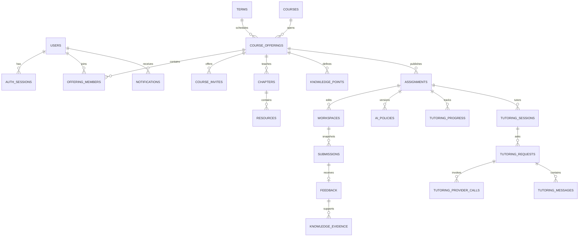

# 后端开发手册

基线：1.3.0。当前实现进度见 [STATUS](STATUS.md)。

先读 [DEVELOPMENT](DEVELOPMENT.md) 的架构及本次业务规则，对外结构只读 [OpenAPI](openapi.yaml)。本文件拥有后端分层、数据库、事务和保留约定。当前阶段、未决事项与待修复问题见 [STATUS §0](STATUS.md)。

快速定位：[工程规范](#a-工程与实现规范) · [会话配置](#session-timeouts) · [教学闭环](#4-p1教学内容与学习闭环) · [AI 与分析](#5-p2受限-ai求助与分析) · [核心事务](#db-transactions) · [查询索引](#8-查询与索引) · [数据保留](#10-迁移归档与删除) · [交付要求](#c-本端交付要求)

## A. 工程与实现规范

实际依赖以 backend/pom.xml、Wrapper 与 Compose 为准，复用现有 Java 21 / Boot / MyBatis / Flyway。Jakarta Validation 与 Spring Security 已接入；P0-A 的 Cookie 会话、CSRF/Origin 与 HTTP 授权过滤链已有实现，异常路径仍有交接节列明的问题。

Boot 4 实现时沿用当前工程的包与依赖：MVC 测试注解位于 `org.springframework.boot.webmvc.test.autoconfigure`，示例见 [HealthControllerTest](../backend/src/test/java/com/learningplatform/common/health/HealthControllerTest.java)。默认 JSON 数据绑定使用 Jackson 3 的 `tools.jackson.*`；注解仍可来自 `com.fasterxml.jackson.annotation`，不要全局替换所有 Jackson 包名，也不要为照搬 Boot 3 示例额外引入 Jackson 2 databind。实际配置以 pom 与现有序列化代码为准。

包目录按业务模块后按职责分 controller/service/dto/mapper/model；只为已有职责建立包，不创建空层。现有 common/health 规模小，保留同包。HTTP security 负责请求适配，modules/auth/security 中现有令牌工具保留在账户模块，不为了目录一致搬动已有实现。

Controller 只处理协议适配、输入校验和 DTO；Service 执行业务与事务；Mapper 只负责参数绑定 SQL。实体不直接序列化为响应，尤其不能暴露口令哈希、会话摘要、CSRF 秘密与未公开评价。学生与教师响应采用契约里的独立视图，不能仅靠前端隐藏字段。

### A.1 事务、异常与跨模块调用

事务入口使用其他 Bean 调用的 public Service，明确 READ_COMMITTED、rollbackFor=Exception；代理同类自调用不算事务入口。MyBatis 与事务管理器使用同一 DataSource，连接池显式 READ COMMITTED。并发手段与时钟以本文数据模型第 7 节为准。

跨模块约束按 [DEVELOPMENT 3.3](DEVELOPMENT.md#33-调用与事务所有者)；同事务通知、事件、证据协作者不得提前独立提交。认证会话 resolve 的特殊提交行为保留在账户事务中，必须先结束它，再启动教学事务。外部 AI 调用不在事务中，不由数据库重试重新调用。

拒绝未知 JSON 属性；PATCH DTO 必须能区分缺失与显式 null，可采用带 presence 标志的字段包装或受控 JsonNode 解析，不能用一个普通 nullable 字段混淆两者。先合并后校验完整对象，外部结构仍与 OpenAPI 一致。

错误代码、HTTP 状态与公开详情必须来自契约 Error_* schema；不得为了实现方便临时新增错误码。现有统一 MVC 处理器继续复用；Security 的 EntryPoint/AccessDeniedHandler 使用相同信封，避免默认 HTML 重定向。原始异常和 SQL 不回显给客户端，日志也不记录凭据或完整正文。

### A.2 接口与验证

遵守契约先于实现。可以手写 Java DTO 与 Controller，但必须用真实 MockMvc 请求/响应验证 schema；springdoc 如加入，仅导出实现作比较，不覆盖 docs/openapi.yaml。前端不等待 Controller 生成后才知道字段。

新增路由及其契约状态在同一变更提交。`ImplementationStatusContractTest` 自动核对生产路由与 planned/implemented/verified，纳入 Maven test；不能靠只改状态使功能通过验收，仍须新增对应 HTTP 行为测试。该检查使用数据库替身，不替代真实 MySQL 集成测试。

实现 listMyAssignments 时，按 [AssignmentPage 契约](openapi.yaml#/components/schemas/AssignmentPage)验证四项计数守恒。测试必须覆盖同一用户与 offeringId/termId 范围内的 todo、done、归档未完成项；切换 filter 或分页不改变 summary，total 则跟随 filter。另测空集合、越界页和不同用户/教学班隔离。在 READ_COMMITTED 下，用同一条聚合 SQL 计算 summary，并据 filter 派生 total，避免分别计数时并发提交使统计来自不同快照。静态示例检查不能代替这些真实查询测试。

状态核对以 Maven 运行结果作为验收证据。IDE 运行若有路由差异，先检查生产与测试类输出位置：该测试按代码来源位置排除测试 Controller，需要分离输出目录；不能未经复现就排除 MyBatis 或减少生产路由扫描。

反馈只使用 [StudentFeedbackDTO](openapi.yaml#/components/schemas/StudentFeedbackDTO) 与 [TeacherFeedbackDTO](openapi.yaml#/components/schemas/TeacherFeedbackDTO)：学生结构只承载已发布公开结果，并关联本人通知；教师结构可承载草稿，messageId 恒为 null，不借用学生通知 ID。学生读路径从 status=published 的不可变评价及量规记录构造，不能把草稿实体序列化后只隐藏按钮。

测试按责任分层：规则与纯函数用单元测试；HTTP 信封、校验、权限用 MockMvc；迁移、JSON、唯一约束与条件更新用真实 MySQL Testcontainers，不用 H2 替代。已有 Maven test/verify 的职责和运行方式见 README。

新增迁移只向前编号；不得修改已经执行的 V1/V2/V3。跨模块共享的迁移序号由后端统一分配。部署执行明确迁移，演示账户与课程数据使用独立显式命令，正常启动不注入演示数据。

### A.3 配置与运行

本地环境与现有启动命令以 [README](../README.md#后端启动) 为准。正式 frontend 已建立（见 [FRONTEND](FRONTEND.md)），但旧 prototype 或前端本地启动成功都不代表业务联调就绪。API 默认 8080，开发数据库 3307；P2 的 AI 后台执行在同一应用内，不另起进程。

数据库账号、预登录签名密钥、邀请摘要密钥和模型密钥由服务端环境注入，不进入前端、日志或仓库；新环境变量同步 .env.example 与实际启动脚本允许列表。健康检查不套业务信封，AI 故障不使数据库 ready 失败。原配置中没有的功能不能在文档里写成已可用。

## B. 数据模型与事务

规范主键、复合约束与 tombstone 规则如下；并发只用唯一约束、乐观锁与条件更新（第 7 节）。API 字段映射只是引用，对外结构仍以契约为准。


## 1. 命名与公共字段

- 数据库基线为 **MySQL 8.4 LTS / InnoDB**；服务端使用 Spring Boot。所有表显式声明 `ENGINE=InnoDB`，正文使用 `utf8mb4`；不混用其他数据库的 SQL 语法。
- 主键 `id` 使用应用生成的规范小写 UUID；API 用字符串，字段 camelCase；数据库字段 snake_case。首版统一 `CHAR(36) CHARACTER SET ascii COLLATE ascii_bin`，所有 UUID 外键同型、同字符集、同排序规则；不在首版夹杂整数 ID 或二进制 UUID 映射。
- 时刻使用 `DATETIME(6)`，语义统一为 UTC，Java 使用 `Instant` 并明确转换为 UTC 存取；连接会话 `time_zone='+00:00'`，显示转换至 `Asia/Shanghai`。`DATETIME` 本身不自动转换时区，禁止写入本地墙上时间或无时区 API 字符串；API 按契约统一使用带 `Z` 的 UTC ISO 8601。AI 预算以请求创建时间计数，自然日边界按 `Asia/Shanghai` 换算为 UTC，不设独立 reserved_day 或预算锁表。
- 非纯关联表默认包含 `created_at/updated_at`。不可变快照只有创建时间和版本/来源信息。
- 数据库状态用 `VARCHAR` 加命名 `CHECK` 约束，布尔值用 `TINYINT NOT NULL` 并约束为 0/1，不能写前端中文标签；分数使用 `DECIMAL(6,2)`，满分限定 `0 < max_score <= 9999.99`，得分限定 `0 <= score <= 对应满分`。Java 使用 `BigDecimal`，输入至多两位小数，不依赖数据库静默舍入；启用严格 SQL 模式，不通过 `INSERT IGNORE` 吞掉错误。
- MySQL `JSON` 用于小型文件集、冻结量表、策略配置和结构化输出；实体归属/核心关系用真实外键，不能全部埋在 JSON 中。JSON 不直接作为普通索引键，需要查询的标量先提取为显式列或生成列；正文/任意 JSON 路径不默认加索引。
- JSON 引用中的知识点/文件/评分项由服务层校验同班归属；数据库外键覆盖独立实体关系。
- 跨教学班关联同时用必要的复合外键和事务内服务校验；FK 本身不负责授权。

唯一、外键、检查约束用于保护数据一致性；跨表业务总量和权限仍需事务/服务规则。MySQL `CHECK` 不用来执行跨表查询，所有引用键采用明确的 `PRIMARY KEY` 或 `UNIQUE`，不依赖非标准的非唯一父键。外键使用独立 `CONSTRAINT ... FOREIGN KEY ... REFERENCES ...` 声明，不用会被忽略的内联 `REFERENCES`。详见 [MySQL 外键规则](https://dev.mysql.com/doc/refman/8.4/en/create-table-foreign-keys.html)、[CHECK 约束](https://dev.mysql.com/doc/refman/8.4/en/create-table-check-constraints.html) 与 [日期类型](https://dev.mysql.com/doc/refman/8.4/en/datetime.html)。

## 2. 关系概览



`course_offering` 是权限与学情隔离的基本单元。章节/知识点在教学班实例内维护，避免改一个班影响同课程其他班。

<a id="db-auth"></a>

## 3. P0：账户与工程基础

<a id="session-timeouts"></a>

### 3.1 会话期限与配置

默认空闲期限为 12 小时，创建后的绝对期限为 7 天；有效访问仅延长空闲期限，不能突破绝对期限。配置项分别为 `auth.session.idle-timeout`、`auth.session.absolute-timeout`，环境变量为 `AUTH_SESSION_IDLE_TIMEOUT=PT12H`、`AUTH_SESSION_ABSOLUTE_TIMEOUT=P7D`。配置必须为正数，空闲期限不超过绝对期限，精度最多微秒；到期时刻本身即失效。默认值应与 [application.yml](../backend/src/main/resources/application.yml) 及 AuthSessionConfigurationTest 同步维护。运行时环境注入方式见 [README](../README.md)。

### 3.2 账户数据与事务

| 表 | 主要字段 | 约束/说明 |
| --- | --- | --- |
| `users` | `id, username, display_name, password_hash, roles, status, created_at, updated_at` | username 为规范小写 ASCII、唯一；roles 是非空且无重复的 student/teacher/admin 集合；status active/disabled，默认 active |
| `auth_sessions` | `id, user_id, token_hash, credential_hash, csrf_secret, expires_at, idle_expires_at, revoked_at, last_seen_at, created_at, updated_at` | 不透明随机令牌只存摘要；user_id FK；token_hash 唯一；credential_hash 绑定密码与平台角色状态；登录轮换令牌 |
| `audit_logs` | `id, actor_id, action, target_type, target_id, metadata, request_id, created_at` | 不记录口令/凭证/完整正文；用户删除可匿名化 actor；只允许追加 |
| `terms` | `id, label, starts_at, ends_at, is_current, current_slot` | 学期由管理员维护；ends_at > starts_at；current_slot 为可空 STORED 生成列，唯一索引保证最多一个当前学期；label 为展示文本 |

已实现 [V1__create_terms.sql](../backend/src/main/resources/db/migration/V1__create_terms.sql)、[V2__create_users.sql](../backend/src/main/resources/db/migration/V2__create_users.sql) 与 [V3__create_auth_sessions.sql](../backend/src/main/resources/db/migration/V3__create_auth_sessions.sql) 及 [V4__create_audit_logs.sql](../backend/src/main/resources/db/migration/V4__create_audit_logs.sql)，包含 audit_logs。教学内容、作业、评价通知与公告相关表由后续迁移 V5～V8 建立，见本手册第 4 节与第 5 节。V9 为 `notices` 增加公告跳转目标列（`target_type/target_id`，多态无外键）并把量规评语放宽到 8000；V10 为 `notifications` 增加同构的通用跳转目标列（P1 由 `notice_published` 消息继承公告目标写入，其余消息类型为 NULL；P2 沿用每收件人一条通知，回复使用唯一来源键）。V11～V13 对应 P2：V11 辅导政策与请求，V12 求助与通知来源，V13 学习事件、知识评价与证据；详细范围与联调边界见 [P2 后端联调说明](features/p2-backend-integration.md)。V14 冻结公告收件人数并回填历史审计，V15 补阶段二分析读索引，V16 导入 Web 开发基础课程内容（5 章、10 资源、12 知识点；迁移不建账号，`course_offerings.created_by` 允许为空，空库时补一个个人学习学期）。V17 新建自动判题配置与任务队列。实际本地库版本见 [STATUS §0](STATUS.md)。`terms.label` 采用 `VARCHAR(200)`，`created_at/updated_at` 为必填 UTC `DATETIME(6)`，由管理功能显式写入，不设置依赖服务器时区的默认时间。迁移不初始化学期、账户或会话；开发账户通过独立命令创建，不设置通用默认口令。`/me/config` 已实现；未初始化学期时 currentTermId=null、terms=[]，不能把此空态当成接口未实现。

`users` 的具体存储约定如下：

- `username` 为 `VARCHAR(64) CHARACTER SET ascii COLLATE ascii_bin`，3～64 个字符，以小写字母或数字开头，其余字符只允许小写字母、数字、点、下划线、连字符。`uq_users_username` 保障唯一并支持查询，不另建重复普通索引；`ck_users_username` 同时检查长度、首字符及非法字符，连末尾空格或换行也必须拒绝。
- 已实现的登录凭据校验对用户名 `strip()`、`toLowerCase(Locale.ROOT)` 后校验规范；受控账户导入后续沿用，本地初始化使用固定规范用户名。Mapper 按规范值精确查询，不自行转换。SQL 保留唯一索引等值条件，并追加字节比较，避免 `ascii_bin` 的 PAD SPACE 语义忽略输入尾随空格。用户名身份比较与中文展示名称分开，`display_name` 为 `VARCHAR(100)`，采用表默认 `utf8mb4`。
- `password_hash` 为 `VARCHAR(255) CHARACTER SET ascii COLLATE ascii_bin`，保存 `{argon2}$argon2id$...` 格式。使用 Spring Security `PasswordEncoder`，Argon2id 参数为内存 19456 KiB、迭代 2 次、并行度 1、随机盐 16 字节、输出 32 字节；算法前缀、参数与盐包含在哈希内，不新增盐字段、不修改已执行的 V2。校验使用 `matches(原始密码, 已存哈希)`，不能重新 encode 后比较两个字符串；相同口令的随机盐不同，因此哈希不同。数据库对象不作为 API DTO，密码哈希不进入 JSON 或 `toString()`。[Spring 密码存储](https://docs.spring.io/spring-security/reference/features/authentication/password-storage.html)、[OWASP 密码存储](https://cheatsheetseries.owasp.org/cheatsheets/Password_Storage_Cheat_Sheet.html)
- `roles` 为必填 JSON 数组，`ck_users_roles` 使用内联 JSON Schema 检查 1～3 个受控字符串且无重复；这是集合，数组顺序不具有权限优先级。Java 映射为不可修改的 `List<String>`。`ck_users_status` 按二进制精确检查 `active/disabled`，防止排序规则忽略末尾空格；登录凭据校验已拒绝 disabled 账户，查询本身不隐藏它。一次查询与口令校验不提供并发状态变更的事务保证，会话创建及后续鉴权须在相应阶段重新检查。
- Java `Instant` 通过 [UtcInstantTypeHandler](../backend/src/main/java/com/learningplatform/common/mybatis/UtcInstantTypeHandler.java) 与 JDBC `LocalDateTime` 按 UTC 显式转换，保留微秒，不使用 JVM 默认时区。

凭据校验只读 `users`，不更新账户时间/哈希/权限，不创建 `auth_sessions`，也不新增迁移。成功返回单独的 `UserDTO`，角色集合复制为不可修改列表；未知用户使用进程内占位哈希进行校验计算，占位值不写入任何账户或数据库。数据库保存的未知算法或损坏哈希拒绝认证；算法升级仍需完整迁移方案，不把原始 MD5 或明文当作可验证格式。登录输入边界与错误规则见 [契约 LoginWrite](openapi.yaml)。

本地开发执行 `Start-Local.ps1 -InitializeAccounts` 时，创建 `student.demo/teacher.demo/admin.demo`，各持有同名的单一角色，姓名为演示学生、演示教师、演示管理员，初始状态 `active`。UUID 与 UTC 微秒时间由 Service 写入。新密码须为 15～128 个 Unicode 码点且不能全为空白，不裁剪、不改变大小写；本地脚本默认生成独立随机口令。已有账户全部跳过，不覆盖哈希、角色、状态、姓名或时间；三项在一个 READ COMMITTED 事务内完成，任一新增失败回滚本次新增，已有数据保留。并发初始化由唯一键阻止重复，失败方回滚后重试。该命令只用于约定的本地开发库，不是公共注册、密码重置或生产账户管理接口；正常 API 启动与 Flyway 迁移均不创建账户。更完整的教学演示数据仍随 P1 实现。

Flyway 自行维护 `flyway_schema_history`，记录迁移版本和校验值；应用启动时验证并执行未应用版本。已经应用的迁移不修改，后续结构调整新增 V4、V5 等文件。当前开发实例和 Testcontainers 均固定 `mysql:8.4.11`，已验证学期迁移重复执行、当前学期唯一性、0/1 检查、时间区间、微秒精度及 UTC / READ COMMITTED 配置；用户与会话验证见历史开发记录的第四至七步。

`auth_sessions` 的存储与事务规则如下：

- `token_hash/credential_hash/csrf_secret` 使用 `CHAR(64) ascii_bin`，CHECK 精确限制 64 个小写十六进制字符。令牌为 32 个密码学随机字节的十六进制表示，数据库仅存 SHA-256 摘要并唯一索引；`csrf_secret` 是另行生成的随机秘密，供已实现的 HTTP CSRF 服务派生会话绑定令牌，原始秘密不对外返回。
- `credential_hash` 为已存密码哈希、换行分隔符及排序后逗号连接的平台角色集合的 SHA-256 摘要，用于识别会话创建后安全状态是否改变；角色数组仅调整顺序不改变摘要。它不哈希原始口令，不替代 `users.password_hash` 中的 Argon2id。
- `user_id` 外键关联 `users.id`，删除账户级联删除其会话；索引 `user_id` 支持账户会话查询，`expires_at` 支持后续清理。会话清理任务尚未实现，保留周期随运维规则落实。全部时间为 UTC 微秒；CHECK 保证 `created_at <= last_seen_at <= updated_at`、空闲期限大于最近访问且不超过绝对期限、撤销时间不早于创建时间。
- `DatabaseSessionService.login()` 在 READ COMMITTED 事务中完成凭据校验，随后对账户 `FOR SHARE` 锁读并再次检查状态及所验证的密码哈希，再锁旧会话 `FOR UPDATE`；切换账户时先按用户 ID 排序取账户锁，所有路径均遵循账户→会话顺序。锁等待结束后通过注入的 UTC `Clock` 取创建时刻，旧会话撤销与新会话插入同事务，后者失败前者回滚。只轮换传入的旧令牌，支持其他设备独立登录。[MySQL 锁读](https://dev.mysql.com/doc/refman/8.4/en/innodb-locking-reads.html)
- `resolve()` 在同样的锁顺序下检查撤销、账户 active、密码/角色摘要及两种期限；到期时刻本身即失效。有效访问更新最近访问与空闲期限，取 `min(访问时刻 + 空闲时长, 绝对期限)`，绝对期限始终不变。时钟回拨时不让最近访问时间倒退。检测到失效会话时持久撤销；此方法使用 `noRollbackFor=BusinessException.class`，使该清理可在业务拒绝时提交，意外数据库故障仍回滚。HTTP 鉴权层在业务写事务前调用并结束会话事务，不能与后续业务异常混成一个事务。
- `revoke()` 重复执行、未知或格式错误令牌均可安全结束；已撤销会话不能恢复。禁用被观察后，即使重新启用也不能恢复该会话。当前没有账户管理入口；后续禁用、口令或权限修改必须在修改事务内主动撤销全部会话，不能仅依赖访问时观察变更。身份每次读取当前姓名与角色，模块资格仍不等于教学班对象权限。
- 内部 `AuthSession/SessionGrant/SessionIdentity` 的敏感字段使用 `@JsonIgnore` 并覆写安全 `toString()`，不直接作为登录 HTTP 响应；原始会话令牌仅写 Cookie，不进入 URL、日志或前端存储。[OWASP 会话管理](https://cheatsheetseries.owasp.org/cheatsheets/Session_Management_Cheat_Sheet.html)

平台角色赋予模块资格，授课范围由 `offering_members` 决定。管理员维护操作通过独立管理流程审计，不能直接把所有学生隐私暴露给普通管理列表。

预登录 CSRF 令牌可使用签名双提交 Cookie，不必创建匿名数据库会话；登录成功后创建有用户的 `auth_sessions`。CSRF 令牌与登录令牌分开，令牌不能出现在 URL。

教学班保存 `term_id`，不以“2026 秋季学期”等自由字符串关联或筛选。`GET /me/config` 的学期信息从 `terms` 读取，功能开关来自服务端配置；没有当前学期时返回明确空值，不通过客户端日期猜学期。切换当前学期在同一事务内先清除原标记再设置新标记，历史班级仍引用原学期。

MySQL 不支持带 `WHERE` 条件的部分唯一索引；使用条件满足时为 1、其余为 NULL 的生成列，利用唯一索引允许多条 NULL 的规则。生成列由数据库维护，应用不得赋值。`terms.is_current` 定义为 `TINYINT NOT NULL DEFAULT 0`，`submissions/knowledge_evidence.is_current` 定义为 `TINYINT NOT NULL DEFAULT 1`，另加 0/1 CHECK；CHECK 不替代 NOT NULL。当前学期约束的关键 DDL 如下，`id/starts_at/ends_at` 等普通列按上表定义：

```sql
ALTER TABLE terms
  ADD CONSTRAINT ck_terms_current CHECK (is_current IN (0, 1)),
  ADD COLUMN current_slot TINYINT
    GENERATED ALWAYS AS (CASE WHEN is_current = 1 THEN 1 ELSE NULL END) STORED,
  ADD UNIQUE KEY uq_terms_current (current_slot);
```

并发切换由同一管理员事务按 ID 升序锁定目标学期与当前学期，先清除再设置；唯一约束是最终防线。冲突整体回滚并返回可识别错误，不能先提交清除操作。[MySQL 生成列](https://dev.mysql.com/doc/refman/8.4/en/create-table-generated-columns.html)、[UNIQUE 的 NULL 规则](https://dev.mysql.com/doc/refman/8.4/en/create-table.html)

<a id="db-teaching"></a>

## 4. P1：教学内容与学习闭环

### 4.1 课程、成员、章节

| 表 | 主要字段 | 约束/说明 |
| --- | --- | --- |
| `courses` | `id, code, mark, title, description, status, created_by` | code 唯一；课程基础，由管理流程导入；status active/archived；mark为展示缩写，不包含个人进度 |
| `course_offerings` | `id, course_id, term_id, title, group_name, progress_unit, status, issue_tags_config, created_by` | course_id/term_id FK；progress_unit chapter/assignment；status active/archived；issue_tags_config 是 P2 启用的版本化词表 JSON |
| `offering_members` | `id, offering_id, user_id, role, status, joined_at, last_studied_at, last_chapter_id` | UNIQUE(offering_id,user_id)；role student/teacher；status active/inactive；同班单一角色；last_chapter_id 可空且必须同班 |
| `course_invites` | `id, offering_id, code_digest, expires_at, max_uses, used_count, revoked_at, created_by` | code_digest 唯一；计数非负且不超过非空 max_uses；名额用条件更新消耗 |
| `chapters` | `id, offering_id, position, title, summary, status, is_required, content_version` | UNIQUE(offering_id,position)；status draft/published/archived；position 正整数 |
| `knowledge_points` | `id, offering_id, title, description, chapter_id, position` | chapter_id 可空；非空时必须属于同 offering；API order映射position |
| `resources` | `id, offering_id, chapter_id, knowledge_point_id, title, content_markdown, position, status` | chapter/knowledge_point 的复合 FK 校验同班；知识点可空；status active/archived；可见性继承章节；P1 仅 Markdown |
| `chapter_progress` | `id, offering_id, member_id, chapter_id, status, completed_at, last_opened_at` | UNIQUE(member_id,chapter_id)；成员必须为该班学生；status in_progress/completed；首次访问可记录 in_progress；已完成后再访问不降级；“已阅读”事实不代表能力 |

Markdown 输出需经过允许列表清理；不渲染任意原始脚本或不受控 HTML。课程资料内容是教学数据，预览学生代码走独立沙箱。

P1 所有 active 基础课程允许 teacher 角色开班；若以后需要逐课程授权，再增加开班授权关联表。章节 API 的 number 对应数据库 position，不另存冗余排序。学生 DTO 的 publicationState 来自 chapters.status，studentProgress 从 chapter_progress 派生，教师响应该字段为 null。教师发布章节后学生才可访问其内容；已发布资源修改是有审计的内容澄清，不能改提交中的冻结评价规则。

实际展示章节或作业后，前端调用 `POST /me/learning-position`，提交 `offeringId` 及 chapterId/assignmentId 中恰好一个；GET 读取本身不修改学习位置。服务校验 active 班级下本人可访问且仍为 published 的对象，更新 `offering_members.last_studied_at`；章节或绑定章节的作业同时更新 `last_chapter_id` 与 `chapter_progress.last_opened_at`，进度行不存在时创建 in_progress，不伪造 completed。未绑定章节的独立作业只更新班级最近学习时间。`currentChapter` 优先选本人最后访问且仍可见的章节，否则选首个未完成的已发布章节，再退到首个已发布章节，均无则为 null。归档教学班只读历史、不接受位置写入。章节完成确认单独处理 completed_at，访问已完成章节不降级。

### 4.2 作业、工作区、提交

| 表 | 主要字段 | 约束/说明 |
| --- | --- | --- |
| `assignments` | `id, offering_id, chapter_id, title, description, estimated_minutes, type, status, is_required, due_at, late_until, allow_resubmit, max_attempts, max_score, content_version, current_ai_policy_id, published_at` | 要求、量规、初始文件、知识关联分别存 assignment_requirements / assignment_rubric_criteria / assignment_initial_files / assignment_knowledge_points；其余约束见 V6 |
| `workspaces` | `id, offering_id, assignment_id, student_id, active_file, revision, updated_at` | UNIQUE(assignment_id,student_id)；revision>=1；文件存 workspace_files；只表达真正保存过的学生草稿 |
| `submissions` | `id, offering_id, assignment_id, workspace_id, student_id, attempt_no, workspace_revision, reflection, content_version, assignment_title_snapshot, max_score_snapshot, ai_policy_id, due_at_snapshot, submitted_at, is_late, is_current, current_slot` | 文件、要求、量规分别存 submission_files / submission_requirements_snapshot / submission_rubric_snapshot；P2 加 submission_knowledge_snapshot；同 revision 自然幂等，current_slot 保证仅一个当前提交 |
| `feedback` | `id, submission_id, assignment_id, offering_id, student_id, teacher_id, status, base_version, overall_comment, final_score, published_at` | submission_id 唯一；量规存 feedback_rubric_scores；发布后不可再编辑；P2 增加独立知识评价和标签存储 |

`assignmentState` 的合法值以 [AssignmentState](openapi.yaml#/components/schemas/AssignmentState) 为准，不单独存成可随意修改的学生状态列。按以下优先级推导对应契约状态：当前提交有 status=published 的评价 → 已评价；当前提交存在 → 已提交；工作区存在 → 进行中；否则 → 未开始。中文仅解释含义，响应必须使用契约枚举原值。

学生对作业的所有读取、列表、推荐与统计都要求 `published_at IS NOT NULL` 且满足成员权限。公开生命周期仅为 draft→published→archived；归档接口只允许 published→archived，重复归档返回原结果，draft 归档请求拒绝。归档教学班不自动公开任何 draft 子对象，教师仍可读自己的草稿。

提交历史通过 `is_current` 表达有效版本；新提交与旧版失效在同一事务完成。MySQL 的当前提交唯一约束为：

```sql
ALTER TABLE submissions
  ADD CONSTRAINT ck_submissions_current CHECK (is_current IN (0, 1)),
  ADD COLUMN current_slot TINYINT
    GENERATED ALWAYS AS (CASE WHEN is_current = 1 THEN 1 ELSE NULL END) STORED,
  ADD UNIQUE KEY uq_current_submission (assignment_id, student_id, current_slot);
```

提交快照只允许更新受控的 `is_current` 指针状态，不允许覆盖文件、评分规则或提交时间。`due_at_snapshot/is_late` 保留当时事实；教师延长期限不会篡改历史提交时间，展示当前是否待补交时按当前规则另算。

`assignment_title_snapshot` 冻结任务标题；P2 `submission_knowledge_snapshot` 保存知识点 ID、标题、说明。`SubmissionDetailDTO.assignmentSnapshot` 从提交行及冻结子表构造标题、要求、满分、量规、knowledgePoints、截止时间、contentVersion、aiPolicyVersion。旧 P1 提交未冻结知识点定义的限制见 §5.3。P1 aiPolicyVersion 为 null，P2 从提交的不可变政策记录派生。

首次读取未保存工作区时 API 返回模板与 `revision=0`，不插入表。第一次保存由 baseRevision=0 创建 revision=1。P2 提示进度放在独立 `tutoring_progress`，发起 AI 辅导不创建模板工作区、不增加文件 revision，也不使未保存作业伪装为 IN_PROGRESS。

对外 files 数组引用契约 FileDTO；正式作品文件使用上述关系子表，AI/求助主动共享的有限副本使用 JSON，不改变对外字段含义。

文件必须完全符合任务模板类型的允许清单；Web 可为空文本但不能遗漏文件字段。默认单文件 100 KiB，总量 256 KiB，按 UTF-8 字节数验证。SQL/文字类型采用对应一个文件，按相同上限。

`rubric` 为不可变 criterionId 的数组：`{criterionId,title,description,maxScore}`；知识点通过任务的 knowledge_point_ids 关联。草稿评分项至少包含 `criterionId,score,comment`，逐项分数范围验证；总分等于评分项得分之和。`knowledgeEvaluations` 不由总分机械转换，教师明确给出每个知识点结论。

评价的 issueTags为P2可选数组，P1为空；每个tag必须属于course_offerings.issue_tags_config当前词表。初始化来自服务端课程配置，包含version和items:[{tag,title,description}]；API提供只读词表。标签历史随公开评价保留词表版本，标签更名不会将旧问题错误合并。

P1 current_ai_policy_id / 提交 ai_policy_id 为空，对外aiPolicyVersion=null；P2才建立ai_policies并为作业绑定生效版本。P1 只接受空知识评价；P2 使用 feedback_knowledge_evaluations 和 feedback_issue_tags 持久化教师输入，发布后禁止编辑。

### 4.3 消息与服务端事件

| 表 | 主要字段 | 约束/说明 |
| --- | --- | --- |
| `notifications` | `id, recipient_id, type, title, content, related_offering_id, related_assignment_id, related_feedback_id, target_type, target_id, is_read, read_at, created_at` | 每收件人一条；数据库类型为 feedback_published/assignment_published/offering_archived/notice_published/help_reply，服务映射到契约类型；P2 回复来源唯一键防重 |
| `learning_events` | `id, user_id, offering_id, assignment_id, chapter_id, client_event_id, source_event_key, session_id, type, source, occurred_at, received_at, payload` | P2 新建并记录后续 server/client 事件，P3 开放 checker；非空 source_event_key 唯一；非空 client_event_id 有 UNIQUE(user_id,client_event_id) |

课程项目规模下，评价发布、公告创建、作业发布及 P2 教师回复，均在原业务事务内同步写入每位收件人的 `notifications`，任一写入失败整体回滚。成功返回后本人消息即可查询；`StudentFeedbackDTO.messageId` 与 `NotificationDTO.id` 均对应本人 `notifications.id`，用于 `/me/messages/{messageId}/read`。不引入共享通知实体或独立收件人表；业务状态与来源唯一约束负责防重。

公告和作业发布在同一事务内查询当时 active 学生成员并批量插入收件人，`recipientCount` 来自实际冻结集合；后加入学生不补发旧个人提醒，但可读本班历史公告。自然键例如 `feedback:{id}:published:{version}`、`assignment:{id}:published:{contentVersion}`、`notice:{id}`、`help_reply:{id}`；重复业务请求命中原通知，不生成新的通知 ID，收件人唯一约束作为第二层防重。`target_type` 的合法值引用 [TargetDTO.type](openapi.yaml#/components/schemas/TargetDTO/properties/type)，数据库约束与该集合保持一致；求助回复指向原 help_request，不暴露其他会话。

2026-10-26 用户确认公告计数修复：[V14](../backend/src/main/resources/db/migration/V14__notice_recipient_counts.sql) 为 `notices` 增加可空的 `recipient_count`，非空时必须为非负整数。新公告在通知写入成功后、原事务提交前保存实际收件人数；创建、列表和详情统一读取该冻结数，不再依赖时间与标题匹配。任何通知或审计写入失败仍整体回滚。迁移只从恰有一条 `NOTICE_CREATED`、`target_type=notice`、`target_id=公告ID` 的创建审计恢复有效整数 `metadata.notified`；缺失、重复或非法审计不生成估计的冻结值，字段保留 NULL。历史 NULL 行继续沿用原时间/标题匹配估算，这是明确保留的历史精度限制；不能将这些行声称为精确计数。迁移不改变对外字段或回填学习事件，不修改 V1–V13，也不自动操作已有环境数据库。

`learning_events.received_at` 是服务端接收或创建事件的 UTC 微秒时间，不从客户端 occurredAt 复制；当前 HTTP 事件上报不接收也不回传 receivedAt。它是内部存储字段，并未从数据模型删除。

核对 V1～V10 与生产代码后确认：P1 仅有审计日志，尚无 learning_events。用户于 2026-10-24 确认在 P2 补齐事件底座及后续可信事件，不将历史审计日志回填成学习事件。保存、提交、评价、AI 和求助成功后在原事务写入；`source_event_key` 使用业务对象 ID 与版本，事务重试不重复记数。payload 只存白名单元数据，不复制作品、密码或聊天正文。客户端不得指定 source 或 source_event_key。

事件自然键和去重键均为 ASCII、区分大小写，禁止使用默认的忽略大小写正文排序规则。`source_event_key/dedupe_key` 用 `VARCHAR(192) ascii_bin`。MySQL 中直接 `UNIQUE(source_event_key)` 与 `UNIQUE(user_id,client_event_id)` 允许多条 NULL，无需条件索引；非空去重字段才参与防重。

### 4.4 必须落实的关联约束

- `chapters/knowledge_points/assignments` 各增加 `UNIQUE(id,offering_id)`；`offering_members` 增加 `UNIQUE(id,offering_id)`。`assignments(chapter_id,offering_id)`、`knowledge_points(chapter_id,offering_id)` 复合引用章节；`resources` 对章节与非空知识点也按同班复合引用。
- `chapter_progress(member_id,offering_id)` 引用成员，`(chapter_id,offering_id)` 引用章节；`offering_members(last_chapter_id,offering_id)` 引用同班章节。成员是否 active 学生、章节是否 published 由服务校验。
- `workspaces(assignment_id,offering_id)` 引用作业，`(offering_id,student_id)` 引用成员的唯一键；增加 `UNIQUE(id,assignment_id,student_id)`。`submissions(workspace_id,assignment_id,student_id)` 必须整体引用该工作区，同时 `(assignment_id,offering_id)` 引用同班作业，不能拼接其他学生/作业的 workspace_id。
- P2 的 `knowledge_evidence` 同时复合引用所属作业、知识点、学生成员、提交与评价：提交增加 `UNIQUE(id,assignment_id,student_id,offering_id)`，评价增加 `UNIQUE(id,submission_id)`；证据以 `(submission_id,assignment_id,student_id,offering_id)` 和 `(feedback_id,submission_id)` 引用，杜绝把其他学生评价混为当前学生证据。引用列与父唯一索引按相同顺序，父/子 UUID 的字符集与排序规则完全一致。
- P2 `ai_policies` 增加 `UNIQUE(id,assignment_id)`，`assignments(current_ai_policy_id,id)` 与 `submissions(ai_policy_id,assignment_id)` 按复合键引用，政策不允许跨作业绑定；P1 两字段为空，相关 FK 随 P2 迁移建立。`tutoring_sessions` 增加 `UNIQUE(id,assignment_id,student_id)`，请求用三列复合 FK 固定会话归属。
- `tutoring_requests` 增加 `UNIQUE(id,session_id)`；消息以 `(tutoring_request_id,session_id)` 复合引用 `(id,session_id)`，请求与会话归属不能仅靠两条各自存在的单列 FK。请求的 `generation_policy_id/review_policy_id` 分别与 assignment_id 复合引用政策唯一键，尚未生成/审核时政策字段允许 NULL。
- P2 求助、证据对已有 offering_id、assignment_id、knowledge_point_id 等采用同班复合引用；JSON 中的任务知识点、量表 criterionId、共享请求 ID 仍需服务层检查重复项、实体存在、同班/同作业与章节范围。外键不能替代身份授权。
- 核心教学记录默认限制物理删除，归档不级联删除作品、评价与历史引用。分数范围、文件大小、量表总分分别由数据库标量约束和服务端结构校验保护。

同班复合外键 DDL 示例（父表/子表普通列和索引在相应阶段迁移中建立）：

```sql
ALTER TABLE chapters
  ADD UNIQUE KEY uq_chapters_id_offering (id, offering_id);

ALTER TABLE assignments
  ADD KEY ix_assignments_chapter_offering (chapter_id, offering_id),
  ADD CONSTRAINT fk_assignments_chapter_offering
    FOREIGN KEY (chapter_id, offering_id)
    REFERENCES chapters (id, offering_id)
    ON UPDATE RESTRICT ON DELETE RESTRICT;
```

`chapter_id` 可空代表独立作业，非空时上述关系强制同班。InnoDB 外键即时校验，不提供延迟到 COMMIT 的约束；循环引用分阶段建立：先建章节/成员与作业/政策表、以 NULL 初始化可选指针，再添加复合 FK 并绑定。不要通过关闭 `foreign_key_checks` 导入未校验数据；重新打开该开关不会回查期间写入的数据。所有 FK 在迁移中使用数据库范围内唯一的显式名称。

<a id="db-ai"></a>

## 5. P2：受限 AI、求助与分析

### 5.1 AI 与求助

提供商适配器只接收按 [外部 AI 数据发送边界](DEVELOPMENT.md#ai-data-boundary) 组装的最小上下文；不得直接序列化用户实体、提交实体或整段请求日志到供应商。每次首次调用与受控重生成均执行发送前检查。

| 表 | 主要字段 | 约束/说明 |
| --- | --- | --- |
| `ai_policies` | `id, assignment_id, version, config, created_by, created_at` | UNIQUE(assignment_id,version)；每版本不可变；config 用服务端固定模型校验；作业指向当前版本 |
| `tutoring_progress` | `id, assignment_id, student_id, highest_delivered_hint_level, disclosure_summary, disclosure_version, content_purged_at` | UNIQUE(student_id,assignment_id)；最高已交付层次默认 0；跨会话共享；summary 可空且受正文保留期限约束 |
| `tutoring_sessions` | `id, assignment_id, student_id, status, next_message_sequence, created_at` | status active/closed；next_message_sequence 默认 1；不因新建会话重置作业提示进度或预算 |
| `tutoring_requests` | `id, session_id, student_id, assignment_id, action, content, student_attempt, workspace_revision, workspace_snapshot, generation_policy_id, review_policy_id, review_version, reviewed_at, hint_level, status, pending_slot, result, fallback_reason, provider_call_count, input_tokens, output_tokens, started_at, completed_at, content_expires_at, content_purged_at` | status queued/running/completed/fallback/failed；每学生每作业最多一个 queued/running，pending_slot 为生成列；provider_call_count 0～2；result 只存已审核输出；代码 revision/snapshot 可空；不保存供应商原始响应 |
| `tutoring_messages` | `id, session_id, tutoring_request_id, sequence, role, content, mode, hint_level, policy_id, created_at, content_purged_at` | UNIQUE(session_id,sequence)；UNIQUE(tutoring_request_id,role)；role student/assistant；正文清理后保留 tombstone，ID/序号不重排 |
| `help_requests` | `id, offering_id, assignment_id, student_id, title, content, student_attempt, workspace_revision, shared_snapshot, shared_snapshot_expires_at, shared_snapshot_purged_at, shared_tutoring_request_ids, issue_tags, status` | status open/answered/closed；只共享本人主动选择的内容；代码共享副本独立 90 天；AI 共享仅引用原请求，不复制正文延长保留 |
| `help_replies` | `id, help_request_id, author_id, content, created_at` | 仅该班授课教师可回复；回复、原求助状态变更和站内通知/收件人同事务 |

预算不建独立计数或锁表：入队时按本人 `tutoring_requests` 计数判断每用户每日、每作业每日与最近一分钟配额，自然日按北京时间计算；计入 queued/running/completed/fallback，以及调用过供应商的 failed（provider_call_count>0）。不同作业、班级和会话共用学生全局额度。并发入队可能偶发超出 1 次，列为已知限制。

同一学生在同一作业的所有会话合计只允许一个未完成请求，数据库兜底如下；冲突（1062 命中该索引）返回 `AI_REQUEST_IN_PROGRESS` 与 pendingRequestId，另开会话不能同时拆解答案或跳过累计审核。

```sql
ALTER TABLE tutoring_requests
  ADD COLUMN pending_slot TINYINT
    GENERATED ALWAYS AS
      (CASE WHEN status IN ('queued', 'running') THEN 1 ELSE NULL END) STORED,
  ADD UNIQUE KEY uq_pending_tutoring_request
    (student_id, assignment_id, pending_slot);
```

`student_id/assignment_id` 必须 NOT NULL，终态产生 NULL slot，因此多条历史终态共存但在途最多一条。不要使用 `UNIQUE(student_id,assignment_id,status)` 替代，它既允许 queued 与 running 各一条，也会错误禁止多条 completed。

`highest_delivered_hint_level` 只在经审核的 `completed` 结果已作为可读助手消息提交时推进，表示平台已交付内容，不等待客户端已读；`fallback/failed` 不升级。下次请求从这个进度决定允许层次；达到政策 requireAttemptFromLevel 时仍检查实际尝试。输出审核必须覆盖本人同作业跨会话的已交付历史，不能只看当前会话。可选 `disclosure_summary/disclosure_version` 用于摘要和校验版本，不得在摘要中永久保留已到期的答案正文；正文过期后的信息不足应保守回退，不视为可重新泄漏的空历史。

外部生成前先把 provider_call_count 加一并提交，再发网络请求；仅在首次收到明确结果且输出审核失败时允许第二次。结果未知（超时、进程中断）不盲目重试，结束为固定回退或 failed，避免重复费用。各次调用 token 累加到请求；用量未知时保持 NULL，不填 0。

入队时若附本人当前已保存 revision，则冻结有限代码片段；未附 revision 可以只按问题和公开材料辅导，不创建工作区。排队后继续保存不会改变已受理上下文。`generation_policy_id` 记录最后一次实际模型调用所用政策，尚未调用时为空；`review_policy_id/review_version/reviewed_at` 单独记录最终交付审核所用政策、审核器版本和时间，不能覆盖生成政策掩盖政策变化。

政策版本不可变。若模型生成或审核期间政策更新，交付事务核对当前政策 ID 与审核版本；不相符时放弃本次交付，按新政策重新审核或受控回退后再核对。最终写入助手消息、请求终态、提示进度及任务成功必须在一次短事务内完成。归档或成员失活后只记录失败元数据，不交付新生成正文。`tutoring_messages.policy_id` 对学生消息可空，对助手消息为实际审核政策。

学生消息在请求入队事务内创建；`next_message_sequence` 用条件更新分配，`UNIQUE(session_id,sequence)` 兜底。完成或提供 fallback 时至多增加一条助手消息；failed 请求不制造助手正文，前端从请求状态展示错误。请求归属必须与消息 session_id 一致，数据库以相应复合键约束。分页以持久 sequence 排序，正文过期后返回“内容已到期”的占位，不能让历史消息序号变化或让同一请求出现两个答案。

`ai_policies.config` 保存契约 AiPolicyWriteDTO 中的政策字段，不含 baseVersion；版本及操作者使用独立列。平台只读值在写入前检查，默认与可配置边界由契约和 DEVELOPMENT 辅导政策规则定义。

### 5.2 后台执行与恢复

P2 不建通用任务表与独立 worker 进程。AI 请求在同一 Spring 应用内由有界线程池执行，并由 `@Scheduled` 定时扫描 queued 请求兜底；领取用条件更新 `SET status='running', started_at=? WHERE id=? AND status='queued'`，影响 1 行才执行，因此同一请求不会被重复执行。外部调用与审核不在数据库事务内。

应用启动时把遗留 running 请求结束为 failed（使用契约 TaskError 已登记的码），释放在途唯一占位；这同时是进程崩溃后的恢复路径。终态请求不再被更新，迟到结果直接丢弃。任务错误只暴露有限错误码，日志不保存学生完整作品、聊天正文或凭证。规模扩大需要独立进程时再拆分，领域 Service 边界不变。

### 5.3 行为与证据

P2 新提交通过 submission_knowledge_snapshot 冻结知识点名称和说明。旧 P1 提交未保存这些历史定义，读取仍沿用当前作业关联的已知限制，不能声称恢复了提交当时的定义。P2 评价知识 ID 以可读提交快照校验。首次迁移时 P1 只接受空知识评价，因此没有历史知识结论可回填。

| 表 | 主要字段 | 约束/说明 |
| --- | --- | --- |
| `knowledge_evidence` | `id, student_id, offering_id, knowledge_point_id, assignment_id, submission_id, feedback_id, feedback_published_version, result, note, occurred_at, is_current, current_slot, rule_version` | result meets_expectation/needs_practice/insufficient_evidence；来源必须可追溯；同学生/作业/知识点只一个当前有效版本，current_slot 为生成列 |

当前证据与来源幂等的关键 DDL 如下。关系列均为 NOT NULL，旧证据先设置 is_current=0，再插入新证据，全部同事务提交；NULL slot 允许保留多条历史。`knowledge-v2` 查询使用 `is_current=1` 的普通复合索引筛选，唯一 slot 列只负责正确性：

```sql
ALTER TABLE knowledge_evidence
  ADD CONSTRAINT ck_evidence_current CHECK (is_current IN (0, 1)),
  ADD COLUMN current_slot TINYINT
    GENERATED ALWAYS AS (CASE WHEN is_current = 1 THEN 1 ELSE NULL END) STORED,
  ADD UNIQUE KEY uq_current_knowledge_evidence
    (student_id, assignment_id, knowledge_point_id, current_slot),
  ADD UNIQUE KEY uq_knowledge_evidence_source
    (feedback_id, feedback_published_version, knowledge_point_id),
  ADD KEY ix_knowledge_evidence_assessment
    (student_id, offering_id, knowledge_point_id, is_current, occurred_at, id);
```

P2 新建 `learning_events`（P1 实际只有审计日志），并开放客户端允许事件最小集：`chapter_opened/resource_opened/editor_opened/preview_opened`。payload 每种有固定字段，不提供任意 JSON 收集个人信息。保存/提交/评价/AI/求助事件由服务端在业务成功事务内产生，客户端不能指定学生、source、score 或可信判定；P1 章节访问的服务端事实与 P2 客户端报告按 source/type 区分，不相加冒充两次访问。

建议一次批量请求原子校验与写入：未知事件、跨班 ID、非法 payload 返回422/403且整批不写；重复事件返回 acceptedCount=0、duplicateCount 增加；客户端不能重传相同 eventId 改正文，返回409 `EVENT_CONFLICT`。允许 occurredAt 为接收时间之前24小时至之后5分钟范围，超范围拒绝。不计算活跃时长。

P2 不单独存 `knowledge_assessment/recommendation` 表。人数少时按有效证据查询计算，返回 `ruleVersion/asOf/evidenceIds`；只有确认查询瓶颈后才加入可重建的缓存/物化表，避免让缓存成为唯一事实。

教师已发布知识评价是当前 `knowledge-v2` 的唯一掌握证据；分析不引用草稿评价。学生有关联任务真正进行中可以决定 learning，但不是通过证据；历史只有一次 meets_expectation 且没有进行中任务时仍为 insufficient_evidence，不能无限期称为正在学习。对外状态引用 [KnowledgeAssessment.assessmentState](openapi.yaml#/components/schemas/KnowledgeAssessment/properties/assessmentState)，不与教师单条 result 混用；具体优先级及 freshness 按 DEVELOPMENT 8.2 计算，不添加可任意写入的状态列。P1 未保存知识评价，没有历史知识结论可回填；P2 从后续发布的知识评价生成证据。

## 6. 课设 MVP 自动判题

| 表 | 主要字段 | 约束/说明 |
| --- | --- | --- |
| `assignment_check_policies` | `assignment_id, version, config` | 仅草稿可改；发布后冻结；类型改变时清除配置并递增版本 |
| `assignment_checks` | `id, assignment_id, student_id, workspace_revision, checker_version, status, policy_snapshot, file_snapshot, result, error, lease_token, lease_until, created_at, completed_at` | 作业、学生与工作区版本唯一；终态清除快照及租约；student_id 由登录态取得 |
| `check_queue_guard` | `id` | 入队额度判断串行化；不持锁执行学生代码 |

学生只能对本人已保存的当前工作区版本创建检查，重复请求返回已有任务。后台执行把快照送到独立 runner；API 与业务数据库不执行学生代码。基础设施 `error` 不转换为学生 `fail`。

P3 将检查转为知识证据时需更新分析规则版本，并标注 source=checker、检查规则与可信度。不要在尚无检查服务时填充“通过检查”的种子事实。

<a id="db-transactions"></a>

## 7. 核心事务

### 7.0 并发策略与时钟

教学写入使用 A.1 的短事务。提交与归档增加局部生命周期锁，其他流程沿用已有并发策略，不引入全局死锁重试协议。正确性依赖以下手段：

- **唯一约束**：成员 `(offering_id,user_id)`、工作区 `(assignment_id,student_id)`、提交 `(assignment_id,student_id,workspace_revision)` 与当前提交 current_slot、通知业务来源键、在途 AI pending_slot、当前证据 current_slot。1062 只在明确命中对应约束时转为业务结果（如返回已有对象），其他唯一冲突按各自业务错误处理。
- **乐观锁**：工作区 revision、评价 version，用 `UPDATE ... WHERE id=? AND revision=?`，影响 0 行返回对应 409。
- **条件更新**：邀请名额、发布与归档等状态迁移，用 `WHERE status=?` 或计数条件，影响 0 行按当前状态返回业务错误。
- **局部行锁**：提交替换与评价发布协调该学生当前 submission；既有工作区提交协调及 P2 主动共享/辅导冻结使用工作区行锁，保证 revision 与文件一致；求助回复/关闭锁单条求助，避免关闭后插入回复。仅持有短业务事务，不跨 AI 外部调用持锁。提交按教学班共享锁 → 作业共享锁 → 工作区 → 当前提交排序；教学班归档先取教学班排他锁，作业归档先取教学班共享锁再取作业排他锁。锁查询清空 MyBatis 会话缓存，等待结束后重读生命周期状态；READ_COMMITTED 保证重读可见已提交变更。

时钟使用应用层 `Instant.now()`（UTC），每个操作在事务内取一次，同时用于期限判断与写入时间；测试注入可控 `Clock`。死锁或锁等待超时不在服务内重试，整体回滚后按契约服务端错误返回，由用户重试；业务 409、FK 与 CHECK 错误不自动重试。数据库事务内绝不执行 AI 网络调用。未防护的竞态列入 [STATUS 已知限制](STATUS.md#4-已知限制)。

### 7.1 加入教学班

校验会话与邀请码 → 读取教学班 active、邀请未过期未撤销 → 已是本班学生返回 200 → 插入成员（成员唯一约束 1062 视为已加入，返回 200）→ 条件更新 `used_count=used_count+1 WHERE id=? AND (max_uses IS NULL OR used_count<max_uses)`，0 行则回滚并返回邀请码不可用 → 提交。无效邀请码统一错误，不通过错误暴露任意教学班；归档教学班不能新增成员。

### 7.2 保存工作区

校验教学班 active、作业 published、本人 active 学生成员 → 校验文件 → baseRevision=0 时插入工作区（唯一约束 1062 返回 409 `WORKSPACE_CONFLICT`）；否则以 revision 条件更新并替换 workspace_files，0 行返回 409 → 更新最近学习时间、写 P2 服务端保存事件 → 提交。

草稿在截止、补交到期或已评价后仍可保存用于练习，不改变原提交与状态；是否正式可提交由 canSubmit 及对应错误码决定。作业/教学班归档后只读。提示进度位于独立表，不增加文件 revision，AI 请求不能制造文件保存冲突。

### 7.3 提交作业

校验身份与归属 → 教学班/作业共享锁与状态重读 → 工作区行锁 → 同 `(assignment,student,workspaceRevision)` 已有提交则返回 200 原提交 → 读取教学班/作业状态 → 锁该学生当前提交行（如有）→ 取一次当前时刻 → 按 DEVELOPMENT 10.3 的优先级检查资格，并校验 workspaceRevision 等于工作区当前 revision → 旧版 is_current=0 → 插入新快照 is_current=1 → 写 P1 服务端事件 → 提交。并发插入命中 workspace_revision 唯一约束时回滚并返回原提交 200；命中 current_slot 唯一约束说明并发提交了不同版本，返回 409 `WORKSPACE_CONFLICT`。

### 7.4 发布评价

校验授课关系与作业状态 → 锁目标 submission 行并确认 is_current=1，否则 409 `SUBMISSION_SUPERSEDED` → 以 baseVersion 乐观更新评价，冲突返回 `FEEDBACK_VERSION_CONFLICT` → 校验分数与量表 → 发布快照并增加版本 → P2 创建当前知识证据 → 同步写唯一反馈通知及学生收件人 → 写服务端事件与审计 → 提交。同一次已发布评价的重复 publish 仅在 baseVersion 等于发布前版本或当前 base_version 时按原公开结果返回，不再增加版本、消息和证据。

评价草稿保存同样锁 submission 行并验证当前提交。P1 已发布评价不可再编辑；不引入成绩更正工作流。归档作业不允许新评价发布。知识状态直接从证据查询计算，不为发布制造重算任务。

### 7.5 AI 入队与完成

入队：校验身份、成员、作业可辅导、会话归属、当前政策与尝试要求 → 按 5.1 计数判断预算 → 冻结有限上下文 → 插入请求（queued；pending_slot 冲突返回 409 `AI_REQUEST_IN_PROGRESS`）与学生消息 → 提交。没有工作区时仍可辅导，不创建假草稿。

执行与交付：按 5.2 条件领取 → 事务外调用 AI 与审核 → 交付短事务确认请求仍 running、成员与教学班有效、审核政策仍为当前 → 原子写入已审核助手消息、结果、终态与提示进度。条件不符时写 fallback/failed，不交付新正文；归档或成员失活发生在排队后同样处理。任何失败都必须得到终态请求，不能永久停在 running。

### 7.6 归档、发布和通知

教学班归档：检查本班无当前且未发布评价的提交，否则返回 `ARCHIVE_PENDING_REVIEWS` → 条件更新 `status='archived' WHERE status='active'`，已归档按原结果返回。作业归档同理，仅 published→archived。检查与更新均受上述生命周期锁保护；先提交则归档读取到待批阅记录并拒绝，先归档则新提交重读状态并拒绝。同 revision 已提交的重试仍返回原提交。归档班级/作业只阻止新的教学写入，历史读取和本人消息已读仍可用。

作业首次发布用条件更新 draft→published，验证章节与规则，冻结 content_version 并写 published_at；公开状态、通知实体和发布时收件人一起提交。重复发布复用自然键，不重复提醒。课程公告与教师回复同理在原业务事务同步写消息；测试须证明“业务已发布但通知缺失”和“重试后通知翻倍”都不会发生。

## 8. 查询与索引

| 场景 | 建议索引 |
| --- | --- |
| 我的课程 | offering_members(user_id,status)，以及唯一(offering_id,user_id) |
| 学期筛选 | course_offerings(term_id,status)；terms(current_slot) UNIQUE 生成列索引 |
| 课程章节/资源 | chapters(offering_id,status,position)，resources(chapter_id,status,position) |
| 最近学习 | chapter_progress(member_id,last_opened_at)，offering_members(user_id,last_studied_at) |
| 待办排序 | assignments(offering_id,status,due_at,id) |
| 当前提交与教师批阅 | submissions(assignment_id,student_id,current_slot) UNIQUE；submissions(assignment_id,student_id,workspace_revision) UNIQUE；submissions(assignment_id,is_current,submitted_at,id) |
| 学生反馈 | submissions(student_id,submitted_at)，feedback(submission_id) UNIQUE |
| 未读消息 | notifications(recipient_id,is_read,created_at,id)，notifications(source_event_key) UNIQUE（P2 求助回复） |
| 行为查询/去重 | learning_events(user_id,offering_id,occurred_at)，非空 user_id/client_event_id 唯一，非空 source_event_key 唯一 |
| 知识证据 | knowledge_evidence(student_id,offering_id,knowledge_point_id,is_current,occurred_at,id)；(student_id,assignment_id,knowledge_point_id,current_slot) UNIQUE 生成列索引；(feedback_id,feedback_published_version,knowledge_point_id) UNIQUE |
| AI 预算/历史 | tutoring_requests(student_id,created_at)，tutoring_requests(student_id,assignment_id,created_at)，tutoring_requests(session_id,created_at,id) |
| AI 并发/消息 | tutoring_progress(student_id,assignment_id) UNIQUE；tutoring_requests(student_id,assignment_id,pending_slot) UNIQUE 生成列索引；messages(session_id,sequence) 与 (tutoring_request_id,role) UNIQUE |
| AI 执行扫描 | tutoring_requests(status,created_at,id) |
| AI 正文清理 | tutoring_requests(content_purged_at,content_expires_at,id)；help_requests(shared_snapshot_purged_at,shared_snapshot_expires_at,id) |

先保证正确性，再在有查询计划与数据量依据时优化；不默认加所有可能索引。列表稳定使用时间/位置加ID排序，避免同时间分页乱序。

本表的普通索引均为 MySQL B-tree 复合索引，不附 `WHERE` 过滤条件。查询与约束使用不同索引时显式保留两者，不能假设生成列唯一索引自动满足所有 `is_current/status` 过滤查询。当前规模只按有效证据计算最近三份不同作业；有查询计划依据后再调整列顺序。自然键等索引不使用前缀唯一索引，防止把截断前缀误当全值唯一。

## 9. 统计与种子数据

统计业务口径只维护在 [DEVELOPMENT 第 9 节](DEVELOPMENT.md#9-首页进度与消息口径)，查询不得复制出另一套公式。

种子数据用虚构教师/学生；至少两个学期、两个教学班、两个学生、一名教师、三个状态不同的作业。截止时间基于可控测试时钟生成，不能把前端固定 `2026-10-01` 作为服务器时钟。必须在真实 MySQL 8.4 / InnoDB 环境验证：跨班访问拒绝；邀请最后名额并发；同 revision 重复提交返回原提交；不同版本并发提交只成功一个；评价发布与重交并发不发到旧提交；通知写入失败整体回滚、重试不翻倍；AI 双会话并发只有一个在途请求；重启后遗留 running 请求结束；终态不被迟到结果覆盖；生成列 NULL 历史多行与非空当前唯一约束；只辅导不产生工作区；未发布草稿在归档班仍不可见；90 天后共享入口不能恢复已清理正文。测试采用 Testcontainers MySQL，不用 H2 代替。

<a id="db-retention"></a>

## 10. 迁移、归档与删除

迁移按 P0→P1→P2→P3 建立实体。P0 包括学期与账户基础；P1 已有个人站内通知与审计；P2 补齐 learning_events、后续可信服务端事件，并引入 AI、求助、客户端事件入口和知识证据，课设 MVP 补齐隔离检查。使用版本化 SQL 迁移明确声明 MySQL 方言、InnoDB、字符集与复合约束；不要在应用启动时用 ORM 自动更新表结构，生成列必须以数据库表达式迁移管理。每次部署执行明确版本迁移，演示数据脚本仅在开发环境使用。MySQL DDL 可能隐式提交，迁移失败按实际已执行步骤恢复，不假设完整 DDL 批次可随事务整体回滚。

成员退出/失活后保留作品和评价归属，阻止新写入；作业、教学班用归档保留链路，不级联删除考核作品。管理员按已确认策略清除用户数据时，先撤销会话，再删除/匿名化事件、聊天、求助、证据及关联作品；日志中的身份做匿名化，通知接收者按关联删除。备份过期也应符合保留周期。

默认原始客户端事件保留 90 天后按策略删除。AI 请求在创建时确定 `content_expires_at=created_at+90 天`；到期清除 content、student_attempt、workspace_snapshot、result 中正文以及 tutoring_messages.content，保留 ID、序号、终态、政策版本、用量、时间、回退原因等必要元数据，并写 content_purged_at。请求和消息 tombstone 使历史分页及审计仍可读，API 不把清理后的空正文当作新生成内容。供应商原始响应不保存。提示 disclosure_summary 到期同步清空或仅依据尚未到期的源内容重建，highest_delivered_hint_level 不归零。

求助的 shared_tutoring_request_ids 仅指向原请求，详情读取受原 AI 请求的同一 content_expires_at 约束；到期显示已清理占位，不能通过求助副本延长聊天或 AI 上下文保留。学生主动共享的代码独立副本在创建求助时写 shared_snapshot_expires_at=created_at+90 天，到期清除 shared_snapshot 并写 shared_snapshot_purged_at。此清理不删除按课程归档策略保留的正式作品和评价；它们属于独立教学考核记录。

日志、摘要、失败堆栈及备份均纳入相同保留边界，清理流程不得留下可以绕过期限的重复正文。自动清理只删除明确到期的内容或缓存；没有批准的课程归档策略时，不自动删除考核作品。知识状态直接从有效提交和已发布反馈重建，不依赖已过期客户端事件或 AI 正文。


## C. 本端交付要求

每个工作包报告实现的 operationId、实际运行的测试、数据库迁移与回滚/恢复边界、尚未实现项。修改接口状态前确认生产 Controller、DTO、授权与失败响应均到位；内部 Service 的测试不能代替 HTTP 可用性。每个工作包完成后按 [AGENTS.md](../AGENTS.md) 的提交约定提交，并更新 [STATUS](STATUS.md)。

阶段建立表的数量不作为进度目标，以可验收流程为准。P2 起学习事件与业务同事务落库；P1 仅空知识评价，无可回填知识证据，不伪造历史；P2 启用 AI 后台执行；自动判题 runner 独立执行，API 不直接执行学生代码。

### 注册频率保护（2026-11-06）

匿名注册在密码哈希和数据库写入前按服务端观察到的客户端 IP 限流，通过请求体校验后进入注册流程的成功和失败均消耗名额，不以更换用户名重置。默认每 60 秒 10 次；配置项 `auth.registration-rate-limit.max-requests`、`auth.registration-rate-limit.window-seconds`。超限使用既有契约 `429 RATE_LIMITED` 与 `Retry-After`，不改变接口结构。单节点内存窗口最多保留 10000 个地址，容量占满时拒绝新地址并返回重试提示；到期条目可回收。反向代理必须配置可信来源的客户端地址解析，不能直接相信请求携带的 X-Forwarded-For；否则同一代理后的用户会共用额度。多实例需共享限流存储，本轮不引入该依赖。


## 课设自动判题实现约束

查询题及教师验证查询只执行单条 SQL，使用全新 UTF-8 会话，禁止先执行会话设置再返回结果。初始化及修改题可执行多条语句，权限限制在各自练习库。可信驱动在容器内限制结果最多 100 行、30 列及每格 2000 字符，再交由主服务解析，避免大量短行绕过字节配额。

本地启用前构建 `docker build -t lms-web-check:1 backend/check-runner`，以及 `docker build -f backend/check-runner/sql.Dockerfile -t lms-sql-check:1 backend/check-runner`（MySQL 8.4.11）；在忽略的本地配置中设置 `CHECKS_ENABLED=true` 后重启后端。默认关闭，不影响预览与人工批阅。执行器禁止自动拉取镜像；缺少镜像返回服务错误。Web 仅检查 HTML/CSS 静态结果，禁用学生 JavaScript，避免学生覆盖检查使用的浏览器 API。SQL 通过可信驱动传输无损 JSON，区分 NULL、NUL 与换行；输出上限 40 MiB，覆盖契约最大预期表的转义；超限属于资源错误，不作为答案错误。

范围与评分含义见 DEVELOPMENT §15。检查入队事务冻结本人工作区与已发布机器规则，执行器不得持有业务事务跨进程运行。MySQL 练习库与平台数据库必须是不同的临时容器；学生身份仅有练习库 SELECT/INSERT/UPDATE/DELETE 权限，初始化身份与验证身份分离。Web 执行器不携带会话、数据库口令或 Docker socket。队列领取须原子，重启不能让 running 永久悬挂；超时、异常及正常退出均清理专属容器。不得通过拼接 shell 命令传递学生代码。
