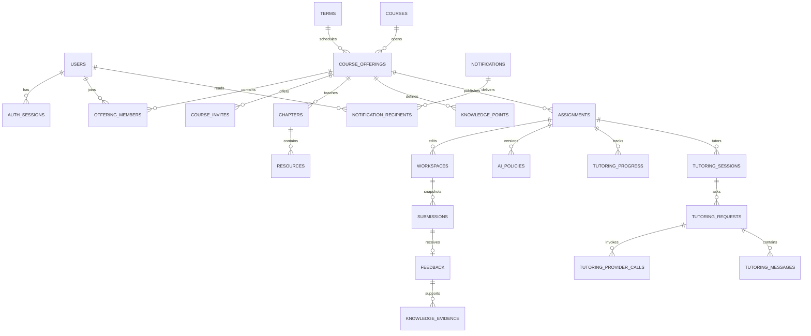

# 后端数据模型

版本：0.4 · 日期：2026-10-06 · 状态：已通过 Flyway V1 建立 terms 并完成真实 MySQL 8.4 验证，其余业务表待迁移。

配套：[开发方案](DEVELOPMENT.md) · [接口契约](API.md)。实现先按阶段建立所需表，不一次性引入 P2/P3 的全部实体。

## 1. 命名与公共字段

- 数据库基线为 **MySQL 8.4 LTS / InnoDB**；服务端使用 Spring Boot。所有表显式声明 `ENGINE=InnoDB`，正文使用 `utf8mb4`；不混用其他数据库的 SQL 语法。
- 主键 `id` 使用应用生成的规范小写 UUID；API 用字符串，字段 camelCase；数据库字段 snake_case。首版统一 `CHAR(36) CHARACTER SET ascii COLLATE ascii_bin`，所有 UUID 外键同型、同字符集、同排序规则；不在首版夹杂整数 ID 或二进制 UUID 映射。
- 时刻使用 `DATETIME(6)`，语义统一为 UTC，Java 使用 `Instant` 并明确转换为 UTC 存取；连接会话 `time_zone='+00:00'`，显示转换至 `Asia/Shanghai`。`DATETIME` 本身不自动转换时区，禁止写入本地墙上时间或无时区 API 字符串；API 使用带 `Z` 或明确偏移的 ISO 8601。预算日 `reserved_day` 为 `DATE`，从锁后采样 UTC 时刻按 `Asia/Shanghai` 转换后取得，不能直接用 UTC 日期代替本地预算日。
- 非纯关联表默认包含 `created_at/updated_at`。不可变快照只有创建时间和版本/来源信息。
- 数据库状态用 `VARCHAR` 加命名 `CHECK` 约束，布尔值用 `TINYINT NOT NULL` 并约束为 0/1，不能写前端中文标签；分数使用 `DECIMAL(6,2)`，满分限定 `0 < max_score <= 9999.99`，得分限定 `0 <= score <= 对应满分`。Java 使用 `BigDecimal`，输入至多两位小数，不依赖数据库静默舍入；启用严格 SQL 模式，不通过 `INSERT IGNORE` 吞掉错误。
- MySQL `JSON` 用于小型文件集、冻结量表、策略配置和结构化输出；实体归属/核心关系用真实外键，不能全部埋在 JSON 中。JSON 不直接作为普通索引键，需要查询的标量先提取为显式列或生成列；正文/任意 JSON 路径不默认加索引。
- JSON 引用中的知识点/文件/评分项由服务层校验同班归属；数据库外键覆盖独立实体关系。
- 跨教学班关联同时用必要的复合外键和事务内服务校验；FK 本身不负责授权。

唯一、外键、检查约束用于保护数据一致性；跨表业务总量和权限仍需事务/服务规则。MySQL `CHECK` 不用来执行跨表查询，所有引用键采用明确的 `PRIMARY KEY` 或 `UNIQUE`，不依赖非标准的非唯一父键。外键使用独立 `CONSTRAINT ... FOREIGN KEY ... REFERENCES ...` 声明，不用会被忽略的内联 `REFERENCES`。详见 [MySQL 外键规则](https://dev.mysql.com/doc/refman/8.4/en/create-table-foreign-keys.html)、[CHECK 约束](https://dev.mysql.com/doc/refman/8.4/en/create-table-check-constraints.html) 与 [日期类型](https://dev.mysql.com/doc/refman/8.4/en/datetime.html)。

## 2. 关系概览



`course_offering` 是权限与学情隔离的基本单元。章节/知识点在教学班实例内维护，避免改一个班影响同课程其他班。

## 3. P0：账户与工程基础

| 表 | 主要字段 | 约束/说明 |
| --- | --- | --- |
| `users` | `id, username, display_name, password_hash, roles, status` | username 唯一；roles 是受控 student/teacher/admin 集合；status active/disabled |
| `auth_sessions` | `id, user_id, token_hash, csrf_secret, expires_at, idle_expires_at, revoked_at, last_seen_at` | 不透明随机令牌只存摘要；user_id FK；token_hash 唯一；登录轮换令牌 |
| `audit_logs` | `id, actor_id, action, target_type, target_id, metadata, request_id, created_at` | 不记录口令/凭证/完整正文；用户删除可匿名化 actor；只允许追加 |
| `terms` | `id, label, starts_at, ends_at, is_current, current_slot` | 学期由管理员维护；ends_at > starts_at；current_slot 为可空 STORED 生成列，唯一索引保证最多一个当前学期；label 为展示文本 |

2026-10-06 已实现 [V1__create_terms.sql](../backend/src/main/resources/db/migration/V1__create_terms.sql)，当前只迁移 `terms`；`users/auth_sessions/audit_logs` 随账户相关功能继续增加版本迁移。`terms.label` 采用 `VARCHAR(200)`，`created_at/updated_at` 为必填 UTC `DATETIME(6)`，由后续管理功能显式写入，不设置依赖服务器时区的默认时间。此轮没有初始化学期数据，因此不存在当前学期；尚未实现的 `/me/config` 不能视为已可查询。

Flyway 自行维护 `flyway_schema_history`，记录迁移版本和校验值；应用启动时验证并执行未应用版本。已经应用的迁移不修改，后续结构调整新增 V2、V3 等文件。当前开发实例和 Testcontainers 均固定 `mysql:8.4.11`，已验证迁移重复执行、当前学期唯一性、0/1 检查、时间区间、微秒精度及 UTC / READ COMMITTED 配置。

平台角色赋予模块资格，授课范围由 `offering_members` 决定。管理员维护操作通过独立管理流程审计，不能直接把所有学生隐私暴露给普通管理列表。

预登录 CSRF 令牌可使用签名双提交 Cookie，不必创建匿名数据库会话；登录成功后创建有用户的 `auth_sessions`。CSRF 令牌与登录令牌分开，令牌不能出现在 URL。

教学班保存 `term_id`，不以“2026 秋季学期”等自由字符串关联或筛选。`GET /me/config` 的学期信息从 `terms` 读取，功能开关来自服务端配置；没有当前学期时返回明确空值，不通过客户端日期猜学期。切换当前学期在同一事务内先清除原标记再设置新标记，历史班级仍引用原学期。

MySQL 不支持带 `WHERE` 条件的部分唯一索引；使用条件满足时为 1、其余为 NULL 的生成列，利用唯一索引允许多条 NULL 的规则。生成列由数据库维护，应用不得赋值。`terms.is_current` 定义为 `TINYINT NOT NULL DEFAULT 0`，`submissions/knowledge_evidence.is_current` 定义为 `TINYINT NOT NULL DEFAULT 1`，另加 0/1 CHECK；CHECK 不替代 NOT NULL。当前学期约束的关键 DDL 如下，`id/starts_at/ends_at` 等普通列按上表定义：

```sql
ALTER TABLE terms
  ADD CONSTRAINT ck_terms_current CHECK (is_current IN (0, 1)),
  ADD COLUMN current_slot TINYINT
    GENERATED ALWAYS AS (CASE WHEN is_current = 1 THEN 1 ELSE NULL END) STORED,
  ADD UNIQUE KEY uq_terms_current (current_slot);
```

并发切换由同一管理员事务按 ID 升序锁定目标学期与当前学期，先清除再设置；唯一约束是最终防线。冲突整体回滚并返回可识别错误，不能先提交清除操作。[MySQL 生成列](https://dev.mysql.com/doc/refman/8.4/en/create-table-generated-columns.html)、[UNIQUE 的 NULL 规则](https://dev.mysql.com/doc/refman/8.4/en/create-table.html)

## 4. P1：教学内容与学习闭环

### 4.1 课程、成员、章节

| 表 | 主要字段 | 约束/说明 |
| --- | --- | --- |
| `courses` | `id, code, mark, title, description, status, created_by` | code 唯一；课程基础，由管理流程导入；status active/archived；mark为展示缩写，不包含个人进度 |
| `course_offerings` | `id, course_id, term_id, title, group_name, progress_unit, status, issue_tags_config, created_by` | course_id/term_id FK；progress_unit chapter/assignment；status active/archived；issue_tags_config 是 P2 启用的版本化词表 JSON |
| `offering_members` | `id, offering_id, user_id, role, status, joined_at, last_studied_at, last_chapter_id` | UNIQUE(offering_id,user_id)；role student/teacher；status active/inactive；同班单一角色；last_chapter_id 可空且必须同班 |
| `course_invites` | `id, offering_id, code_digest, expires_at, max_uses, used_count, revoked_at, created_by` | code_digest 唯一；计数非负且不超过非空 max_uses；加入事务锁定 |
| `chapters` | `id, offering_id, position, title, summary, status, is_required, content_version` | UNIQUE(offering_id,position)；status draft/published/archived；position 正整数 |
| `knowledge_points` | `id, offering_id, title, description, chapter_id, position` | chapter_id 可空；非空时必须属于同 offering；API order映射position |
| `resources` | `id, offering_id, chapter_id, knowledge_point_id, title, content_markdown, position, status` | chapter/knowledge_point 的复合 FK 校验同班；知识点可空；status active/archived；可见性继承章节；P1 仅 Markdown |
| `chapter_progress` | `id, offering_id, member_id, chapter_id, status, completed_at, last_opened_at` | UNIQUE(member_id,chapter_id)；成员必须为该班学生；status in_progress/completed；首次访问可记录 in_progress；已完成后再访问不降级；“已阅读”事实不代表能力 |

Markdown 输出需经过允许列表清理；不渲染任意原始脚本或不受控 HTML。课程资料内容是教学数据，预览学生代码走独立沙箱。

P1 所有 active 基础课程允许 teacher 角色开班；若以后需要逐课程授权，再增加开班授权关联表。章节 API 的 number 对应数据库 position，不另存冗余排序。学生 DTO 的 publicationState 来自 chapters.status，studentProgress 从 chapter_progress 派生，教师响应该字段为 null。教师发布章节后学生才可访问其内容；已发布资源修改是有审计的内容澄清，不能改提交中的冻结评价规则。

实际展示章节或作业后，前端调用 `POST /me/learning-position`，提交 `offeringId` 及 chapterId/assignmentId 中恰好一个；GET 读取本身不修改学习位置。服务持父级共享锁校验 active 班级下本人可访问且仍为 published 的对象，更新 `offering_members.last_studied_at`；章节或绑定章节的作业同时更新 `last_chapter_id` 与 `chapter_progress.last_opened_at`，进度行不存在时创建 in_progress，不伪造 completed。未绑定章节的独立作业只更新班级最近学习时间。`currentChapter` 优先选本人最后访问且仍可见的章节，否则选首个未完成的已发布章节，再退到首个已发布章节，均无则为 null。归档教学班只读历史、不接受位置写入。章节完成确认单独处理 completed_at，访问已完成章节不降级。

### 4.2 作业、工作区、提交

| 表 | 主要字段 | 约束/说明 |
| --- | --- | --- |
| `assignments` | `id, offering_id, chapter_id, title, description, estimated_minutes, type, status, is_required, due_at, late_until, allow_resubmit, max_attempts, max_score, content_version, requirements, rubric, template_files, knowledge_point_ids, current_ai_policy_id, published_at` | type web_lab/sql_text/text；status draft/published/archived；max_attempts>=1；late_until 空或>due_at；满分范围见第 1 节；rubric 总分与 max_score 相符；API initialFiles 映射 template_files |
| `workspaces` | `id, offering_id, assignment_id, student_id, files, active_file, revision, updated_at` | UNIQUE(assignment_id,student_id)；revision>=1；文件为 JSON；只表达真正保存过的学生草稿 |
| `submissions` | `id, offering_id, assignment_id, workspace_id, student_id, attempt_no, workspace_revision, files_snapshot, reflection, content_version, assignment_title_snapshot, requirements_snapshot, rubric_snapshot, max_score_snapshot, knowledge_points_snapshot, ai_policy_id, due_at_snapshot, submitted_at, is_late, is_current, current_slot` | UNIQUE(assignment_id,student_id,attempt_no)；每学生每任务仅一个 is_current=1；current_slot 为生成列；快照字段创建后不可修改 |
| `feedback` | `id, submission_id, teacher_id, draft_payload, published_payload, version, published_version, published_at` | submission_id 唯一；draft/published payload分开；发布后P1不可再编辑；分数/量表/知识结论在payload内 |

`assignmentState` 不单独存成可随意修改的学生状态列，按以下顺序派生：当前提交有 published_payload → REVIEWED；当前提交存在 → SUBMITTED；工作区存在 → IN_PROGRESS；否则 NOT_STARTED。

学生对作业的所有读取、列表、推荐与统计都要求 `published_at IS NOT NULL` 且满足成员权限。公开生命周期仅为 draft→published→archived；归档接口只允许 published→archived，重复归档返回原结果，draft 归档请求拒绝。归档教学班不自动公开任何 draft 子对象，教师仍可读自己的草稿。

提交历史通过 `is_current` 表达有效版本；新提交与旧版失效在同一事务完成。MySQL 的当前提交唯一约束为：

```sql
ALTER TABLE submissions
  ADD CONSTRAINT ck_submissions_current CHECK (is_current IN (0, 1)),
  ADD COLUMN current_slot TINYINT
    GENERATED ALWAYS AS (CASE WHEN is_current = 1 THEN 1 ELSE NULL END) STORED,
  ADD UNIQUE KEY uq_current_submission (assignment_id, student_id, current_slot);
```

提交快照只允许更新受控的 `is_current` 指针状态，不允许覆盖文件、评分规则或提交时间。`due_at_snapshot/is_late` 保留当时事实；教师延长期限不会篡改历史提交时间，展示当前是否待补交时按当前规则另算。

`assignment_title_snapshot` 冻结任务标题；`knowledge_points_snapshot` 是 `{id,title,description}` 数组而非只有 ID。教师批阅 `SubmissionDetailDTO.assignmentSnapshot` 从这些冻结字段提供标题、要求、满分、量规、knowledgePoints、截止时间、contentVersion、aiPolicyVersion，不从当前课程标题或知识点描述回填历史标准。P1 aiPolicyVersion 为 null，P2 从提交的不可变政策记录派生。

首次读取未保存工作区时 API 返回模板与 `revision=0`，不插入表。第一次保存由 baseRevision=0 创建 revision=1。P2 提示进度放在独立 `tutoring_progress`，发起 AI 辅导不创建模板工作区、不增加文件 revision，也不使未保存作业伪装为 IN_PROGRESS。

`files` 结构：

```json
[
  {"path":"index.html","content":"<nav class=\"navbar\"></nav>"},
  {"path":"style.css","content":".navbar { display: flex; }"},
  {"path":"script.js","content":""}
]
```

文件必须完全符合任务模板类型的允许清单；Web 可为空文本但不能遗漏文件字段。默认单文件 100 KiB，总量 256 KiB，按 UTF-8 字节数验证。SQL/文字类型采用对应一个文件，按相同上限。

`rubric` 为不可变 criterionId 的数组：`{criterionId,title,description,maxScore}`；知识点通过任务的 knowledge_point_ids 关联。草稿评分项至少包含 `criterionId,score,comment`，逐项分数范围验证；总分等于评分项得分之和。`knowledgeEvaluations` 不由总分机械转换，教师明确给出每个知识点结论。

feedback_payload的issueTags为P2可选数组，P1为空；每个tag必须属于course_offerings.issue_tags_config当前词表。初始化来自服务端课程配置，包含version和items:[{tag,title,description}]；API提供只读词表。标签历史随公开评价保留词表版本，标签更名不会将旧问题错误合并。

P1 current_ai_policy_id / 提交 ai_policy_id 为空，对外aiPolicyVersion=null；P2才建立ai_policies并为作业绑定生效版本。P1 feedback_payload可以保留教师明确给出的知识评价，但P2之前不自动产生掌握判断。

### 4.3 消息、幂等与服务端事件

| 表 | 主要字段 | 约束/说明 |
| --- | --- | --- |
| `notifications` | `id, offering_id, type, title, content, target_type, target_id, source_event_key, source_version, created_by` | source_event_key 唯一；type course_notice/assignment_published/feedback/system/help_reply；help_reply 于 P2 启用；target 为受控对象 |
| `notification_recipients` | `id, notification_id, user_id, read_at, superseded_at` | UNIQUE(notification_id,user_id)；按接收者记录阅读状态；旧反馈提醒可置为已替代 |
| `idempotency_records` | `id, user_id, method, path, idempotency_key, request_hash, state, response_status, response_body, resource_type, resource_id, expires_at` | UNIQUE(user_id,method,path,idempotency_key)；对应 Idempotency-Key 请求头，保留至少 24 小时；state processing/completed；AI 仅保存请求指针和入队响应，不复制正文；过期后相同键视为新请求 |
| `learning_events` | `id, user_id, offering_id, assignment_id, chapter_id, client_event_id, source_event_key, session_id, type, source, occurred_at, received_at, payload` | P1 先建最小表并仅写 source=server；P2 开放 client，P3 开放 checker；非空 source_event_key 唯一；非空 client_event_id 有 UNIQUE(user_id,client_event_id) |

课程项目规模下，评价发布、公告创建、作业发布及 P2 教师回复，均在原业务事务内同步写入 `notifications` 和全部 `notification_recipients`，任一写入失败整体回滚。P1 不引入通知 worker 或“通知处理中”状态。成功返回后本人消息即可查询；`FeedbackDTO.messageId` 与 `NotificationDTO.id` 均对应本人 `notification_recipients.id`，用于 `/me/messages/{messageId}/read`。共享通知实体 `notifications.id` 只用于公告端点及内部关联，不混作个人消息 ID。

公告和作业发布在同一事务内查询当时 active 学生成员并批量插入收件人，`recipientCount` 来自实际冻结集合；后加入学生不补发旧个人提醒，但可读本班历史公告。自然键例如 `feedback:{id}:published:{version}`、`assignment:{id}:published:{contentVersion}`、`notice:{id}`、`help_reply:{id}`；重复业务请求命中原通知，不生成新的通知 ID，收件人唯一约束作为第二层防重。`target_type` 允许 offering/chapter/resource/assignment/feedback/help_request；求助回复指向原 help_request，不暴露其他会话。

P1 保存、提交、评价、发布与章节访问等可信事件同业务事务落库，事件 `source_event_key` 使用业务对象 ID 与版本，例如 `workspace:{id}:saved:{revision}`，事务重试不重复记数。P1 不开放客户端事件写接口，也不产生掌握分析；这避免 P1 事务依赖尚未迁移的 P2 表。事件 payload 只存白名单元数据，不复制作品、密码或聊天正文。每个事件只能使用对应来源的去重键，客户端不得指定 source 或 source_event_key。

幂等键、事件自然键和去重键均为 ASCII、区分大小写，禁止使用默认的忽略大小写正文排序规则。`idempotency_key` 用 `VARCHAR(128)`，`method` 用 `VARCHAR(8)`，`path` 用 `VARCHAR(512)`（规范化路由路径，不包含 query，业务参数纳入 request_hash），这些列统一 `ascii_bin`；键长度和允许字符在边界校验。`source_event_key/dedupe_key` 用 `VARCHAR(192) ascii_bin`，`request_hash` 用 `CHAR(64) ascii_bin` 的 SHA-256 hex。MySQL 中直接 `UNIQUE(source_event_key)` 与 `UNIQUE(user_id,client_event_id)` 允许多条 NULL，无需条件索引；非空去重字段才参与防重。指针类型与正文响应的保留期限按接口约定管理。

### 4.4 必须落实的关联约束

- `chapters/knowledge_points/assignments` 各增加 `UNIQUE(id,offering_id)`；`offering_members` 增加 `UNIQUE(id,offering_id)`。`assignments(chapter_id,offering_id)`、`knowledge_points(chapter_id,offering_id)` 复合引用章节；`resources` 对章节与非空知识点也按同班复合引用。
- `chapter_progress(member_id,offering_id)` 引用成员，`(chapter_id,offering_id)` 引用章节；`offering_members(last_chapter_id,offering_id)` 引用同班章节。成员是否 active 学生、章节是否 published 由持有生命周期锁的服务校验。
- `workspaces(assignment_id,offering_id)` 引用作业，`(offering_id,student_id)` 引用成员的唯一键；增加 `UNIQUE(id,assignment_id,student_id)`。`submissions(workspace_id,assignment_id,student_id)` 必须整体引用该工作区，同时 `(assignment_id,offering_id)` 引用同班作业，不能拼接其他学生/作业的 workspace_id。
- P2 的 `knowledge_evidence` 同时复合引用所属作业、知识点、学生成员、提交与评价：提交增加 `UNIQUE(id,assignment_id,student_id,offering_id)`，评价增加 `UNIQUE(id,submission_id)`；证据以 `(submission_id,assignment_id,student_id,offering_id)` 和 `(feedback_id,submission_id)` 引用，杜绝把其他学生评价混为当前学生证据。引用列与父唯一索引按相同顺序，父/子 UUID 的字符集与排序规则完全一致。
- P2 `ai_policies` 增加 `UNIQUE(id,assignment_id)`，`assignments(current_ai_policy_id,id)` 与 `submissions(ai_policy_id,assignment_id)` 按复合键引用，政策不允许跨作业绑定；P1 两字段为空，相关 FK 随 P2 迁移建立。`tutoring_sessions` 增加 `UNIQUE(id,assignment_id,student_id)`，请求用三列复合 FK 固定会话归属。
- `tutoring_requests` 增加 `UNIQUE(id,session_id)`；消息以 `(tutoring_request_id,session_id)` 复合引用 `(id,session_id)`，请求与会话归属不能仅靠两条各自存在的单列 FK。请求的 `generation_policy_id/review_policy_id` 分别与 assignment_id 复合引用政策唯一键，尚未生成/审核时政策字段允许 NULL；调用行的政策归属由请求关联和服务校验保证。
- P2 求助、证据对已有 offering_id、assignment_id、knowledge_point_id 等采用同班复合引用；JSON 中的任务知识点、量表 criterionId、共享请求 ID 仍需服务层检查重复项、实体存在、同班/同作业与章节范围。外键不能替代身份授权。
- 核心教学记录默认限制物理删除，归档不级联删除作品、评价与历史引用。分数范围、文件大小、量表总分分别由数据库标量约束和服务端结构校验保护。

同班复合外键 DDL 示例（父表/子表普通列和索引在相应阶段迁移中建立）：

```sql
ALTER TABLE chapters
  ADD UNIQUE KEY uq_chapters_id_offering (id, offering_id);

ALTER TABLE assignments
  ADD KEY ix_assignments_chapter_offering (chapter_id, offering_id),
  ADD CONSTRAINT fk_assignments_chapter_offering
    FOREIGN KEY (chapter_id, offering_id)
    REFERENCES chapters (id, offering_id)
    ON UPDATE RESTRICT ON DELETE RESTRICT;
```

`chapter_id` 可空代表独立作业，非空时上述关系强制同班。InnoDB 外键即时校验，不提供延迟到 COMMIT 的约束；循环引用分阶段建立：先建章节/成员与作业/政策表、以 NULL 初始化可选指针，再添加复合 FK 并绑定。不要通过关闭 `foreign_key_checks` 导入未校验数据；重新打开该开关不会回查期间写入的数据。所有 FK 在迁移中使用数据库范围内唯一的显式名称。

## 5. P2：受限 AI、求助与分析

### 5.1 AI 与求助

| 表 | 主要字段 | 约束/说明 |
| --- | --- | --- |
| `ai_policies` | `id, assignment_id, version, config, created_by, created_at` | UNIQUE(assignment_id,version)；每版本不可变；config 用服务端固定模型校验；作业指向当前版本 |
| `ai_budget_locks` | `student_id, created_at` | student_id 为 PK 且 FK→users.id；每个学生一行，仅用于跨作业/班级串行化 AI 预算检查与预占；不存预算金额/正文；其他领域表不引用此表 |
| `tutoring_progress` | `id, assignment_id, student_id, highest_delivered_hint_level, disclosure_summary, disclosure_version, content_purged_at` | UNIQUE(student_id,assignment_id)；最高已交付层次默认 0；跨会话共享；summary 可空且受正文保留期限约束 |
| `tutoring_sessions` | `id, assignment_id, student_id, status, next_message_sequence, created_at` | status active/closed；next_message_sequence 默认 1；不因新建会话重置作业提示进度或预算 |
| `tutoring_requests` | `id, session_id, student_id, assignment_id, action, content, student_attempt, workspace_revision, workspace_snapshot, generation_policy_id, review_policy_id, review_version, reviewed_at, hint_level, status, pending_slot, result, fallback_reason, input_tokens, output_tokens, reserved_day, budget_reserved, started_at, completed_at, content_expires_at, content_purged_at` | status queued/running/completed/fallback/failed；每学生每作业最多一个 queued/running，pending_slot 为生成列；result 只存已审核输出；代码 revision/snapshot 可空 |
| `tutoring_provider_calls` | `id, tutoring_request_id, attempt_no, generation_policy_id, state, provider_request_id, started_at, completed_at, input_tokens, output_tokens, raw_response, content_purged_at` | UNIQUE(tutoring_request_id,attempt_no)；attempt_no 为 1 或 2；state started/completed/unknown；raw_response 默认不保存，确需诊断时受同一保留期限约束 |
| `tutoring_messages` | `id, session_id, tutoring_request_id, sequence, role, content, mode, hint_level, policy_id, created_at, content_purged_at` | UNIQUE(session_id,sequence)；UNIQUE(tutoring_request_id,role)；role student/assistant；正文清理后保留 tombstone，ID/序号不重排 |
| `help_requests` | `id, offering_id, assignment_id, student_id, title, content, student_attempt, workspace_revision, shared_snapshot, shared_snapshot_expires_at, shared_snapshot_purged_at, shared_tutoring_request_ids, issue_tags, status` | status open/answered/closed；只共享本人主动选择的内容；代码共享副本独立 90 天；AI 共享仅引用原请求，不复制正文延长保留 |
| `help_replies` | `id, help_request_id, author_id, content, created_at` | 仅该班授课教师可回复；回复、原求助状态变更和站内通知/收件人同事务 |

预算不必先创建独立计数系统：按第 7 节取得教学班、作业共享锁后，对既有 `ai_budget_locks.student_id` 行取 `FOR UPDATE`，再依次锁该学生成员、提示进度、可选工作区及会话，在全部必要锁后采样时间并串行检查预占记录。每日请求、每学生每作业请求和滚动一分钟配额都查 `budget_reserved=1` 的预占记录；`reserved_day` 按锁后数据库时间转换为北京时间自然日。不同作业、班级和会话共用学生全局额度；释放确定未调用的预占也取同一预算锁。该锁不替代授课/本人权限校验，不锁 users 行。

同一学生在同一作业的所有会话合计只允许一个未完成请求，数据库兜底如下。新 key 并发入队返回 `AI_REQUEST_IN_PROGRESS`，原 key 重试返回原请求；另开会话不能同时拆解答案或跳过累计审核。

```sql
ALTER TABLE tutoring_requests
  ADD COLUMN pending_slot TINYINT
    GENERATED ALWAYS AS
      (CASE WHEN status IN ('queued', 'running') THEN 1 ELSE NULL END) STORED,
  ADD UNIQUE KEY uq_pending_tutoring_request
    (student_id, assignment_id, pending_slot);
```

`student_id/assignment_id` 必须 NOT NULL，终态产生 NULL slot，因此多条历史终态共存但在途最多一条。不要使用 `UNIQUE(student_id,assignment_id,status)` 替代，它既允许 queued 与 running 各一条，也会错误禁止多条 completed。

预算锁表在 P2 迁移时为既有学生预填，新建学生或赋予 student 角色时在账户事务中预创建。若检测到缺行，允许在进入教学业务事务**之前**用独立短事务补齐；未补齐不得进入 AI 入队事务。在已经持有 offering/assignment 锁后缺行，整体回滚并报告配置错误，不临时插入预算行，不用 `users FOR UPDATE` 替代。补齐只进行预算行插入，1062 表示其他入口已创建后可读既有行；不使用 `INSERT IGNORE` 吞掉 FK/类型错误。该初始化流程不获取教学班/作业锁，因此不会把隐式 users FK 锁带入教学锁链。

```sql
CREATE TABLE ai_budget_locks (
  student_id CHAR(36) CHARACTER SET ascii COLLATE ascii_bin NOT NULL,
  created_at DATETIME(6) NOT NULL,
  PRIMARY KEY (student_id),
  CONSTRAINT fk_ai_budget_locks_student
    FOREIGN KEY (student_id) REFERENCES users (id)
    ON UPDATE RESTRICT ON DELETE RESTRICT
) ENGINE=InnoDB;
```

`highest_delivered_hint_level` 只在经审核的 `completed` 结果已作为可读助手消息提交时推进，表示平台已交付内容，不等待客户端已读；`fallback/failed` 不升级。下次请求从这个进度决定允许层次；达到政策 requireAttemptFromLevel 时仍检查实际尝试。输出审核必须覆盖本人同作业跨会话的已交付历史，不能只看当前会话。可选 `disclosure_summary/disclosure_version` 用于摘要和校验版本，不得在摘要中永久保留已到期的答案正文；正文过期后的信息不足应保守回退，不视为可重新泄漏的空历史。

每次真正的外部生成先插入一条 `tutoring_provider_calls(state=started)` 并提交，再发网络请求；第二次受控重生成是 `attempt_no=2` 的新调用行，也必须先持久化 started。仅在首次收到明确结果且输出审核失败时允许第二次；请求最多两次调用，不把 worker 重试次数当作外部调用次数。失联的 started 调用回收为 unknown：支持查询时按 provider_request_id 恢复结果，否则固定回退/失败，不重新生成、不释放预算。提供商已经受理或结果未知仍占一次请求预算；只有该请求没有任何外部调用、且确定在调用前系统失败时才释放预占。各调用 token 汇总到请求；unknown 的用量为空并明确未知，不能填 0。

入队时若附本人当前已保存 revision，则冻结有限代码片段；未附 revision 可以只按问题和公开材料辅导，不创建工作区。排队后继续保存不会改变已受理上下文。`generation_policy_id` 记录最后一次实际模型调用所用政策，尚未调用时为空；每次外部调用另以不可变调用行保存本次 generation_policy_id，重生成不能覆盖之前调用的依据；`review_policy_id/review_version/reviewed_at` 单独记录最终交付审核所用政策、审核器版本和时间，不能覆盖生成政策掩盖政策变化。

政策版本不可变。若模型生成或审核期间政策更新，完成事务持作业共享锁核对当前政策 ID 与审核版本；不相符时放弃本次提交，在锁外按新政策重新审核/受控回退，再持锁核对。最终写入助手消息、请求终态、提示进度及任务成功必须在一次短事务内完成。归档或成员失活后只记录失败元数据，不交付新生成正文。`tutoring_messages.policy_id` 对学生消息可空，对助手消息为实际审核政策。

学生消息在请求入队事务内创建；会话行锁保护 `next_message_sequence` 分配。完成或提供 fallback 时至多增加一条助手消息；failed 请求不制造助手正文，前端从请求状态展示错误。请求归属必须与消息 session_id 一致，数据库以相应复合键约束。分页以持久 sequence 排序，正文过期后返回“内容已到期”的占位，不能让历史消息序号变化或让同一请求出现两个答案。

`ai_policies.config` 示例（项目默认建议，不是实现中的常量）：

```json
{
  "enabled":true,
  "allowedActions":["ask","concept","next_hint"],
  "allowedModes":["concept","debug_hint","guided_question"],
  "restrictCompleteSolution":true,
  "maxHintLevel":3,
  "allowCodeBlocks":false,
  "requireAttemptFromLevel":2,
  "dailyUserLimit":30,
  "dailyAssignmentLimit":12,
  "perMinuteLimit":3,
  "maxOutputTokens":800
}
```

教师规则只能收紧平台上限，不能扩大允许输出为完整答案或修改其他班政策。dailyUserLimit 和 perMinuteLimit 是平台只读配置，教师 PUT 时只可省略或原值回传；班级政策最多再收紧该作业限额。

### 5.2 后台任务与恢复

| 表 | 主要字段 | 约束/说明 |
| --- | --- | --- |
| `background_jobs` | `id, type, dedupe_key, payload, status, attempts, max_attempts, available_at, lease_until, claimed_by, claim_token, lease_version, last_error` | P2 建立；dedupe_key 唯一；status queued/running/succeeded/failed；payload 只放领域对象 ID；每次领取生成新 claim_token，lease_version 加一 |

领取使用 InnoDB 短事务 `FOR UPDATE SKIP LOCKED` 并设置租约，锁定任务行后另发 `SELECT UTC_TIMESTAMP(6)` 取得租约时刻。`SKIP LOCKED` 只用于可跳过行的任务队列，不用于提交/评价/权限校验；领取排序使用 `available_at,id` 并配置相应索引。如启用复制，使用行复制，不能采用不安全的语句复制。普通领取事务只锁任务行，提交后才执行领域事务；不得长期持有任务锁再逆序获取教学班/作业锁。[MySQL 锁定读与 SKIP LOCKED](https://dev.mysql.com/doc/refman/8.4/en/innodb-locking-reads.html)

续租在短事务内先按任务 PK 取 `FOR UPDATE`，锁后用独立 `SELECT UTC_TIMESTAMP(6)` 采样，再核对 `id+claim_token+lease_version+status=running` 与旧租约尚未过期，最后按相同条件更新；过期 worker 不能自行复活旧租约。完成交付也先获取全部领域锁与任务锁，再用新语句采样并核对有效租约；不能在可能等待的锁定 SELECT 或 UPDATE 中使用语句开始时的 `UTC_TIMESTAMP()` 代替锁后时间。

外部调用前的 started 记录须在短事务内验证当前领取代次和有效租约，与调用行创建一起提交。完成事务按第 7 节锁领域行后再锁任务行，检查同一领取代次、有效租约和允许的请求前态；将领域终态、消息、提示进度及任务成功作为同一原子提交。条件不匹配时丢弃迟到结果，禁止旧 worker 覆盖新 worker 的 fallback/failed/completed。任务回收后先检查逐次外部调用记录，再决定恢复查询或固定回退，不能仅凭任务重新变 queued 就再次调用 AI。

达到重试上限的任务必须同时把关联请求推进到可解释终态，释放未完成请求唯一索引占位；不得仅把 background_jobs 标 failed、让 tutoring_requests 永久 running。清理、续租和补偿任务同样遵守领取代次。任务错误只暴露有限错误码，日志和 payload 不保存学生完整作品、聊天正文或凭证。

### 5.3 行为与证据

| 表 | 主要字段 | 约束/说明 |
| --- | --- | --- |
| `knowledge_evidence` | `id, student_id, offering_id, knowledge_point_id, assignment_id, submission_id, feedback_id, feedback_published_version, result, note, occurred_at, is_current, current_slot, rule_version` | result meets_expectation/needs_practice/insufficient_evidence；来源必须可追溯；同学生/作业/知识点只一个当前有效版本，current_slot 为生成列 |

当前证据与来源幂等的关键 DDL 如下。关系列均为 NOT NULL，旧证据先设置 is_current=0，再插入新证据，全部同事务提交；NULL slot 允许保留多条历史。`knowledge-v2` 查询使用 `is_current=1` 的普通复合索引筛选，唯一 slot 列只负责正确性：

```sql
ALTER TABLE knowledge_evidence
  ADD CONSTRAINT ck_evidence_current CHECK (is_current IN (0, 1)),
  ADD COLUMN current_slot TINYINT
    GENERATED ALWAYS AS (CASE WHEN is_current = 1 THEN 1 ELSE NULL END) STORED,
  ADD UNIQUE KEY uq_current_knowledge_evidence
    (student_id, assignment_id, knowledge_point_id, current_slot),
  ADD UNIQUE KEY uq_knowledge_evidence_source
    (feedback_id, feedback_published_version, knowledge_point_id),
  ADD KEY ix_knowledge_evidence_assessment
    (student_id, offering_id, knowledge_point_id, is_current, occurred_at, id);
```

沿用 P1 的 `learning_events`，P2 才开放客户端允许事件最小集：`chapter_opened/resource_opened/editor_opened/preview_opened/active_heartbeat`。payload 每种有固定字段，不提供任意 JSON 收集个人信息。保存/提交/评价/AI/求助事件由服务端在业务成功事务内产生，客户端不能指定学生、source、score 或可信判定；P1 章节访问的服务端事实与 P2 客户端报告按 source/type 区分，不相加冒充两次访问。

建议一次批量请求原子校验与写入：未知事件、跨班 ID、非法 payload 返回422/403且整批不写；重复事件返回 acceptedCount=0、duplicateCount 增加；客户端不能重传相同 eventId 改正文，返回409 `EVENT_CONFLICT`。允许 occurredAt 为接收时间之前24小时至之后5分钟范围，超范围拒绝；时长按服务端接收/合法时间综合估计。

P2 不单独存 `knowledge_assessment/recommendation` 表。人数少时按有效证据查询计算，返回 `ruleVersion/asOf/evidenceIds`；只有确认查询瓶颈后才加入可重建的缓存/物化表，避免让缓存成为唯一事实。

教师已发布知识评价是当前 `knowledge-v2` 的唯一掌握证据；分析不引用草稿评价。学生有关联任务真正进行中可以决定 learning，但不是通过证据；历史只有一次 meets_expectation 且没有进行中任务时仍为 insufficient_evidence，不能无限期称为正在学习。对外 assessmentState=basically_mastered/needs_practice/learning/insufficient_evidence，不与教师单条 result 混用；具体优先级及 freshness 从有效证据、当前任务和接口规则计算，不添加可任意写入的状态列。P1 不建 knowledge_evidence，P2 启用后从既有已发布评价幂等回填。

## 6. P3：自动检查

| 表 | 主要字段 | 约束/说明 |
| --- | --- | --- |
| `check_runs` | `id, assignment_id, student_id, workspace_revision, files_snapshot, submission_id, checker_version, status, result, error_code, started_at, finished_at` | status queued/running/completed/error；result记录规则ID与pass/fail；无密钥；student_id由登录态取得 |

检查任务只能从本人服务器保存版本或授课教师可访问提交取快照。worker 将快照送到独立 runner；API 与业务数据库不执行学生代码。基础设施 `error` 不转换为学生 `fail`。

P3 将检查转为知识证据时需更新分析规则版本，并标注 source=checker、检查规则与可信度。不要在尚无检查服务时填充“通过检查”的种子事实。

## 7. 核心事务

### 7.0 生命周期锁、锁顺序与时钟

采用 **MySQL InnoDB + 明确 READ COMMITTED 隔离级别**下的短事务和行锁；Spring 服务事务显式指定该隔离级别，不能依赖 MySQL 默认的 REPEATABLE READ。所有教学写操作（含进度/访问记录、加入、内容维护、提交、评价、AI 入队与结果交付）先对所属 `course_offerings` 行按主键取 `FOR SHARE` 并检查 active；涉及作业时再对 assignment 按主键取 `FOR SHARE` 并核对可操作状态。普通保存与提交在父级只取共享锁，因此不同学生可并发，不把整班或整份作业排他串行。

教师修改/发布/归档作业、修改当前 AI 政策时，在取得教学班共享锁后直接取 assignment `FOR UPDATE`；教学班归档直接取 offering `FOR UPDATE`。需要排他锁的操作一开始就获取所需模式，不先取共享锁再升级。父级共享锁一直持有到事务提交，归档检查与新业务写入才能互斥；仅普通 SELECT 校验状态不足以阻止并发修改。生命周期锁仅使用本设计明确的 MySQL FOR SHARE / FOR UPDATE 模式。

触及多类对象时统一顺序：教学班 → 作业 → `ai_budget_locks` 预算行（仅需要时，`FOR UPDATE`）→ 学生成员行（`FOR UPDATE`）→ 提示进度 → 工作区 → 提交 → 评价 → 辅导会话 → 辅导请求 → 调用记录 → 后台任务；需要修改的子表按键取 `FOR UPDATE`。只取当前操作需要的锁；同类多行按 ID 升序。邀请在教学班锁之后、成员创建之前锁定，不在持有成员行后反向等待邀请。单纯任务领取/续租不再获取领域锁，避免和结果提交形成反向顺序。管理员执行成员失活或班级角色变更时先取得 offering FOR UPDATE，再修改成员；这与全部教学写入的父级共享锁互斥，保证教师和学生权限撤销与在途写入有明确先后。

首次工作区/提示进度尚不存在时先锁该学生成员行，随后按唯一键创建并重新检查版本；不同学生仍互不阻塞。工作区保存、提交和评价都遵循成员→工作区→提交→评价顺序，避免发布评价到已替换提交。预算只锁独立 `ai_budget_locks` 行，禁止为预算锁 `users FOR UPDATE`：InnoDB 外键检查会对 users 父行获取共享锁，排他预算锁会扩大无关业务冲突范围。预算行在教学事务前确保已存在，具体创建规则见 5.1；不要依赖对不存在行的 SELECT FOR UPDATE 保护首行创建。

READ COMMITTED 减少普通范围查询的间隙锁，但外键校验与唯一键检查仍可能加间隙锁，仍需按一致顺序取锁并处理死锁。字段更新关联的 FK 检查可能产生隐式锁；显式生命周期锁不能替代真实 MySQL 并发测试。参见 [MySQL 隔离级别](https://dev.mysql.com/doc/refman/8.4/en/innodb-transaction-isolation-levels.html) 与 [锁定读](https://dev.mysql.com/doc/refman/8.4/en/innodb-locking-reads.html)。

新提交获取全部必要锁后，**另发一条 `SELECT UTC_TIMESTAMP(6)`** 并只采样一次，此值共同用于期限校验、`submitted_at` 和 `is_late`；AI 的日期/分钟预算、邀请到期与租约有效性也使用各自完成必要锁后的单次数据库时间。MySQL NOW / UTC_TIMESTAMP 在每条语句开始时取值；不能把时间与可能等待的 `SELECT ... FOR UPDATE` 或条件 UPDATE 合并，否则等待锁跨过截止后仍可能用旧时刻。锁等待完成后的独立时间采样是必需步骤。幂等命中的旧提交直接返回原结果，不重新判迟交。[MySQL 当前时间函数](https://dev.mysql.com/doc/refman/8.4/en/date-and-time-functions.html)

数据库死锁 `1213 / SQLSTATE 40001` 在服务内部最多重试 2 次（首次加重试共 3 次），每次整体重做短事务并保留原幂等键。非幂等键等待导致的锁等待超时 `1205 / SQLSTATE HY000`，应用显式回滚整个事务后才允许按相同上限整体重试；不能把所有 HY000 或所有数据库异常都视为可重试。MySQL 默认的锁超时通常只回滚当前语句，服务不得继续提交先前写入；事务代理外层执行重试，每次使用新的事务与连接状态。业务 409、FK 错误、CHECK 错误和普通唯一键冲突不自动覆盖重试。数据库事务及其重试范围内绝不执行 AI 网络调用。[MySQL 错误处理](https://dev.mysql.com/doc/refman/8.4/en/innodb-error-handling.html)、[错误码](https://dev.mysql.com/doc/mysql-errors/8.4/en/server-error-reference.html)

幂等记录与业务成功同事务提交，不能先提交 processing 行再无限等待；规范请求哈希与原键不因事务重试改变。并发同键插入由 `UNIQUE(user_id,method,path,idempotency_key)` 竞争：1062 只在明确命中该约束时才按幂等逻辑处理，先整体回滚本次业务事务，再在新短事务读取已提交记录，校验 request_hash 并重放响应；其他唯一冲突按各自业务错误处理。不能通过 `INSERT IGNORE` 或 `ON DUPLICATE KEY UPDATE` 覆盖原幂等记录。设置有限锁等待时间，同键等待超时整体回滚并返回 `REQUEST_IN_PROGRESS` 与 `Retry-After`，不在服务内部追加重试、也不留下已提交的 processing 占位。认证和授权在读取/重放前重新校验。

### 7.1 加入教学班

校验会话、解析邀请码目标 → 教学班共享锁 → 查已存在成员 → 锁邀请码 → 用锁后时间校验期限/余量 → 插入唯一成员 → 使用次数加一 → 提交。并发冲突返回现有成员，不再次计数；已加入学生重复提交无需耗用新名额，返回既存关系也不新增教学写入。无效邀请码统一错误，不通过错误暴露任意教学班；归档教学班不能新增成员。

### 7.2 保存工作区

教学班共享锁 → 作业共享锁确认 published → 锁该学生成员并校验 active → 校验文件 → 锁/创建工作区 → 比较 baseRevision → 覆盖完整文件并 revision+1 → 更新最近学习时间、写 P1 服务端保存事件 → 提交。首次保存 baseRevision=0 若已存在工作区返回409，不悄悄覆盖刚保存的内容。

草稿在截止、补交到期或已评价后仍可保存用于练习，不改变原提交与状态；是否正式可提交由 canSubmit 及对应错误码决定。作业/教学班归档后只读。提示进度位于独立表，不增加文件 revision，AI 请求不能制造文件保存冲突。

### 7.3 提交作业

验证当前身份及既有幂等响应；未命中时在同一事务领取幂等键 → 教学班/作业共享锁 → 该学生成员、工作区、当前提交及评价锁 → 新语句获取一次提交时刻 → 校验期限/重交/次数/版本/尚未发布评价 → 旧版 is_current=0 → 新快照 is_current=1 → 写 P1 服务端事件 → 保存幂等响应 → 同事务提交。任一失败整体回滚；旧提交先失效再插入新当前提交，以满足生成列唯一约束。

### 7.4 发布评价

教学班/作业共享锁 → 锁目标学生成员、工作区及当前提交 → 锁评价 → 校验授课关系、当前提交、baseVersion 和分数 → 发布快照并增加版本 → P2 创建当前知识证据 → 同步写唯一反馈通知及学生收件人 → 写服务端事件与审计 → 提交。若新提交已替换正在批阅作品，返回409 `SUBMISSION_SUPERSEDED`。同一次已发布评价的重复 publish 仅在 baseVersion 等于发布前版本或当前 published_version 时按原公开结果幂等返回；更旧版本返回 FEEDBACK_VERSION_CONFLICT，不再增加版本、消息和证据。

评价草稿保存也使用相同顺序并验证当前提交。P1 已发布评价不可再编辑；不引入成绩更正工作流。归档作业不允许新评价发布。P2 当前规模下知识状态直接从证据查询计算，无需为每次发布制造无用途的重算任务；未来引入缓存时才在业务事务内插入可幂等重建任务。

### 7.5 AI 入队与完成

进入业务事务前确认该学生预算行已存在；入队：领取/命中幂等键 → 教学班/作业共享锁 → 独立 ai_budget_locks 行 FOR UPDATE → 学生成员及独立提示进度锁 → 按需锁已保存工作区、会话 → 锁后新语句采样预算时刻 → 检查当前政策、尝试要求、该学生该作业未完成请求与预算 → 预占预算并冻结有限上下文 → 创建请求、学生消息与唯一后台任务 → 保存幂等入队响应 → 提交。同学生同作业另一 key 的请求返回409 `AI_REQUEST_IN_PROGRESS`，不限于同一会话。没有工作区时仍可辅导，不创建假草稿。

执行：worker 单独领取任务并提交领取事务 → 以有效领取代次提交外部调用 started 行 → 锁外调用 AI → 保存每次调用状态/用量 → 锁外审核 → 按统一顺序在完成短事务中再次验证成员、当前政策、教学状态和任务领取代次 → 原子提交已审核助手消息、请求终态、进度与任务终态。不得先提交任务成功再写领域结果。

若归档或成员失活发生在排队后，完成阶段取消正文发布；可持父级共享锁写入失败元数据、清理预占状态并结束任务，这属于已受理任务收尾，不开放新的教学写入。提示进度与消息只在仍允许交付时更新。后台任务失败、超出重试上限、外部结果未知都必须得到终态请求，不能永久停在 running。

### 7.6 归档、发布和通知

教学班归档先取得 offering `FOR UPDATE`，再检查本班是否存在当前且无已发布评价的提交；存在则返回 `ARCHIVE_PENDING_REVIEWS`，否则改为 archived 后提交。父级排他锁会等待所有已开始的子业务事务结束，并阻止新的子业务通过 active 检查，因此检查后不会再插入漏掉的提交。

作业归档先取得 offering `FOR SHARE`、assignment `FOR UPDATE`；仅 published→archived，锁后检查该作业待批阅提交，重复归档返回原结果。归档班级/作业只阻止新的教学写入，历史读取和本人消息已读仍可用，消息已读不要求教学班 active。

作业首次发布持 assignment 排他锁验证章节与规则，冻结 content_version 并写 published_at；公开状态、通知实体和发布时收件人一起提交。重复发布复用自然键，不重复提醒。课程公告与教师回复同理在原业务事务同步写消息；故障注入必须证明“业务已发布但通知缺失”和“事务重试后通知翻倍”都不会发生。

## 8. 查询与索引

| 场景 | 建议索引 |
| --- | --- |
| 我的课程 | offering_members(user_id,status)，以及唯一(offering_id,user_id) |
| 学期筛选 | course_offerings(term_id,status)；terms(current_slot) UNIQUE 生成列索引 |
| 课程章节/资源 | chapters(offering_id,status,position)，resources(chapter_id,status,position) |
| 最近学习 | chapter_progress(member_id,last_opened_at)，offering_members(user_id,last_studied_at) |
| 待办排序 | assignments(offering_id,status,due_at,id) |
| 当前提交与教师批阅 | submissions(assignment_id,student_id,current_slot) UNIQUE；submissions(assignment_id,is_current,submitted_at,id) |
| 学生反馈 | submissions(student_id,submitted_at)，feedback(submission_id) UNIQUE |
| 未读消息 | notification_recipients(user_id,read_at)，notification_recipients(notification_id,user_id) UNIQUE，notifications(source_event_key) UNIQUE |
| 行为查询/去重 | learning_events(user_id,offering_id,occurred_at)，非空 user_id/client_event_id 唯一，非空 source_event_key 唯一 |
| 知识证据 | knowledge_evidence(student_id,offering_id,knowledge_point_id,is_current,occurred_at,id)；(student_id,assignment_id,knowledge_point_id,current_slot) UNIQUE 生成列索引；(feedback_id,feedback_published_version,knowledge_point_id) UNIQUE |
| AI 预算/历史 | ai_budget_locks(student_id) PK；tutoring_requests(student_id,budget_reserved,reserved_day)，tutoring_requests(student_id,budget_reserved,created_at)，tutoring_requests(session_id,created_at,id) |
| AI 并发/消息 | tutoring_progress(student_id,assignment_id) UNIQUE；tutoring_requests(student_id,assignment_id,pending_slot) UNIQUE 生成列索引；messages(session_id,sequence) 与 (tutoring_request_id,role) UNIQUE；calls(tutoring_request_id,attempt_no) UNIQUE |
| 任务领取/回收 | background_jobs(status,available_at,id)，background_jobs(status,lease_until,id)，dedupe_key UNIQUE |
| AI 正文清理 | tutoring_requests(content_purged_at,content_expires_at,id)；help_requests(shared_snapshot_purged_at,shared_snapshot_expires_at,id) |
| 幂等过期 | idempotency_records(expires_at) |

先保证正确性，再在有查询计划与数据量依据时优化；不默认加所有可能索引。列表稳定使用时间/位置加ID排序，避免同时间分页乱序。

本表的普通索引均为 MySQL B-tree 复合索引，不附 `WHERE` 过滤条件。查询与约束使用不同索引时显式保留两者，不能假设生成列唯一索引自动满足所有 `is_current/status` 过滤查询。当前规模只按有效证据计算最近三份不同作业；有查询计划依据后再调整列顺序。幂等、自然键等索引不使用前缀唯一索引，防止把截断前缀误当全值唯一。

## 9. 统计公式与种子数据

- 学生有效完成作业：每任务当前有效提交存在，不累计 attempt_no。
- 待完成只包含active班级的published未提交作业；归档未完成计archivedIncompleteCount，不进入首页。allCount=todoCount+doneCount+archivedIncompleteCount，done包含已提交/评价历史。
- 已完成实验：以上范围中 type=web_lab；不能把所有文字任务都叫实验。
- 已发布教师评价：当前提交的 published_payload 非空；重复发布不重复计数。
- 教师待批阅：本班当前提交没有 published_payload；草稿评价仍算待批阅。
- 章节进度：已发布必修章节中本人已确认 completed 数 / 已发布必修章节总数。
- 实验/作业进度：已发布必做任务中有有效提交数 / 已发布必做任务总数。
- 百分比正数 .5 向上，零分母返回 percent=0、notConfigured=true。
- 未读反馈：本人当前评价对应消息未读，按不同 feedbackId 去重；旧版提醒不再计数。
- 班级共性问题：相同 offering/assignment/issueTag 下学生ID去重，不按报错次数累计。

种子数据用虚构教师/学生；至少两个学期、两个教学班、两个学生、一名教师、三个状态不同的作业。截止时间基于可控测试时钟生成，不能把前端固定 `2026-10-01` 作为服务器时钟。除跨班、截止和同版本竞争外，必须在真实 MySQL 8.4 / InnoDB 环境验证：归档与提交/邀请/政策完成并发；等待锁跨过截止；通知写入失败整体回滚及重试防重；AI 双会话并发和跨作业每日预算竞争；预算首行初始化并发；生成列 NULL 历史多行与非空当前唯一约束；1213/1205 后无部分提交；第一次或第二次外部调用失联；旧 worker 迟到不覆盖终态；续租等待跨过旧租约；只辅导不产生工作区；未发布草稿在归档班仍不可见；90 天后共享入口不能恢复已清理正文。测试可采用 Testcontainers MySQL，不用 H2 代替这些方言与锁行为。

## 10. 迁移、归档与删除

迁移按 P0→P1→P2→P3 建立实体。P0 包括学期与账户基础；P1 包括完整站内通知、幂等记录、最小 learning_events 及可信服务端写入，不依赖 worker；P2 才引入 AI、预算锁表与预填、求助、后台任务、客户端事件入口和知识证据，P3 增加隔离检查。使用版本化 SQL 迁移明确声明 MySQL 方言、InnoDB、字符集与复合约束；不要在应用启动时用 ORM 自动更新表结构，生成列必须以数据库表达式迁移管理。每次部署执行明确版本迁移，演示数据脚本仅在开发环境使用。MySQL DDL 可能隐式提交，迁移失败按实际已执行步骤恢复，不假设完整 DDL 批次可随事务整体回滚。

成员退出/失活后保留作品和评价归属，阻止新写入；作业、教学班用归档保留链路，不级联删除考核作品。管理员按已确认策略清除用户数据时，先撤销会话，再删除/匿名化事件、聊天、求助、证据及关联作品；日志中的身份做匿名化，通知接收者按关联删除。备份过期也应符合保留周期。

默认原始客户端事件保留 90 天后按策略删除。AI 请求在创建时确定 `content_expires_at=created_at+90 天`；到期清除 content、student_attempt、workspace_snapshot、result 中正文以及 tutoring_messages.content，保留 ID、序号、终态、政策版本、用量、时间、回退原因等必要元数据，并写 content_purged_at。请求和消息 tombstone 使历史分页及审计仍可读，API 不把清理后的空正文当作新生成内容。外部调用 raw_response 如曾保存，同原请求到期清理，不以调用/重试时间延长；没有留存的原始响应无需另复制。提示 disclosure_summary 到期同步清空或仅依据尚未到期的源内容重建，highest_delivered_hint_level 不归零。

求助的 shared_tutoring_request_ids 仅指向原请求，详情读取受原 AI 请求的同一 content_expires_at 约束；到期显示已清理占位，不能通过求助副本延长聊天或 AI 上下文保留。学生主动共享的代码独立副本在创建求助时写 shared_snapshot_expires_at=created_at+90 天，到期清除 shared_snapshot 并写 shared_snapshot_purged_at。此清理不删除按课程归档策略保留的正式作品和评价；它们属于独立教学考核记录。

background_jobs.payload 只存对象 ID；幂等响应对于 AI 仅存入队状态与请求 ID，不复制模型正文。日志、摘要、失败堆栈及备份均纳入相同保留边界，清理流程不得留下可以绕过期限的重复正文。自动清理只删除明确到期的内容、缓存或过期幂等记录；没有批准的课程归档策略时，不自动删除考核作品。知识状态直接从有效提交和已发布反馈重建，不依赖已过期客户端事件或 AI 正文。
