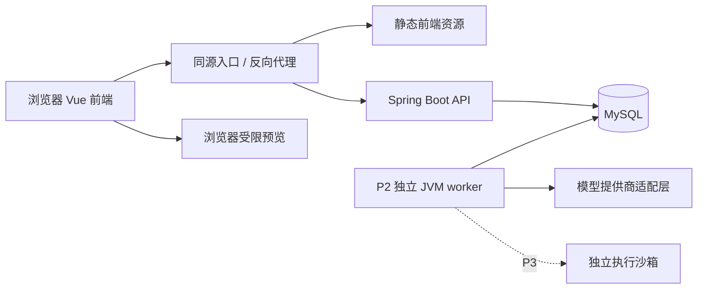

# 项目开发方案与协作基线

设计基线：1.0.1 · 状态更新：2026-10-13。前后端按独立工作包实现，不绑定模型名称；共享设计、契约与跨端审查由用户指定的维护任务统一负责。

## 1. 阅读与权威边界

日常只维护三份开发文档和一份结构契约：

| 文件 | 唯一负责的内容 | 阅读方式 |
| --- | --- | --- |
| 本文 | 架构、跨端业务规则、协作、阶段与验收 | 两端必读 1～3、11～14 节，业务章节按任务读取 |
| [FRONTEND.md](FRONTEND.md) | Vue 工程、页面、状态、保存与浏览器行为 | 前端按功能读取 |
| [BACKEND.md](BACKEND.md) | 服务分层、存储、锁、事务、迁移与运行 | 后端按功能读取 |
| [openapi.yaml](openapi.yaml) | HTTP 地址、字段、类型、必填/可空、枚举、错误和接口状态 | 按 operationId 及其引用的 schema 读取，不将全文塞进每个任务 |

字段结构以 OpenAPI 为准，业务含义以本文为准，存储与事务以 BACKEND 为准，界面行为以 FRONTEND 为准。这是职责分工，不是允许冲突的覆盖顺序：发现冲突先修正文档与契约再开发。其他文件可引用字段、表名和规则，但不维护第二套字段表、错误码表或 DTO 定义。示例不取代 schema。

`archive/` 是历史快照和审计输入，不是开工必读项。README 只保留项目入口与实际启动方法，不再承担新增规范。旧 API、DATA_MODEL 与开发进度详细记录已保存到 2026-10-08 快照。

### 1.1 当前真实状态

截至 2026-10-13，P0-A 已交付：契约 83 个操作中，5 个认证操作（getCsrfToken、login、logout、getMe、getConfig）标为 verified，2 个健康检查为 implemented，其余 76 个为 planned。已有账户初始化、数据库会话、认证 HTTP 链、登录限流、审计和 Flyway V1～V4；正式 Vue 工程 frontend/ 已建立，包含登录、会话联调页、身份恢复、退出、同源代理与 mock。website-prototype/ 仅保留静态原型。

已有通过前端代理连接真实数据库的接口联调记录，尚未完成真实浏览器 UI 验收。P1 教学业务与 P2/P3 功能尚未实现；本轮定向检查发现认证异常恢复和并发限流问题，见下方交接。verified 保留原已验证场景的证据，不表示覆盖所有异常或并发条件。

OpenAPI 中 `x-implementation-status` 使用 planned / implemented / verified：分别表示未实现、已有生产实现且相关 HTTP 测试通过、通过真实跨端验收。`x-contract-status: reviewed` 仅表示静态设计审计。P0～P3 是计划阶段，不代表可用性。新增或删除生产路由必须在同一变更中更新契约状态；改变状态须在交付记录附代码与对应测试，verified 另附真实联调证据，不能按按钮是否出现判断完成。

CI 使用应用注册的生产路由，按 HTTP 方法和路径双向核对状态：实际存在的路由不得标为 planned，也不得游离于契约之外；implemented/verified 必须存在对应路由。此检查不自动认定业务完成或把状态升级为 verified，接口行为仍由 HTTP 测试和跨端验收证明。状态描述当前仓库版本，不表示某个服务器已部署；前端真实联调须同时确认环境地址、部署提交和测试账户。

<a id="handoff"></a>

### 1.2 交接说明（2026-10-13）

- **接手方式**：先读本节，再按任务阅读本端手册及契约切片。前端只实现 frontend/，后端只实现 backend/；不绑定任何模型，共享文档/契约变更须先说明影响并取得用户授权。
- **代码基点**：整理前 HEAD 为 `86574e2`；前端首包 `12205b6`，后端首包 `fa72b3f`，启动脚本修复 `0aa9856`，CI 扩充 `6935b6e`。当前处于 P0-A 收尾，P1 尚未开工。
- **已有证据**：本地报告为后端 93 项单元/HTTP 测试、98 项数据库集成测试通过；前端交付记录为 verify 与 39 项用例通过；五个认证操作经代理联调通过。浏览器 UI、远程 CI 未确认，不能据此宣称全量验收。工具链基线与历史实测版本存在记录冲突，接手前记录 node/npm 实际版本，按锁定基线重新验证。
- **建议下一步**：前后端分别处理下表问题，再做浏览器登录→刷新→退出与异常恢复验收；不要直接把这些问题记为已修复。本次仅整理文档，没有改业务代码或契约。

| 待处理 | 归属 / 入口 | 已复现的现象及验收目标 |
| --- | --- | --- |
| 登录后身份失效 | 前端 [auth.ts](../frontend/src/stores/auth.ts) | login 200 后 /me 401，仍返回登录成功并保留 authenticated；应进入身份恢复 |
| CSRF 刷新失败提示错误 | 前端 auth.ts | 刷新请求失败仍提示“令牌已刷新”，旧 token 保留；区分成功与失败 |
| 退出恢复不完整 | 前端 auth.ts / csrf-refresh.ts | 三次退出 CSRF 失败触发三次刷新、零次身份核对；落实单次恢复、再次失败停止及用户代次检查 |
| 会话查询异常无统一响应 | 后端 [SessionCookieAuthFilter](../backend/src/main/java/com/learningplatform/common/security/SessionCookieAuthFilter.java) | 模拟数据库异常直接逃出过滤器，未写入业务错误信封；按现有契约处理服务端故障 |
| 并发登录限流空档 | 后端 [LoginRateLimiter](../backend/src/main/java/com/learningplatform/modules/auth/security/LoginRateLimiter.java) / AuthController | 模拟先检查后回报失败的并发时序，上限 5 仍放行 20 次校验；补原子的请求准入或在途限制并验证 |

上表来自 2026-10-13 对现有代码的定向模拟验证，不是真实浏览器或并发压测；临时探针未提交。接手者先补可重复的回归测试，再修复并分别提交。每包交付说明改动、实际检查、未做事项、自主决定和提交哈希；不要把排查结论当成实现结果。

## 2. 范围与阶段


| 阶段 | 交付内容 | 验收出口 |
| --- | --- | --- |
| P0 基础 | 后端目录、配置、迁移、登录退出、权限、统一错误、健康检查、种子数据 | 学生、教师可登录；匿名访问、失效或撤销会话、角色入口越权与无效 CSRF 被拒绝 |
| P1 教学闭环 | 教学班与邀请、章节资料、任务发布、草稿、预览、提交、批阅、站内通知、首页、最小服务端事件 | 跨用户/教学班对象访问被拒绝；学生提交真实作品；教师评价与站内提醒同事务可见，刷新不丢数据 |
| P2 项目特色 | 作业级 AI 政策、分层辅导、教师求助、行为事件、知识证据和建议、共性问题 | 辅导受服务端规则约束，学习结论可追溯且不改变人工成绩 |
| P3 扩展 | 独立浏览器/SQL 检查沙箱、自动检查证据、队列扩容、SSO 等 | 检查与主服务隔离，资源受限，错误可恢复 |

P1 就应提供可编辑作业与浏览器隔离预览，但“预览”不能显示为“自动验收通过”。原型的“运行检查”在 P1 调整为“预览效果”；实际自动检查留到 P3。SQL 作业 P1 保存 `answer.sql` 并人工评价，不连接平台业务数据库执行。

P2 的 AI、行为和分析依赖 P1 已有任务、作品和评价；先有可靠教学事实，再展示分析。不会用示例值填充尚无证据的学习状态。

## 3. 架构与责任边界

### 3.1 技术方向

正式前端采用 Vue 3 + TypeScript + Vite + Vue Router + Pinia，Composition API 与 `<script setup>` 统一写法；保留现有视觉和业务交互作为迁移基准。框架不代替保存串行化、权限和幂等设计。前端版本在首次建工程时核对兼容性、固定依赖并提交 lockfile；P0-A 已建立 `frontend/` 并提交 `.nvmrc`、`engines` 与 lockfile。

后端沿用仓库已固定的 Java 21、Spring Boot 4.1.1、MyBatis、Flyway 与 MySQL 8.4.11。精确依赖以 `backend/pom.xml`、Wrapper、Compose 为准；本轮不升级现有工程。使用模块化单体和同一数据库，按业务包分模块。



开发浏览器统一从 127.0.0.1:4173 进入，Vite 只将 `/api/v1/` 转发至预配置后端 8080；生产由同源 HTTPS 入口提供静态文件与 API。数据库及 worker 不直接对浏览器开放。原型静态服务继续用于看原型，不再承担正式登录代理改造。

API 负责身份、对象授权、短事务与查询；P2 worker 使用同一 Maven 项目和领域规则，以独立非 Web JVM 运行，处理外部 AI 调用和清理。P1 站内通知在业务事务内同步写入。P2 知识状态先按有效证据查询计算，不提前引入重算队列或缓存。P3 才引入独立 runner，主 API 与数据库不执行学生代码。

### 3.2 模块归属

| 后端模块 | 拥有的数据与职责 | 对外提供的能力 |
| --- | --- | --- |
| auth | 用户、数据库会话、本地账户准备 | 当前身份、会话轮换与撤销 |
| courses | 学期、基础课程、教学班、成员、邀请、章节、资料、知识点、阅读位置 | 班级范围与生命周期校验、内容读写 |
| assignments | 作业、模板、发布规则、工作区 | 作业资格判定、保存、冻结任务要求 |
| submissions | 提交与不可变作品快照 | 提交协调、当前有效提交与历史读取 |
| feedback | 评价草稿与公开快照 | 保存评价、发布与版本冲突处理 |
| notifications | 通知内容与个人收件状态 | 同事务创建通知、个人读取与标记已读 |
| tutoring | AI 政策、预算、进度、会话、请求、提供商调用与消息 | 辅导受理、审核、结果交付 |
| helprequests | 学生求助、主动共享快照、教师回复 | 求助与回复流程 |
| analytics | 最小学习事件、P2 知识证据、规则查询与建议 | 可信事件写入、证据入库、聚合查询 |
| jobs | 任务领取、租约、恢复调度 | 按任务类型调用领域入口，不自行改领域状态 |
| common / security | 响应、异常、请求标识、UTC、审计与幂等基础；HTTP 认证链 | 基础设施，不能反向依赖业务 Controller |

P1 的 analytics 仅提供服务端事件写入；知识证据和分析查询在 P2 才启用。学期和基础课程的管理首版采用受控初始化流程，不补造未设计的公共管理接口。

### 3.3 调用与事务所有者

Controller → 本模块应用 Service → 领域规则 / Mapper。跨模块调用显式 Service 或窄接口，不调用其他模块 Controller，不直接改其他模块的表。查询聚合可通过专门 QueryService/只读 Mapper 做跨表 JOIN，但统一做对象授权，不从查询绕过数据归属。

| 工作流 | 外层事务负责人 | 同事务协作者 |
| --- | --- | --- |
| 邀请加入、章节访问 | courses | 最小事件、审计 |
| 工作区保存 | assignments | courses 成员与位置、最小事件 |
| 正式提交 | submissions | assignments 工作区、feedback 发布状态读取、幂等、最小事件 |
| 评价发布 | feedback | submissions 当前版本校验、notifications、最小事件；P2 加知识证据 |
| AI 入队 / 结果完成 | tutoring | courses / assignments 校验、jobs、幂等、最小事件 |
| 教师回复 | helprequests | notifications、审计 |

同事务协作者复用同一 DataSource，以 REQUIRED 参与，不在发布链中使用 REQUIRES_NEW 或异步事件投递来绕过原子性。为避免 submissions 与 feedback 的循环 Bean 依赖，将“锁当前提交/读取评价发布状态”提取为只读或锁定窄接口，禁止两个工作流 Service 相互调用。notifications、事件与证据写入服务不回调发布服务。

教学写事务的具体锁顺序只在 [BACKEND 数据模型第 7 节](BACKEND.md#db-transactions) 定义。会话鉴权事务先完成，再进入教学事务。AI 外部网络调用、输入输出审核不持数据库锁，交付前另开短事务重新核对授权、政策与领取代次。

### 3.4 前后端边界

后端拥有身份与授权、正式状态、期限、分数、AI 预算和派生统计。前端拥有页面路由、本地编辑、保存队列、展示文案与请求生命周期。客户端倒计时、隐藏按钮和预览结果不能成为后端的权限、截止或成绩依据。

同一个工作区的编辑状态由独立控制器维护，页面组件只触发动作。浏览器预览是独立信任边界；AI 输出与教师输入都按不可信文本处理。详细交互仅在 FRONTEND 定义。


## 4. 业务与权限

### 4.1 课程与教学班分离

`course` 表示课程基础，例如《Web 前端开发技术》；`course_offering` 表示“2026 秋季 · 计算机 2301 班 · 李老师”的一次开课。章节、知识点、作业、成员和分析都绑定开课实例 `offeringId`，同一课程不同班互不影响。

原型的 `web/db/design/network` 只作为种子数据的可读标识。真实对象使用 UUID；前端从 DTO 中拿到 `offeringId/assignmentId` 后生成自己的 hash 路由，后端不保存 `#/lab` 等页面地址。

### 4.2 权限矩阵

| 对象/操作 | 学生 | 授课教师 | 管理员 |
| --- | --- | --- | --- |
| 教学班已发布章节、作业 | 本人已加入的班 | 自己授课的班 | 维护基本配置，不默认浏览私有作品 |
| 草稿、提交 | 仅本人 | 本班已提交作品；不默认读取未提交草稿 | 需审计的维护流程 |
| 评价 | 本人已发布评价 | 本班评价草稿与发布 | 需审计的更正/维护流程 |
| AI 对话 | 仅本人 | P2 默认只看摘要/求助中学生主动共享的片段 | 需审计的维护流程 |
| 学习记录 | 仅本人 | 本班学生证据与汇总 | 需审计的维护流程 |
| 通知 | 本人接收的消息 | 创建本班通知 | 系统通知 |
| AI 政策/作业发布 | 读取生效版本 | 维护本班 | 维护平台允许范围 |

平台 `teacher` 身份只是可创建教学班的资格；读取某个班仍需授课成员关系。邀请码只授予学生成员资格，不能提升为教师。后端逐次验证对象归属；切换到 `#/teacher` 不改变身份。

教学班归档后统一停止章节/作业/内容修改、草稿保存、提交、评价发布、进度确认、求助和新辅导；保留本人/授课范围的历史读取以及本人消息标记已读。教学班或作业有当前待批阅提交时，归档返回 `ARCHIVE_PENDING_REVIEWS`，教师先处理提交。归档后不能靠仍为 published 的子作业继续写入。

所有教学写入在同一事务先持有教学班共享行锁；归档持有排他行锁后检查并更新状态。涉及作业的操作也使用对应父行共享/排他锁，避免“检查 active 后又被归档”的窗口。不同学生的普通保存可以并行，不能为每次自动保存排他锁住全班作业。具体锁顺序与模式见 [BACKEND](BACKEND.md#db-transactions)。

作业仅允许 published → archived；草稿不能通过归档公开。学生查询除状态条件外还必须满足 `published_at IS NOT NULL`，教学班归档不会改变其草稿的可见性。

### 4.3 邀请与选课

- 邀请码由服务端生成，不沿用 `WEB2026` 等示例值；数据库保存带服务端秘密的 HMAC 摘要，不保存可公开枚举的短明文。
- 可设置有效期、最大使用人数与撤销时间；不公开提供“查询任意邀请码对应课程”的接口。
- 加入时在事务内锁定邀请码并检查余量，成员表有唯一约束；并发重复点击不会重复入课或消耗名额。
- 已经是该班学生时返回现有成员关系，HTTP 200；新加入返回 201。无效、过期、撤销对未加入者统一显示“邀请码不可用”。
- 教师成员不能通过邀请码同时变成该班学生；访问失败、未加入和数据为空分别处理。

## 5. 作业、草稿与评价规则

### 5.1 状态分离

| 层 | 状态 | 含义 |
| --- | --- | --- |
| 教师作业 | `draft / published / archived` | 是否对学生可见、是否允许新操作 |
| 学生作业 DTO | `NOT_STARTED / IN_PROGRESS / SUBMITTED / REVIEWED` | 未编辑、已有草稿、已有有效提交、当前提交已发布评价 |
| 评价 | `draft / published` | 学生是否可以看到成绩与反馈 |

`assignmentState` 从草稿、当前有效提交和已发布评价派生，不接受前端写入。P1 不提供“退回修改”状态；教师可建议练习，正式返工流程后续再增加，避免未定义状态进入接口。

- 待完成 `todo` = 教学班 active、作业 published，且状态为 `NOT_STARTED + IN_PROGRESS`。归档未完成项目只在历史/all列表显示，不推荐为当前任务。
- 已完成筛选 `done` = `SUBMITTED + REVIEWED`（含归档历史），页面分别显示“已提交”“已评价”。已提交不等于已掌握。all列表额外包含已归档未完成项，计为 archivedIncompleteCount，不能强行改成已完成。
- DTO 的 `overdue = now > dueAt 且状态属于 todo`；某次提交的 `late = submittedAt > dueAt`，两者用途不同，数据库对应 `is_late`。
- 截止时间统一为带时区时刻，数据库 UTC；UI 使用 `Asia/Shanghai`。若教师输入某天，界面明确默认是该日北京时间 23:59:59，转换后再保存。

作业列表满足 `allCount = todoCount + doneCount + archivedIncompleteCount`。summary 以同一学生及 offeringId/termId 范围统计，排除 draft 与不可读项；切换 filter 或分页不改变这些汇总数。total 随当前 filter 取对应计数，超出最后一页时 items 为空但仍返回真实 total。各项从同一数据库快照计算，避免并发更新造成计数不守恒。字段定义见 [AssignmentPage](openapi.yaml#/components/schemas/AssignmentPage)。

### 5.2 补交与重交

作业字段包含 `dueAt`、`lateUntil`、`allowResubmit`、`maxAttempts`。

- `lateUntil=null` 表示禁止补交；允许补交必须指定晚于 `dueAt` 的截止时刻。
- 服务端取得必要锁后，在同一事务发出**另一条独立 SQL** `SELECT UTC_TIMESTAMP(6)`，只取一次，用于窗口校验、`submittedAt` 和 `late`。MySQL 的当前时间函数取语句开始时间，不能放在可能等待锁的 SELECT / UPDATE 语句中当作锁后时间。等锁跨越截止时按独立查询取得的时刻判定；幂等重放沿用原结果。提交数最多 `maxAttempts` 次；客户端时间不能延长期限。[MySQL 日期与时间函数](https://dev.mysql.com/doc/refman/8.4/en/date-and-time-functions.html)
- `allowResubmit=true` 时，未发布评价之前可提交新版本；旧版保留但成为 `superseded`，教师待批阅列表只显示当前版。
- P1 当前提交已经发布评价后禁止重交，返回 `RESUBMIT_AFTER_REVIEW`；教师建议通过下一项作业/练习落实。
- 归档作业可继续看历史，不能再保存、提交、开启新辅导或发布新的评价；已存在通知和结果仍可读取。

章节默认 draft；教师通过独立发布接口公开章节及其有效资料。学生章节目录只返回已发布章节，教师维护接口可读取草稿。作业关联章节时，发布作业需该章节属于本班且已发布；未关联章节的课程级作业允许独立发布。

### 5.3 草稿并发与提交快照

工作区按 `(studentId, assignmentId)` 唯一。读取返回 `revision`；保存全量文件时带 `baseRevision`。只有版本相等才成功并加一，否则返回 409 `WORKSPACE_CONFLICT`，前端保留本地编辑并提示重新加载或比较，不能静默覆盖。

- Web 作业仅允许 `index.html/style.css/script.js`，SQL 为 `answer.sql`，文字为 `answer.md`；任务模板包含文件清单。
- 默认每文件不超过 100 KiB UTF-8，总量不超过 256 KiB；不接受二进制、压缩包、任意路径或文件系统路径穿越。
- 自动保存建议编辑后 1.5 秒防抖；同一工作区最多一个在途保存，后续修改合并成下一次。前端分别跟踪本地编辑序号和服务端 revision，旧应答只确认对应版本，不能覆盖新编辑。
- 提交引用服务器已保存的 `workspaceRevision`；服务器复制文件、反思说明、任务要求、量表与政策版本，生成不可变快照。
- 保存、提交与教师发布按固定顺序锁定作业、该学生工作区/当前提交，避免评价发到刚被替换的旧提交。
- 提交要求 `Idempotency-Key`。相同用户、路径、键、请求体返回同一提交；相同键不同请求体返回 409，不能重复创建或占用次数。

学生提交后继续编辑草稿不会改变已提交作品。教师评价绑定 `submissionId`，不是绑定不断变化的工作区。

点击提交时冻结本次编辑内容，等待该内容保存成功后，再提交返回的 revision。保存失败、未知结果或409冲突时停止提交。网络中断重试保留原幂等键；切路由后旧请求不得重绘新页面。详细保存状态机与账号隔离见 [FRONTEND 第 5 节](FRONTEND.md#5-编辑自动保存与提交)。

截止或已评价后可以保存草稿用于练习，状态不倒退，正式提交仍受窗口和重交规则约束；只有作业/教学班归档后停止新的草稿写入。工作区响应提供 `canSave/saveBlockedReason`，使界面能区分练习和提交。

### 5.4 教师发布与批阅

作业草稿包含任务要求、文件模板、关联知识点、截止规则、满分与量表。发布时验证同班关联和量表总分，冻结 `contentVersion` 对应的要求/量表快照。

发布后可以延长截止/补交窗口、修改非评分性质的提示说明并留下审计；不能原地改变要求、满分、量表、模板或核心知识点。需要实质改变时新建作业。教师发布新 AI 政策版本可立即生效，但提交保留当时政策版本。

评价先保存草稿，带 `baseVersion` 做乐观锁；发布时确认提交仍是当前版，成绩不超满分，量表评分合法。**评价发布、P1服务端事件、反馈通知及本人接收记录在同一数据库事务内写入；P2再加入知识证据更新**。消息生成有唯一业务来源键，重放不会增加提醒。学生只见已发布版本。

P1 已发布评价不可再通过草稿接口修改。需要更正时先由教师确认，通过审计管理流程处理；面向用户的评价修订工作流后续单独设计。数据保留公开快照和版本，避免学生看到尚未确认的变动。

这项范围限制必须在教师发布前说明。P1 可用于演示和小范围试用；正式承担教学计分之前，必须补齐并验收保留旧版、修改原因和操作者的成绩更正流程，不能把直接修改数据库作为日常批阅功能。

## 6. 预览与运行边界

P1 浏览器将三个文本文件组成预览文档，通过受限 `iframe` 运行学生 HTML/CSS/JS。

- 使用没有 `allow-same-origin` 的 sandbox；按作业需要仅允许 `allow-scripts`。
- 预览不允许表单提交、弹窗、顶层跳转、下载和平台 Cookie/存储访问。
- 可信预览模板先设置 CSP，再装配学生内容；设置 `default-src 'none'`、`connect-src 'none'`、`base-uri 'none'`、`form-action 'none'`、`object-src 'none'`，按预览实现仅放行必要的本地组合脚本/样式。阻断受支持的 fetch/子资源通道；这不构成任意 JavaScript 严格零外网的保证。P1 不支持外部 npm 包/CDN。
- 不向预览窗口发送登录态、API 密钥或私有教学数据；消息桥校验 `event.source` 与每次预览随机标识及白名单格式，不能仅信任不透明来源的 `origin='null'`，也不能提供平台 API 代理。
- 浏览器 sandbox 不是 CPU/内存配额机制；死循环仍可能影响浏览器。提供重置预览，不将它当成可执行任意语言的服务器隔离方案。

这些限制需真实联调验证，不能仅凭 iframe 标签宣称安全。MDN 对 sandbox 权限及组合风险有说明。[MDN iframe 文档](https://developer.mozilla.org/en-US/docs/Web/HTML/Reference/Elements/iframe)

组合预览只解析/重写三个允许文件的本地引用，移除学生的 base/meta refresh、外部引用和嵌套frame；不要直接拼接可提前闭合 script/style 的任意文本。平台HTML/API响应设置合适的CSP `frame-ancestors 'none'`，禁止被预览导航后嵌入。CSP资源限制与导航隔离是不同边界，真正可保证的无外网执行放在P3的网络出口隔离中。[MDN CSP说明](https://developer.mozilla.org/en-US/docs/Web/HTTP/Reference/Headers/Content-Security-Policy)

P3 自动检查由独立 runner 消费提交/检查快照。它使用临时环境、无平台数据库或密钥、无外网、只读基础文件、资源配额、超时与清理。Web 可以在隔离浏览器的多个视口检查布局；SQL 使用一次性练习库。API 进程不 `eval/exec` 学生代码。

检查结论注明 `checkerVersion`、`submissionId/workspaceRevision`、规则和失败原因。基础设施超时标为 `error`，不能记为学生测试失败。客户端“我运行成功了”仅是行为报告，不是可信检查证据，也不能直接给成绩。

## 7. 受限式 AI 辅导（P2）

### 7.1 作业政策

`ai_policy` 是不可变版本，作业指向当前生效版本。P1 政策版本为空，接口 `aiPolicyVersion=null` 且 AI 未开放；P2 为既有已发布作业配置并启用版本。默认“引导模式”：

| 规则 | 默认建议 |
| --- | --- |
| 允许能力 | 概念解释、排错方向、引导提问、验证思路 |
| 提示层次 | 1 观察问题；2 指向相关概念/步骤；3 让学生验证自己的修改 |
| 核心答案 | 禁止生成完整可提交实现，默认禁止代码块 |
| 解锁要求 | 第二层开始需要学生描述实际尝试；新建会话不重置作业提示进度 |
| 预算 | 初始配置：每用户每日 30 次、每作业每日 12 次、每分钟 3 次；可按演示需求调整 |
| 上下文 | 本人本作业最近 8 轮已审核对话、当前代码上限 16 KiB、教师公开要求和知识资料 |
| 回复 | 最多 800 个输出 token；30 秒提供商超时；最多一次受控重新生成 |

外部上下文同时受 [AI 数据发送边界](#ai-data-boundary) 约束，容量上限不表示允许发送真实学生材料。

服务端决定提示层次、允许模式和上下文。客户端仅发送 `ask/concept/next_hint`、问题、实际尝试和可选工作区版本；不接受自定义系统提示、角色、答案开关或指定层次。

跨会话共享 `(studentId, assignmentId)` 的最高已交付提示层次、预算和披露历史；该学生该作业最多一个 queued/running 请求。提示进度独立于工作区，问AI不会创建一份假保存草稿。达到层次上限仍可澄清概念，但 next_hint 不再升级。

| 动作 | 服务端目标层次 | 成功交付后的进度 |
| --- | --- | --- |
| ask | 已交付最高层，尚无历史时为1；不因多问一次自动升级 | completed后记已交付层；失败不变 |
| concept | 1，提供基础概念 | 不降低既有最高层 |
| next_hint | 最高层+1，初次为1；超过政策上限返回 HINT_LIMIT_REACHED | 仅completed后推进，fallback/failed不推进 |

任何达到 `requireAttemptFromLevel` 的请求需提供实际尝试描述。上下文按同学生同作业跨会话选最近已审核交付历史及服务端披露摘要，不仅取当前会话8轮。历史正文到期后暂停继续升级，返回固定知识卡或教师求助，不能把历史清空当成重新开放完整答案的机会。

### 7.2 一次辅导请求的流程

1. 验证登录、选课关系、作业可辅导、会话归属、幂等键与请求大小。
2. 原子预占预算；按模型顺序锁定该学生的独立 `ai_budget_locks` 行（FOR UPDATE）及作业级进度，不排他锁住 users 行。同一学生同一作业最多一个未完成请求，重复幂等请求返回已有任务，并在事务中记录学生消息。预算锁行在 P2 迁移时回填、创建学生时预建；发现缺行时在进入教学事务之前另开短事务补建，不能持有父对象锁后临时补建并反向取得用户外键锁。活动请求唯一性由 MySQL 可空生成列与唯一索引落实，具体 DDL 见 [BACKEND](BACKEND.md#db-ai)。
3. 读取服务端政策与本人保存版本，创建 `tutoringRequest` 和后台任务，返回 HTTP 202。
4. worker 检查请求意图；索要完整答案或明显注入可直接走规则模板回退。
5. 构造分隔的政策和不可信内容，只带获准发送的公开知识、本人作品必要片段和必要历史，并执行发送前敏感内容检查；不检索参考答案或他人作品。
6. 调用提供商适配层，每次真实调用有独立attempt记录，先持久化启动状态再调用，最多两次。解析有限字段的结构化响应；没有结构化能力时也必须经过服务端解析校验。
7. 校验模式、层次、代码块/整份实现、提示长度与累计泄漏风险；至多重生成一次，仍不合规则返回固定引导模板。
8. 分开保存生成政策与审核政策。最终发布的短事务持有班级/作业共享锁，确认审核政策仍是当前版本、成员有效，且领取代次仍有效；不符则重新审核或结束为固定回退/失败。
9. 同事务保存唯一助手消息、已审核结果、已交付层次及任务终态。过期worker和终态请求不接受迟到覆盖；客户端轮询结果并展示，首版不流式输出未审核内容。

失败结果必须区分模型不可用、预算不足、政策回退和系统错误。`fallback` 表示实际提供了明确的安全模板，不能伪装成模型已生成个性化回复；`failed` 不含可展示答案。对结果未知的外部超时不盲目重试，避免重复费用。

只靠提示词或关键词过滤不能保证永远不泄漏答案。首版用低代码/无代码输出、分层规则、上下文权限、输入输出检查与固定模板降低风险；若要求严格可证明的“不给答案”，使用预先审核的知识卡/提示模板模式，关闭自由生成。相关风险与分层防护可参考 OWASP。[OWASP 提示注入防护](https://cheatsheetseries.owasp.org/cheatsheets/LLM_Prompt_Injection_Prevention_Cheat_Sheet.html)

### 7.3 AI 验收与权限

- 测试直接索要完整代码、扮演教师、忽略规则、代码注释注入、多轮拆解答案、重复建会话、并发请求和政策更新。
- 每种违规用例应返回约束内提示或固定回退；记录违规率、回退率、延迟和用量，保留测试样例作为回归集。
- 模型不执行工具、不访问文件系统、不代替学生提交、不直接评分或写能力结论。
- API 密钥只在服务端环境中；日志不记录密钥、Cookie、完整学生代码或整段聊天正文。
- 教师求助记录可以由学生主动附上自己的代码版本或已审核对话片段，服务端再次验证归属。

## 8. 行为分析与个性化建议（P2）

### 8.1 事件来源与可信度

| 来源 | 示例 | 用途 |
| --- | --- | --- |
| 客户端报告 | 章节打开、编辑器打开、预览打开、活跃心跳 | 使用路径、可解释的活动概览 |
| 服务端事实 | 草稿成功保存、有效提交、已发布评价、AI 请求完成、求助创建 | 可靠次数、状态和证据关联 |
| P3 检查事实 | 特定规则的通过/失败，含检查版本 | 可引用的辅助知识证据；不能替代人工成绩 |

客户端事件批量不超过 50 条，包含 `eventId/sessionId/occurredAt`、教学班及可选作业，用户 ID 从会话获得。去重、白名单字段、对象归属与时间偏差校验；接收时间由服务端生成并写入 `learning_events.received_at`（内部语义名 receivedAt），不接受客户端提供，不作为当前批量上报响应字段；`occurredAt` 仍是客户端声称的发生时间，不能替代服务端接收时间。事件不能设置成绩、进度、提交状态或冒充服务端事件。

活跃心跳建议前台且有近期操作时每30秒一次。先在同一 `(userId,sessionId,offeringId,activityTarget)` 内按合法时间形成相邻心跳间隔≤60秒的区间，再按用户取并集去重；不同窗口各一次心跳不能被拼成一个区间。课程统计只累计明确归属本班的区间；不累计首次之前、末次之后和离线空档。标为“估计活跃时长”，不证明真实注意力，也不进入评分。

### 8.2 知识点状态规则 knowledge-v2

已发布教师评价通过 `knowledgeEvaluations` 关联知识点；每条结果是 `meets_expectation / needs_practice / insufficient_evidence`，附说明和作品来源。未发布评价、AI 猜测和客户端事件不作为掌握判断。

对同一学生、教学班、知识点，按时间选最近三个**不同作业**的当前有效证据，规则依次判断：

1. 最新教师结论为 `insufficient_evidence`：显示“证据不足”，说明需要哪种表现；不能等同于未掌握。
2. 最新教师结论为 `needs_practice`：显示“需要巩固”。
3. 最新结论为 `meets_expectation` 且最近三个不同作业至少两个符合要求：显示“基本掌握”。
4. 其余情况下有未完成且 IN_PROGRESS 的关联任务：显示“正在学习”。
5. 其他情况显示“证据不足”；仅一次合格历史证据说明“已有一次符合要求记录，尚需另一项任务佐证”，不能永久显示正在学习。

按证据时间加ID作稳定排序，返回 `ruleVersion:'knowledge-v2'/asOf/evidenceIds/latestEvidenceAt/evidenceCount/freshness` 和解释。asOf只是计算时刻；freshness在无证据时none、最近证据距asOf≤90天为fresh、否则stale。历史基本掌握仍显示证据日期和“历史证据”，不自动抹去教师结论，也不作为当前测量。stale时建议补充可访问任务证据；阈值是待教师校准的规则初值，不宣称教育测量准确性。P3加入检查证据需发布新规则版本。

### 8.3 建议与教师共性问题

建议按规则生成：优先处理最近需要巩固的知识点，再关联本班已发布且可访问的资源或未完成任务；无新任务时提示复习，不虚构独立练习。返回 `reason/evidenceIds/targetType/targetId`。没有足够证据就明确说明。

教师共性问题来自有标签的已发布评价、学生求助，以及P3可信检查规则。分别返回 reportedStudentCount（学生自报）、confirmedStudentCount（教师/可信规则确认）、distinctStudentCount（两集合并集），同一学生不重复计总人数。说明来源与时间范围；自报不能当成已确认问题或掌握证据，不能从P1文本作业推断“9人窄屏溢出”。

P2 评价/求助可附 `issueTags`，只能选择服务端配置的教学班问题词表。标签是教学问题描述，不是分数；初始词表如 layout_overflow、flex_alignment、box_model，由配置初始化，返回词表版本，不用学生或模型自由生成的字符串聚合人数。

AI 次数、求助次数、页面时长用于教学支持，不直接扣分，也不作为“能力弱”的结论。成绩由教师确认；P2 规则输出是学习证据摘要，不是模型训练结果或准确率承诺。

## 9. 首页、进度与消息口径

### 9.1 统一派生

- 首页 `currentLearning` 按待完成任务截止时间升序，稳定用 ID 打破平局；无待办时返回最近学习教学班的章节，均没有时返回 `null`。
- P1由 `POST /me/learning-position` 确认用户实际打开的章节/任务，服务端验证归属后更新 last_chapter_id/last_studied_at；预取GET不改学习位置。当前章节按最近可读章节→首个未完成已发布章节→首个已发布章节→null选择。章内任务可更新其章节，独立任务不覆盖最后章节；这类记录不产生掌握证据。
- 课程 `progressUnit` 可为 `chapter` 或 `assignment`；章节完成是学生确认“已阅读”，实验完成是首次有效提交。两者都不代表掌握。
- 分母分别为本班已发布的必修章节或必做作业，排除草稿、选做和已撤销条目。新增内容会改变分母，接口返回当前计算时间。
- `percent = round(completed / total * 100)`，正数 .5 向上；`total=0` 时返回 0 和 `notConfigured=true`。原型 `5/8=62%` 是示例，真实计算应为 63%，`1/8` 为 13%。
- 学习记录 `completedLabCount` 仅统计实验类有效提交，不混入 SQL/文字作业；“教师评价数”统计当前已发布评价，不重复计数。
- 教师提交进度分子按至少一次有效提交的不同学生数；待批阅按当前有效提交且没有当前已发布评价计算，不累计已替换版本。

### 9.2 消息与反馈

通知内容与接收者状态分表；按用户记录 `readAt`。公告面向发布时的当前学生成员，后续加入者从课程公告读取，不追发旧个人提醒。

教师反馈新消息由 `feedbackId + publishedVersion + studentId` 唯一识别。评价重复发布请求不能产生重复消息；课程未读反馈按不同当前 `feedbackId` 统计。后续若增加评价修订，需同时定义旧消息替代与证据更新规则，P1 不提供此工作流。

消息列表/反馈页面读取本身不修改已读状态，前端在成功展示内容后显式调用本人消息标记已读接口。P1 不提供批量删除消息，避免丢失审计链。加载失败返回错误，不显示成“0 条消息/0 门课程”。

学生已发布 StudentFeedbackDTO 带本人 `messageId`，便于从学习记录进入反馈后标记消息；教师侧与评价草稿为null。P1发布与消息同事务完成。较晚加入学生通过教学班公告列表读取既往公告，不依赖个人收件箱。

## 10. 共享接口语义

完整结构只在 [OpenAPI](openapi.yaml) 定义。基础地址为 `/api/v1`；健康检查位于 `/health`，不使用业务信封。以下规则补充 schema 无法表达的业务语义。

### 10.1 响应、类型与查询

- 客户端请求层只解包一次 `data`。分页响应保留 items/page/pageSize/total/summary 整体；目录型非分页响应保留 offeringId/items；学习记录只在 feedbackPage 内分页。页面不通过猜测字段“兼容”多种形状。
- 所有 schema 中 required 与允许 null 分别判断；响应必填字段即使值为空也不能省略。空数组为 []；失败不是空列表。评分在 JSON 中为数值，Java 使用 BigDecimal；未知输入字段拒绝。跨字段、字节大小和对象归属校验仍需 Service 实现。
- UTC 传输并使用 Z 后缀，页面统一按 Asia/Shanghai 展示。本轮将原文允许的偏移输入收敛为前端先转换 UTC；按天输入须明确北京时间日末含义。
- 不同领域枚举保留现有大小写；不得将所有状态统一转小写。学习状态与作业状态是不同集合。
- 所有私有与错误响应 no-store。X-Request-ID 同响应正文；输入缺失、重复或不合法时生成新 ID，不因此拒绝正常业务。参数 schema 描述合法标识，不改变这一容错规则。
- 默认分页按创建时间降序、ID 降序；有专门业务排序时使用操作的 x-sort。统计 total/summary 表示权限及筛选范围，不是当前页长度。超出最后一页返回 200 空 items 与真实 total。
- 未传学期默认当前学期；无当前学期时课程/作业/首页返回空结果，配置与首页学期为 null。不从本机日期猜学期。offeringId 确定班级学期，同时提供不匹配 termId 返回校验错误。
- 首页课程最多六门、其他待办最多两项并排除当前任务；全量列表仍分页。教师公共作业详情中的学生个人状态全部 null，教师编辑读取专用接口。学生提交响应不能透露草稿评价存在性；教师视图使用独立 schema。
- 公告创建、列表、详情统一使用 NoticeDTO，target 未设置时为 null。个人消息 ID 是收件记录 ID，不是公告或通知实体 ID。晚加入成员读取旧公告，不补发个人提醒。

### 10.2 会话、CSRF 与请求边界

匿名先取 CSRF，再附预登录 Cookie 与 CSRF 登录；成功后轮换为数据库会话并返回新 CSRF。刷新通过取 CSRF 和 /me 恢复，不在浏览器存原始会话令牌。Cookie 名称、属性与预登录有效期只维护在契约 x-cookie-policy。预登录签名密钥由后端环境提供，登录成功清除预登录 Cookie，退出撤销会话并清除对应 Cookie。

预登录 Cookie 不建立匿名数据库会话。CSRF token 与当前预登录上下文或用户会话绑定；所有 POST/PUT/PATCH/DELETE 同时验证 CSRF 与明确允许的浏览器 Origin。Origin 由浏览器发送，前端代码不尝试设置；测试客户端需模拟合法请求。开发可在本机 HTTP 关闭 Secure，生产 HTTPS 必须启用。代理不得篡改 Origin 来掩盖非法请求。

收到 **403 CSRF_INVALID** 时，执行以下恢复约定，不自动重放失败的写请求：

1. 后端在业务写入及业务幂等记录创建前拒绝无效 CSRF/Origin。前端暂停相关写入和自动保存，保留当前用户的内存编辑；普通 FORBIDDEN 不触发令牌刷新，401 使用身份恢复流程。
2. 同一用户代次中的并发 CSRF 失败只共用一次进行中的令牌刷新；记录令牌代次，同一旧令牌的迟到失败不得再次触发刷新。每轮恢复自动获取 CSRF 最多一次，不循环刷新。对已登录页面再读取 /me，确认 userId 仍相同并更新权限；身份变化清除旧用户数据与待发送请求，恢复结果落地前核对用户代次。匿名登录页只恢复预登录令牌，登录需用户再次提交。
3. 恢复成功后提示用户再次保存或提交，自动保存保持暂停，直到用户明确恢复；不把刷新成功显示为原操作成功。同一用户的原操作若正文未改，保留原幂等键；正文改变视为新操作，重新检查版本和资格。
4. 刷新失败或用户重试后仍出现 CSRF_INVALID，停止自动恢复，保留编辑并提供重新登录/刷新入口及 requestId。该错误也可能是 Origin 不受允许，不能通过反复换令牌、放宽来源检查或把普通 403 当作会话失效来绕过。

内部会话默认期限与配置规则见 [BACKEND 会话期限](BACKEND.md#session-timeouts)，账户安全变更行为见 [BACKEND 账户事务](BACKEND.md#db-auth)。未认证返回统一 JSON 401，禁止默认 HTML 登录跳转。其他学生私有资源返回 404，角色入口不足返回 403；管理员身份不自动授予学生作品浏览权。

用户名导入与登录规范沿用已有内部服务。新密码要求和登录长度校验不同，不能在登录时套用新建密码最小长度。失败凭据不公开区分不存在、禁用和口令错误；数据库故障不伪装成凭据失败。完整字段约束见 LoginWrite 与 BACKEND 账户节。

整个 JSON 请求限制 2 MiB；普通文本、Markdown、文件与 AI 输入的各自限制见对应 schema。字节限制在编码为 UTF-8 后验证，不能以 Java 字符长度代替。请求过大本轮统一 400 INVALID_REQUEST，代理与应用均不得返回 HTML 错误页。服务端输出不包含凭据、内部令牌或被拒绝的原始值。

### 10.3 PATCH 与正式提交资格

PATCH 省略字段表示保持；显式 null 仅对 schema 允许 null 的字段表示清空，其余返回校验错误；空字符串不等于 null。数组整体替换，[] 仅在完整对象校验允许时清空。空 PATCH 拒绝，合并后重新验证整个对象，不能绕过同班、日期、模板和量规约束。

资料 knowledgePointId:null 表示解绑；知识点 chapterId:null 表示变为班级知识点，但已有资源/作业引用时禁止改变章节关联。draft 作业可以清空 chapterId/lateUntil；published 作业只允许澄清 description 或延长 dueAt/lateUntil，已有补交窗口不能清空。保持原 null 的重复设置不构成缩短窗口。

canSubmit 表示已授权学生在读取时的业务资格，不包含是否编辑了本地文件、是否已保存等客户端状态；正式提交仍要求正的当前已保存 revision。阻断原因采用契约 SubmissionBlockedReason 的顺序：班归档、作业归档、评价后重交、禁止重交、次数用尽、提交窗口关闭。多项同时命中返回第一项；可提交时原因必须 null。时间关闭统一一个错误码，界面可依据截止/补交时间解释，不再发明新的错误码。

POST 重新取得锁后判断资格；先完成认证、归属和幂等重放，再做新提交校验。正常授权读取的 canSubmit 不替代服务器再次判断。归档、次数和期限不影响未归档工作区的练习保存。

### 10.4 幂等、错误与异步状态

提交和 AI 消息要求 UUID 幂等键，P3 检查可选。范围是当前用户、HTTP 方法、目标路径和 key；正文按解析后的字段/值规范化比较，对象键顺序不影响摘要，数组顺序与字符串内容保留。记录至少保留 24 小时；不得对未知结果换新键重试。

同键同正文返回原成功状态与资源，requestId 是本次请求标识；带键成功响应必须返回 Idempotency-Replayed，初次 false、重放 true。同键不同正文拒绝；处理中返回 REQUEST_IN_PROGRESS 与 Retry-After。权限在重放前重新检查。回滚后允许原键重试；事务边界见 BACKEND。幂等过期后原键可能创建新操作，客户端不能据此自动再次提交。

错误结构、HTTP 状态及触发含义以 Error_* schema 为唯一注册表；无额外信息时 details={}，字段错误使用 FieldError，版本与在途请求使用各自具名详情。不允许各模块新增未登记错误码。TaskError/CheckError 是 HTTP 200 状态查询中的异步结果错误，与 HTTP 失败信封分开。

AI queued/running 没有结果，completed 只交付审核后的正文，fallback 交付固定提示并带原因，failed 不制造助手回答。正文到期只改变可读内容与到期原因，不把历史 completed 改成 failed。求助共享沿用原 AI 到期时间；代码共享副本按独立期限清理。闭合辅导会话拒绝发送；P2 不提供关闭会话的新端点，状态保留给受控生命周期管理。

### 10.5 内容发布、批阅与共享补充

章节首次发布后冻结位置与必修属性，内容澄清留审计并递增版本；首版没有独立章节归档/删除入口，不让前端发明地址。教师目录可读草稿，学生只读已发布内容。章节详情的知识点包括直接关联章节及章内资源/作业引用的班级知识点。

知识点属于一个班，章节关联非空时资源与作业须同章节；为空可被同班多个章节引用。资料仅受控 Markdown，软删除不清除历史考核快照。发布作业前验证章节已发布、量规 ID 唯一、量规总分与满分一致、模板文件与类型匹配。提交后批阅使用冻结标准。

评价保存必须覆盖快照全部量规项，项分数合法且总和等于总分；知识评价 ID 不重复且属于快照知识点，可为空。P1 问题标签只能省略或 []；P2 校验班级版本词表并保存当时版本。已公开评价不可重新保存草稿，发布重试的版本规则见 BACKEND 核心事务。

邀请码只在创建成功时显示明文，列表只读摘要信息；明文响应丢失需撤销重建。名额可不限制，重复加入不增加人数和次数。同班教师不能再通过邀请变为学生。

求助只分享学生主动选择的本人当前已保存代码和同作业已审核结果；冻结共享快照不随后续草稿变化。教师不得通过求助入口读取未分享内容。回复与状态更新、个人通知同事务；关闭后的求助不再回复，重复关闭不改变首次关闭时间。


## 11. 开发顺序与工作包

| 顺序 | 工作包 | 完成条件 |
| --- | --- | --- |
| P0-A | 认证 HTTP 与 Vue 工程入口 | CSRF → 登录 → /me → config → 刷新恢复 → 退出；错误与 Cookie 经同源代理透传 |
| P1-A | 教学班、邀请与内容 | 教师开班并发布章节，学生加入与阅读，跨班访问拒绝 |
| P1-B | 作业与工作区 | 发布作业，三类文件编辑保存，刷新恢复及双窗口冲突可解释 |
| P1-C | 提交、批阅与消息 | 不可变提交，draft 不可见，发布与通知原子完成，学生读反馈 |
| P1-D | 多课程聚合与完整边界 | 首页、消息、历史、归档、期限与并发场景通过 |
| P2-A | 受限 AI 与求助 | 同作业单在途、跨班预算、政策变更审核、崩溃恢复及主动分享 |
| P2-B | 行为与证据分析 | 事件去重、真实教师证据、规则版本、陈旧证据与解释 |
| P3 | 独立运行检查 | 沙箱资源限制、网络隔离、服务错误与学生失败分离 |

每个工作包先确定接口与验收场景，再允许前后端并行实现。所有 81 个接口已有结构设计，不意味着一次性开发全部功能。P2 默认预算/提供商和正式数据归档配置到相应阶段落实，不阻塞 P0/P1。

工作包交接只需以下信息，不复制整份文档：

```text
目标：一个可验收的用户流程
基线：契约版本 + Git 提交/分支（未提交时附文件摘要）
必读：DEVELOPMENT 对应章节 + 本端手册章节
接口：operationId 列表及引用 schemas
修改范围：本端目录；共享规则变化需提出具体差异
验收：正常、权限、冲突、失败恢复的输入和预期
交付：改动文件、实际检查结果、尚未实现项
```

### 11.1 协作与冻结流程

用户已经确认 Vue 方向与三份文档组织。本轮基线 1.0.1 可作为两端开工依据；P0/P1 结构变更须先更新契约和受影响规则，P2/P3 开工前复核阶段设计。不得以“后端尚未实现”为由随意改字段。

前端与后端由独立工作包实现，执行 agent 不绑定模型品牌。用户指定的共享设计维护任务负责架构、契约与跨端审查；任何实现方均可提出变更。修改 docs/ 前须说明内容、原因与影响并取得用户授权，再由维护任务统一修改；已获明确授权的文档维护任务按授权范围执行。普通本端内部重构可在任务范围内处理，遇到影响目标或方案的不确定性先询问。

建议同一仓库、各自独立分支/工作区开发：前端主要改 frontend，后端主要改 backend，共享文档/契约集中修改后同步。多个 agent 不要同时编辑同一工作区的共享文件。交接必须包含实际提交或文件差异，聊天里的“已同步”不算证据。

**提交约定：** 每完成一个工作包或一个可独立验收的模块，在本端检查通过后立即提交，不把多个工作包压成一个提交，也不长期保留未提交改动。提交信息首行为 `<范围>: <结果>`，范围用 `frontend` / `backend` / `contract` / `docs` / `scripts`；正文写清三件事——改了什么（关键文件或模块）、实际执行了什么检查及真实结果、本次未做什么。契约状态变更（`x-implementation-status`）必须与新增或删除的生产路由在同一提交内；前后端代码分开提交；已授权的契约状态变更可与对应后端路由同提交，其他共享设计变更单独提交。禁止 `wip`、`更新`、`fix`、`修改` 这类无法据以判断内容的说明；不用 `-f` 绕过 `.gitignore` 提交 `target/`、`dist/`、`.env`、`.contract-venv` 等生成物或私密配置。交接时给出提交哈希，用于替代口头说明。

以下为提交格式模板，不是实际测试结果：

```text
<frontend|backend|docs>: <本包可验证的结果>

改动：<关键文件与行为>
检查：<命令、实际结果；未运行须说明原因>
未做：<未覆盖的场景与后续事项>
```

契约变更在同一可审查变更集中更新受影响 schema、示例、前端生成类型/模拟数据和后端契约测试。两端无法同步时停止使用受影响接口，保留旧基线，不能只让一端兼容猜测。patch 表示文字澄清与不改结构的修正；新增兼容操作用 minor；删除、重命名、类型/必填/枚举语义变化按破坏性变更审查，不因版本号小就绕过审查。

### 11.2 当前交接范围

P0-A 首批五个认证操作与 Vue 工程入口已交付，具体代码基点、验证边界和待修复问题统一见 [交接说明](#handoff)。下一包优先收尾认证异常路径，再按第 11 节工作包进入 P1-A；不重新创建已有工程或重复实现认证接口。

模拟模式使用真实请求层对应的响应结构，明确显示模拟环境。真实模式收到失败不得回退模拟成功。mock 能支持并行开发，不能证明权限、事务或数据库行为已实现。

## 12. 验收与审计

### 12.1 文档与契约检查

从项目根目录建立独立工具环境后运行（Python 3.11+）：

```powershell
python -m venv .contract-venv
.\.contract-venv\Scripts\python.exe -m pip install -r scripts/requirements-contract.txt
.\.contract-venv\Scripts\python.exe scripts/validate_contract.py
```

检查 OpenAPI 3.1、内部引用、81 个基线业务端点覆盖、schema 结构、示例与关键正反例、文档链接。工具只做静态检查，不会启动或修改开发数据库。依赖由工具目录单独管理，不加入正式后端或前端依赖。

契约本身较长，属于机器可读产物，不要求开发者或模型全文阅读。使用下列只读命令先找接口，再提取当前工作包及其依赖的 schema：

```powershell
.\.contract-venv\Scripts\python.exe scripts/contract_slice.py --list
.\.contract-venv\Scripts\python.exe scripts/contract_slice.py login getMe getConfig
```

提取结果只用于阅读，不另存为需要维护的契约；它不替代工作包指定的公共规则和本端手册。枚举领域、阻断原因优先级、计数范围等容易误读的接口语义同时就近写入 schema，保证提取后仍可读。

GitHub Actions 在 docs、backend、frontend、契约脚本及工作流变化时，执行静态检查与后端 `test`。本地从 backend 目录运行 `./mvnw.cmd test`（Linux 使用 `bash ./mvnw test`）。其中 ImplementationStatusContractTest 启动应用上下文、以 DataSource 替身隔离数据库，并将真实注册的生产路由与契约状态双向核对；不加载开发数据库、不执行迁移。新增 Controller 会自动纳入检查，无需维护路由白名单。远程运行结果以实际 CI 为准。当前检查不自动证明变更向后兼容；字段兼容性仍需架构审查及两端类型/契约测试。

前端开工后从契约生成 TypeScript 类型，生成目录不可手改；必须执行 vue-tsc 与构建。后端使用 MockMvc 实际响应对 schema 校验，已实现端点按对应状态验证；springdoc 如引入，只导出实现用于差异核对，不反向覆盖设计契约。具体生成工具版本在前端工程初始化时锁定，目前没有声称已经生成客户端。

自动检查负责可验证结构，跨字段总分、时间窗口、权限与并发由实际测试证明。CI 静态通过不等于跨端联调通过；实际调用还应检查响应状态、Cookie/CSRF、错误详情和角色可见字段。

### 12.2 功能验收


接口校验与权限使用 MockMvc / Spring Boot Test；迁移、唯一约束、JSON、锁等待和并发使用与目标版本一致的 Testcontainers MySQL。并发用独立连接 / 事务真实提交，不能以 H2 或测试方法整体回滚替代 MySQL 行锁、提交可见性与死锁验证。

- 两个学生互换作业、草稿、提交、会话、通知 ID；教师跨教学班访问。
- 邀请名额最后一个的并发加入、同用户双请求、过期/撤销。
- 两个标签页同版本保存；提交瞬间重交与评价发布并发。
- 正好截止、禁止补交、补交到期、次数上限、评价后重交、归档。
- 提交/发布/AI 的网络断开后重试；同幂等键不同请求体。
- 未发布评价对学生不可见；发布后只能读取确定的公开快照，重复发布不增加消息和证据。
- 数据库失败时不产生“提交成功”；评价/消息同时提交或回滚，AI worker过期、回收和迟到结果不重复计数或覆盖终态。
- 归档与提交/邀请并发，锁等待跨截止，不同学生并发保存，同作业跨会话AI并发。
- 自动保存中继续输入和立即提交、旧路由迟到响应、401后换账号、课程标题/AI回复含HTML或恶意链接。
- 空课程、空任务、证据不足、加载失败返回不同状态，前端不把错误变成空态。
- CSRF 过期、多请求同时失败、恢复期间换用户、Origin 不受允许：业务无写入、不自动重放、仅一次共享刷新，失败后可人工恢复。
- P2 供应商适配器测试确认不发送真实身份、凭据或未获准材料，重生成同样经过发送前检查。

### 12.3 验证记录（P0-A 历史证据 / 2026-10-13 文档整理）

本次文档整理实际重跑：`python scripts/validate_contract.py` 通过（83 个操作、327 个 schema、29 个示例、40 个结构回归用例、74 处当前文档链接；切片示例、计数检查及启动脚本 BOM 检查通过），`git diff --check` 通过。本次未重跑前后端测试，下面的运行结果保留为历史证据。

| 项目 | 历史设计整理与证据边界 |
| --- | --- |
| 架构职责 | 明确模块拥有的数据、跨模块窄接口、事务负责人及循环依赖处理 |
| 前端方案 | 从原生正式接入调整为 Vue 3 + TypeScript；保留原型与视觉，不标记迁移已完成 |
| 接口覆盖 | 81 个业务操作与两项健康检查，逐项标注阶段、权限、CSRF、幂等及实现状态 |
| 类型缺口 | 补齐内联/未登记 DTO；学生与教师视图分离；列表解包路径明确 |
| 横切缺口 | PATCH/null、Cookie 名称、评分类型、提交阻断顺序、重放头与错误注册补齐 |
| 新发现歧义 | 公告 target 统一；教师个人状态为 null；关闭求助拒绝回复；章归档与闭合会话错误登记 |
| 设计与运行 | 未改动生产源码；新增生产路由核对并运行后端测试，未实现业务仍不标为验收通过 |
| 1.0.1 修订 | CSRF 恢复、AI 外发边界、正式路由、mock/工具链、反馈视图和事件内部接收时间已明确 |

以下为 **P0-A 已有交付记录与本地报告（提交日期 2026-10-13）、设计基线 1.0.1** 的验证快照；不是自动更新的进度表。契约、校验器或相关测试变更后，交付者须重新执行并更新本段；不能只沿用此前的通过结论。

| 执行位置与命令 | 已有记录的结果 | 能证明与不能证明的内容 |
| --- | --- | --- |
| 项目根目录：`python scripts/validate_contract.py` | PASS：81 个业务 + 2 个健康操作，327 个 schema；29 个示例、40 个结构回归用例、文档链接检查通过（当前数量以重新执行的输出为准）；6 个响应切片保留示例；5 项计数/筛选检查。实现状态为 verified 5（P0-A 认证操作）+ implemented 2（健康检查） | 验证结构、引用与静态样例，不验证实际权限、SQL 查询或并发 |
| backend 目录：`./mvnw.cmd --batch-mode test` | BUILD SUCCESS；Tests run: 93, Failures: 0, Errors: 0, Skipped: 0 | 单元与 MockMvc HTTP 契约；不是真实数据库或跨端联调 |
| backend 目录：`./mvnw.cmd --batch-mode verify` | BUILD SUCCESS；Tests run: 98, Failures: 0, Errors: 0, Skipped: 0（Testcontainers `mysql:8.4.11`：AuditLog 3 / Database 7 / UserMapper 33 / DatabaseSession 32 / LocalAccountInit 9 / LoginCredential 14） | 真实 MySQL 的方言、约束与事务行为；仍不能替代跨端联调 |
| frontend 目录：`npm run verify`（typecheck + build + check:no-mock + vitest） | 全部通过：`vue-tsc` 无错误；`vite build` 38 模块；`check-no-mock` PASS；vitest 4 个文件 39 条用例通过 | 前端类型、构建与模拟传输下的行为；不证明真实后端联调或浏览器 UI |
| P0-A 跨端联调（本机 `127.0.0.1:4173` 同源代理 → `8080` → MySQL `3307`） | 通过。正常流程：`GET /api/v1/auth/csrf-token` 200 且下发 `lp_pre_auth`（Max-Age=600）；`POST /auth/login` 200 且下发 `lp_session`（7 天）、清除 `lp_pre_auth`、响应不含密码字段；`GET /me` 200；`GET /me/config` 200（无学期时 `currentTermId:null`、`terms:[]`，三个 feature 均 false）；`POST /auth/logout` 200 且清除 `lp_session`；退出后 `GET /me` 401 `UNAUTHENTICATED`。负例：错误密码 401 `INVALID_CREDENTIALS`；缺 `X-CSRF-Token`、缺 `Origin`、非白名单 `Origin` 均 403 `CSRF_INVALID`。全部响应的 `X-Request-ID` 与正文 `requestId` 一致且带 `Cache-Control: no-store` | 证明这五个操作经前端同源代理与真实数据库可用；**不证明**浏览器 UI 交互、并发与限流边界，也不覆盖 P1 起的业务端点 |

Maven XML/文本报告位于 `backend/target/surefire-reports/` 与 `backend/target/failsafe-reports/`（本地生成、不提交）；CI 运行日志是远程证据，本轮未声称远程 CI 已运行成功。

尚未确认：真实浏览器 UI、P1 业务联调与远程 CI。工具链方面，前端提交 12205b6 声称实测 Node 24.21.0 / npm 11.19.0，后续审计文字却记录 Node 24.17.0 / npm 11.13.0；现有证据不能消除这项历史差异，不把任一说法当作已核实。接手者记录实际 node --version / npm --version，再按 frontend/.nvmrc 与 packageManager 重现 npm ci 和 verify。

后端已有功能的历史运行证据见 [历史开发记录](archive/2026-10-08_DEVELOPMENT.md#112-实施进度与代码阅读)。架构与契约是一套可实施基线，运行正确性仍按工作包实测。

## 13. 运维与数据边界

本地启动与环境变量见 [README](../README.md)，依赖与服务配置见 [BACKEND](BACKEND.md)。P0/P1 API 和数据库完成教学闭环；AI 故障不影响基础数据库就绪判断。密钥只在服务端环境提供，日志只记录必要元数据与请求标识，禁止凭据和完整作品/聊天正文。

备份必须实际演练恢复。AI 正文、共享副本、事件和考核作品采用不同保留类别，准确期限、tombstone 与删除顺序只维护在 BACKEND 数据保留节；未确认正式课程归档策略时不自动删除考核作品。正式计分前须补齐可审计成绩更正工作流，P1 普通批阅不提供改分入口。

<a id="ai-data-boundary"></a>

### 13.1 外部 AI 数据发送边界

本地演示只使用虚构账号、姓名、学号、作品和对话，不把真实学生姓名、学号或作品发送给外部 AI 供应商。上下文的 16 KiB 上限是容量限制，不是外发授权；用户主动输入或选择共享，也不自动授权发送任何包含其中的个人信息。

真实课程启用外部 AI 前，必须明确提供商、允许发送的数据类别、用途、保留方式与学生告知，并记录项目确认结果；未落实时保持真实数据的外部调用关闭，P0/P1 教学功能不受影响。若允许发送代码，只发送经服务端检查、去除身份与秘密后的必要片段，不能默认上传完整作品、班级名单、成绩、内部教师评价、会话凭据或日志。不能通过截断、简单替换姓名就宣称完成匿名化。

发送上下文由服务端按白名单组装，权限检查在读取时执行，数据最小化和敏感内容检查在每次外部调用前执行，受控第二次生成也相同。不能确认内容可发送时，不向供应商发出请求；已入队请求使用现有 TaskError.code=POLICY_REJECTED，提供固定安全提示时进入 fallback，否则进入 failed 且 result=null，不推进提示层次。尚未启用真实课程外部 AI 时沿用功能开关与既有不可用错误，不临时发明码或标为生成成功。日志不记录正文与数据禁止外发是两项独立约束。

## 14. 决策与变更记录

| 日期 / 基线 | 决定 | 原因与影响 |
| --- | --- | --- |
| 2026-10-11 / 1.0.0 | 三份开发文档加单一 OpenAPI；历史归档 | 按职责阅读，避免多份字段定义 |
| 同上 | Vue 3 + TypeScript，迁移时保留既有视觉 | 支持编辑、请求生命周期和多页面状态；需新建正式前端工程 |
| 同上 | 保留 Spring Boot 模块化单体、MySQL 短事务 | 复用现有能力，不拆微服务；P2 才启 worker |
| 同上 | 契约先于实现，schema 校验与业务验收分开 | 支持两端独立开发，避免各自产生接口口径 |
| 同上 | 补充常规协议细节与角色视图 | 具体字段差异见契约 x-change-log；既有业务不变量保留 |
| 2026-10-11 / 1.0.1 | 补齐恢复、外发边界与工程约定，移除未引用的通用反馈类型 | 路由、mock、工具链及学生/教师视图明确；schema 生成类型须基于新版本；业务端点无新增或删除 |

技术依据：[Vue](https://vuejs.org/guide/introduction.html)、[Vue TypeScript](https://vuejs.org/guide/typescript/overview.html)、[OpenAPI 3.1.1](https://spec.openapis.org/oas/v3.1.1.html)。项目边界、阶段与规则属于本项目设计决定，不是外部文档给定的结果。
