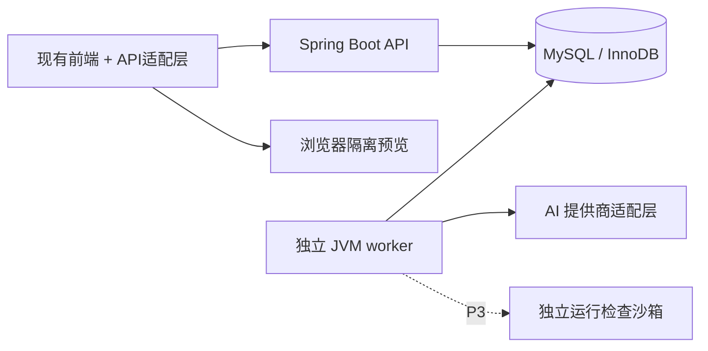

> 历史快照：2026-10-11 整理前的工作区内容，含当时未提交修改。仅供追溯，不是现行开发依据；当前入口见 [开发方案](../DEVELOPMENT.md)。

# 项目开发方案

版本：0.13 · 日期：2026-10-08 · 状态：P0 已完成工程启动、健康检查、统一业务响应基础、账户准备、登录凭据校验及内部数据库会话管理；登录 HTTP 与其他业务接口待开发。

## 阅读导航

- [1. 结论与设计依据](#1-结论与设计依据)
- [2. 范围与阶段](#2-范围与阶段)
- [3. 技术与架构](#3-技术与架构)
- [4. 业务与权限](#4-业务与权限)
- [5. 作业、草稿与评价规则](#5-作业草稿与评价规则)
- [6. 预览与运行边界](#6-预览与运行边界)
- [7. 受限式 AI 辅导（P2）](#7-受限式-ai-辅导p2)
- [8. 行为分析与个性化建议（P2）](#8-行为分析与个性化建议p2)
- [9. 首页、进度与消息口径](#9-首页进度与消息口径)
- [10. 前端接入方案](#10-前端接入方案)
- [11. 开发任务拆分与验收](#11-开发任务拆分与验收)
- [12. 运维、隐私与实施准备](#12-运维隐私与实施准备)
- [13. 参考资料与说明](#13-参考资料与说明)

## 1. 结论与设计依据

项目既定技术栈是 **Java / Spring Boot / MySQL**，后端采用模块化单体，先完成真实教学闭环，再接入受限 AI 辅导与可追溯的规则式学习分析。原生 HTML/CSS/JavaScript 前端可以继续使用，通过 API 适配层逐步替换示例数据。

当前 `backend/` 已实现 `GET /health/live`、`GET /health/ready`，接入 MySQL / Flyway 并建立学期、用户及会话表，完成公共响应、账户准备、凭据校验和内部会话管理，以及对应构建与真实数据库验证。登录 HTTP 及教学业务接口仍待开发。本文及配套[接口契约](2026-10-08_API.md)、[数据模型](2026-10-08_DATA_MODEL.md)是实施依据，已交付与待开发内容见[第 11.2 节](#112-实施进度与代码阅读)。

前端接入规则集中在[第 10 节](#10-前端接入方案)，历史决策保存在[架构评审归档](ARCHITECTURE_REVIEW.md)。模块化单体适合当前课程规模；并发、权限和预览隔离是否正确，必须由实现后的集成测试验证。开发过程中以接口契约定义对外字段、数据模型定义存储和事务，修改业务规则时同步三者。

### 1.1 当前页面对应的需求

| 前端依据 | 当前表现 | 后端需求 |
| --- | --- | --- |
| `website-prototype/src/learning-ui.js`：首页、课程、作业、邀请码 | 内存中的课程与任务，固定日期排序 | 课程成员关系、个人待办、截止规则、首页聚合 |
| `website-prototype/src/course-ui.js`：章节与资料 | Web 第三章样例，其他课程资料展开 | 教学班章节、资料、知识点及阅读进度 |
| `website-prototype/src/main.js`：实验室 | 只读代码、静态效果、运行/提交提示 | 草稿、编辑器、隔离预览、提交快照 |
| `website-prototype/src/main.js`：AI 区域 | 固定对话与两条提示 | 作业级辅导政策、会话、提示层次、预算与回退 |
| `website-prototype/src/main.js`：教师工作台 | 班级人数、提交数、求助数硬编码 | 教师授课范围、作业发布、批阅与聚合统计 |
| `website-prototype/src/records-ui.js`：记录、消息 | 固定评价、知识点状态及阅读状态 | 已发布评价、证据、建议、消息接收者与已读时间 |
| `README.md`、`docs/archive/UI_DESIGN_HISTORY.md` | 明确说明是视觉原型 | 接入时保留现有布局，分别处理加载、空数据和失败 |

“前端接口设计”在这里指页面需要的数据与操作。代码中尚无 `fetch` 等真实网络调用，不把页面函数直接当成已存在的 HTTP API。

### 1.2 设计假设

- 项目首先服务一个学校内的课程实践，按教师授课教学班隔离数据。
- 一名教师可负责多个教学班；学生可加入多个不同课程或学期的教学班。
- 第一版提供 HTML/CSS/JavaScript 文件作业，以及 SQL、文字答案的文本提交；类型枚举为 `web_lab/sql_text/text`。
- Java、Spring Boot 与 MySQL 是已确定的项目约束，不作为待选择的替代方案。JDK、框架与组件的具体兼容版本在 P0 核对并锁定；业务与接口设计以这一技术栈落实。
- 账户先由管理员导入/初始化，教师账号由管理流程赋予。公共注册、找回密码、学校统一身份认证属于后续范围。
- AI 服务通过提供商适配层接入，模型与密钥由服务端配置；本设计不绑定具体模型，不依赖训练模型或向量数据库。

### 1.3 技术选型依据

项目采用 **Java / Spring Boot / MySQL**，选型依据是教学业务、权限控制、数据一致性与当前实施范围。首版以模块化单体完成教学闭环，组件增加以明确业务需求或测量结果为依据。

| 判断因素 | 本项目情况 | 选型依据 |
| --- | --- | --- |
| 业务服务 | 课程、成员权限、草稿、提交、批阅与通知 | 使用 Spring Boot 组织业务模块，统一参数校验、身份认证与对象授权 |
| 数据存储 | 教学数据、作品快照、评价与通知需要一致提交 | 使用 MySQL / InnoDB 的事务、约束和行锁实现数据一致性，配合版本迁移维护表结构 |
| AI 辅导 | 调用外部模型 API，控制上下文、提示层次、预算与输出 | 使用 Java HTTP 客户端实现提供商适配，按兼容情况评估 Spring AI |
| 学习分析 | 从提交与教师评价计算可解释的规则式判断 | 在 Java 服务与 SQL 查询中实现，首版无需模型训练或独立算法服务 |

Spring AI 的对话调用与结构化输出能力可参考 [ChatClient 官方文档](https://docs.spring.io/spring-ai/reference/api/chatclient.html)和[结构化输出官方文档](https://docs.spring.io/spring-ai/reference/api/structured-output.html)。

P2 是否引入 Spring AI 按所选 Spring Boot / 模型提供商的兼容情况决定；通过普通 HTTP 实现适配层同样可行。若使用 SDK，逐次调用、超时、重试与用量记录仍遵循本文契约：不能让 SDK 的自动重试、结构化输出自我修正或工具循环绕过最多两次实际生成的限制。SDK 提供结构化结果不等于已满足受限辅导政策，业务审核仍由服务端负责。

首版实施重点与验证要求：

1. 完成可演示的教学闭环：教师发布、学生加入、编辑保存、提交、批阅、查看反馈；包括角色和对象权限。
2. 验证关键并发问题：双窗口保存冲突、提交幂等、冻结作品快照、评价与通知整体提交，记录触发条件、解决方案和测试结果。
3. 完成项目特色：受限 AI 的跨会话预算、失败恢复和教师评价驱动的学情分析，展示输出依据及边界案例。
4. 提供可重复启动、数据库迁移、集成测试和日志定位说明。查询或性能优化保留实际数据规模、方法、环境及结果；没有实测就不填写吞吐、并发量或提升百分比。

当前设计文档属于实施依据。阶段汇报应区分前端原型、已实现功能和待开发内容；功能完成情况以可演示结果与验收记录为准，具体任务及验收出口见[第 11 节](#11-开发任务拆分与验收)。

## 2. 范围与阶段

| 阶段 | 交付内容 | 验收出口 |
| --- | --- | --- |
| P0 基础 | 后端目录、配置、迁移、登录退出、权限、统一错误、健康检查、种子数据 | 学生、教师可登录；匿名访问、失效或撤销会话、角色入口越权与无效 CSRF 被拒绝 |
| P1 教学闭环 | 教学班与邀请、章节资料、任务发布、草稿、预览、提交、批阅、站内通知、首页、最小服务端事件 | 跨用户/教学班对象访问被拒绝；学生提交真实作品；教师评价与站内提醒同事务可见，刷新不丢数据 |
| P2 项目特色 | 作业级 AI 政策、分层辅导、教师求助、行为事件、知识证据和建议、共性问题 | 辅导受服务端规则约束，学习结论可追溯且不改变人工成绩 |
| P3 扩展 | 独立浏览器/SQL 检查沙箱、自动检查证据、队列扩容、SSO 等 | 检查与主服务隔离，资源受限，错误可恢复 |

P1 就应提供可编辑作业与浏览器隔离预览，但“预览”不能显示为“自动验收通过”。原型的“运行检查”在 P1 调整为“预览效果”；实际自动检查留到 P3。SQL 作业 P1 保存 `answer.sql` 并人工评价，不连接平台业务数据库执行。

P2 的 AI、行为和分析依赖 P1 已有任务、作品和评价；先有可靠教学事实，再展示分析。不会用示例值填充尚无证据的学习状态。

## 3. 技术与架构

### 3.1 技术栈与版本基线

| 层 | 选型 | 项目内用途 |
| --- | --- | --- |
| API | Java 21、Spring Boot 4.1.1、Spring MVC；后续加入 Spring Security、Jakarta Validation | Controller / DTO 校验、JSON 契约、会话与 CSRF、逐对象授权 |
| 存储 | MySQL 8.4 LTS / InnoDB、MyBatis、Flyway | 显式 SQL、行锁、教学数据、事务与版本迁移 |
| 构建 | Maven 3.9.16、Maven Wrapper 3.3.4、JDK 21 | 可重复构建，Wrapper 下载校验值进入仓库 |
| 会话 | 数据库中的不透明会话令牌 | 可注销、可撤销，避免把凭证长期存入前端存储 |
| 后台任务 | P2 起同一后端项目的独立 JVM worker + MySQL 任务表 | AI 调用、分析及检查；按任务类型决定是否可重试 |
| 文件 | P1 小型文本文件存 MySQL JSON | 3 个 Web 文件及 SQL/文字答案，简化备份与快照 |
| 部署 | 单机容器部署、同源反向代理 | `/` 前端、`/api/v1` 后端、数据库与 worker |
| 测试 | JUnit Jupiter 6（由 Boot BOM 管理）、Spring Boot Test、MockMvc；数据库阶段加入 Testcontainers MySQL | 权限、事务、并发、契约和 AI 回退；数据库测试使用真实 MySQL |

当前工程已锁定 JDK、Spring Boot、Maven 与 Wrapper 基线，加入 MVC、Boot 4 的 `spring-boot-starter-flyway`（含 JDBC/Hikari）、`flyway-mysql` 与运行时 MySQL Connector/J。Flyway 12.4.0、Connector/J 9.7.0、Testcontainers 2.0.5 和 Failsafe 3.5.6 由 Boot 4.1.1 的依赖管理确定；开发与数据库测试统一使用固定补丁镜像 `mysql:8.4.11`。首次用户查询已接入 MyBatis Starter 4.0.0（官方兼容 Boot 4.0+、Java 17+）；springdoc-openapi 随 API 文档功能核对兼容版本。使用 Spring Boot 的依赖管理并核对组件兼容表，不使用浮动的 `latest` 作为可重复部署依据。Boot 4 的 MVC 测试使用 `org.springframework.boot.webmvc.test.autoconfigure` 包，默认 JSON 使用 Jackson 3，后续自定义序列化配置须匹配实际依赖。OpenAPI / Swagger UI 由兼容所选 Spring Boot 版本的 springdoc-openapi 集成提供，并非框架内置能力。[Spring Boot 测试说明](https://docs.spring.io/spring-boot/reference/testing/spring-boot-applications.html)、[Spring Boot 数据库支持](https://docs.spring.io/spring-boot/reference/data/sql.html)、[MyBatis Starter 兼容表](https://mybatis.org/spring-boot-starter/mybatis-spring-boot-autoconfigure/)、[springdoc-openapi 官方说明](https://springdoc.org/)

P0/P1 由 API 和数据库完成闭环，站内消息只是数据库记录，随业务事务批量写入。P2 再运行数据库队列与 worker；将来通知规模或外部渠道需要异步投递时另行引入 outbox，不提前把站内反馈变成最终一致。这是本项目的规模取舍。

### 3.2 服务关系



API 处理认证、参数、权限和短事务；P2 起 worker 执行较慢的 AI/分析/检查工作。同一 Maven 项目、同一业务代码以 `api` 和 `worker` profile 在独立 JVM 中启动，worker 设置非 Web 应用模式，不监听 API 端口。任务领取、外部调用、结果发布分别处理：调用外部 AI 时不持有数据库事务锁；API 进程不执行这些长任务。worker 使用领取代次与条件更新，租约失效的旧进程不得覆盖新结果。

### 3.3 建议目录（后续实现时创建）

下列为完整阶段的目标目录，按功能逐步建立。当前已有启动入口、API 与数据库配置、`common/health` 存活及就绪检查、Flyway 学期与用户表迁移、`modules/auth` 用户对象与 Mapper、Web 与真实 MySQL 测试和 Wrapper；security 与 jobs 尚未加入。

```text
backend/
  pom.xml
  mvnw / mvnw.cmd / .mvn/
  src/main/java/com/learningplatform/
    LearningPlatformApplication.java
    common/            配置、统一错误、日志与时间类型处理
    security/          会话认证、CSRF、权限规则
    modules/
      auth/
      courses/
      assignments/
      submissions/
      feedback/
      notifications/
      tutoring/
      helprequests/
      analytics/
    jobs/              worker、任务领取、租约和重试
  src/main/resources/
    application.yml
    application-api.yml
    application-worker.yml
    mapper/            MyBatis SQL 映射文件
    db/migration/      Flyway V版本__说明.sql
  src/test/java/com/learningplatform/
  src/test/resources/
  .env.example
docs/                  本组设计文档
website-prototype/     现有前端
```

每个模块包含 Controller、输入输出 DTO、Service、Mapper 与持久化对象。Controller 接收与返回 DTO，不能直接暴露数据库对象；Mapper 使用参数绑定，不拼接用户输入为 SQL。跨表状态修改由 Service 层统一管理事务。API 和 worker 共用经过测试的业务规则，不让两处各自计算期限或权限。按业务包划分模块即可，首版无需拆成多个微服务或 Maven 子工程。

包组织采用“先按业务模块，再按职责分包”：正式业务模块按需建立 `controller/service/dto/mapper/model` 子包，只在有对应代码时创建。小型基础功能可以在同一功能包内保留多个职责类；当前 `common/health` 只有一个 Controller、一个检查 Service 和两个响应 DTO，保持同包便于阅读。职责分层由调用关系体现，不取决于是否分别建立目录；健康检查不需要空 Mapper 或数据库实体。

例如账户模块的目标结构为（目前已实现 mapper/model/service/bootstrap/dto，其他职责随功能加入）：

```text
modules/auth/
  controller/    HTTP 请求与响应
  service/       账户业务与事务协调
  dto/           请求、响应数据结构
  mapper/        数据库读写
  model/         持久化对象
  bootstrap/     显式启用的一次性本地初始化入口
```

组件仍放在启动类 `com.learningplatform` 的包及子包内。移动类时同步 `package`、`import`、测试引用和文档链接，运行已有相关检查；不依靠目录名代替组件注册或权限边界。

### 3.4 实施约定

- P0 锁定实际测试的 Java、Spring Boot、MySQL 与全部依赖版本；以 Spring MVC + JDBC / MyBatis 同步访问落实，不引入缺少需求依据的响应式链路。
- P0 为当前静态服务补充 `/api/v1/*` 到本地 `127.0.0.1:8080` 的固定代理；浏览器入口统一为 `http://127.0.0.1:4173`。当前 `serve.mjs` 只服务静态文件，未经改造会对 API 返回 404。
- `GET /me/config` 返回学期与能力开关；学期使用稳定 ID；配置列表展示字段为 `label`，课程 DTO 为 `termLabel`，不按自由文本判断同一学期。P1 的 AI、分析、服务端检查开关均为 false。
- 使用 springdoc-openapi 从 Controller / DTO 导出 OpenAPI，配合必要注解明确业务错误、枚举、幂等和分页约定；实际生成的版本进入仓库并进行契约差异检查。本文的示例应覆盖必填字段，接口不兼容变化不能只改一个页面或单份文档。
- 输入 DTO 使用 Jakarta Validation，并显式配置 Jackson 遇到未知字段时拒绝请求；Bean Validation 本身不负责拒绝未知 JSON 属性。金额式评分使用 BigDecimal 与 MySQL DECIMAL(6,2)，禁止浮点舍入误差及 NaN / Infinity；字段边界遵守接口契约。
- MyBatis 与 Spring 事务管理器必须使用同一 DataSource；写入服务使用 `@Transactional(isolation = Isolation.READ_COMMITTED, rollbackFor = Exception.class)` 或具有相同配置的 TransactionTemplate。连接池显式设置 `TRANSACTION_READ_COMMITTED`，不依赖 InnoDB 默认的 REPEATABLE READ。并发不变量仍需唯一约束与显式行锁，隔离级别不能代替这些规则。[MyBatis-Spring 事务说明](https://mybatis.org/spring/transactions.html)、[MySQL 隔离级别说明](https://dev.mysql.com/doc/refman/8.4/en/innodb-transaction-isolation-levels.html)
- Spring 默认使用代理拦截事务方法；事务入口使用由其他 Bean 调用的 public Service 方法，不能靠同类自调用让注解生效。受检异常也需整体回滚；不捕获并吞掉异常后继续提交。死锁/锁等待超时仅对文档允许的数据库短事务有限重试（最多重试 2 次），必须先结束旧事务，由外层协调器进入新的完整事务重新校验，外部 AI 调用不随数据库重试重放。[Spring 声明式事务说明](https://docs.spring.io/spring-framework/reference/data-access/transaction/declarative/annotations.html)
- Spring Security 负责请求认证链和角色入口限制，服务层继续验证教学班、作品与消息归属。请求认证过滤器验证契约中的不透明会话令牌，查验 `auth_sessions` 未过期且未撤销，并恢复本次 SecurityContext；退出撤销数据库会话，不以默认内存 HttpSession 代替可撤销会话。CSRF token 策略与同一会话及预登录流程对齐。过滤链中的认证、拒绝与 CSRF 失败由 AuthenticationEntryPoint / AccessDeniedHandler 写出统一 JSON 错误信封及 requestId，不能仅依赖 `@RestControllerAdvice`；Controller 内业务异常再由统一异常处理器转换，避免默认 HTML 登录跳转或两套错误格式。
- 数据库时间字段使用 UTC 的 `DATETIME(6)`，MySQL 会话 time_zone 固定 `+00:00`；Java API 使用 Instant / 带偏移时间解析，MyBatis 显式完成 UTC 映射，不依赖宿主机时区。截止判定按 5.2 的锁后独立时间查询执行。

## 4. 业务与权限

### 4.1 课程与教学班分离

`course` 表示课程基础，例如《Web 前端开发技术》；`course_offering` 表示“2026 秋季 · 计算机 2301 班 · 李老师”的一次开课。章节、知识点、作业、成员和分析都绑定开课实例 `offeringId`，同一课程不同班互不影响。

原型的 `web/db/design/network` 只作为种子数据的可读标识。真实对象使用 UUID；前端从 DTO 中拿到 `offeringId/assignmentId` 后生成自己的 hash 路由，后端不保存 `#lab` 等页面地址。

### 4.2 权限矩阵

| 对象/操作 | 学生 | 授课教师 | 管理员 |
| --- | --- | --- | --- |
| 教学班已发布章节、作业 | 本人已加入的班 | 自己授课的班 | 维护基本配置，不默认浏览私有作品 |
| 草稿、提交 | 仅本人 | 本班已提交作品；不默认读取未提交草稿 | 需审计的维护流程 |
| 评价 | 本人已发布评价 | 本班评价草稿与发布 | 需审计的更正/维护流程 |
| AI 对话 | 仅本人 | P2 默认只看摘要/求助中学生主动共享的片段 | 需审计的维护流程 |
| 学习记录 | 仅本人 | 本班学生证据与汇总 | 需审计的维护流程 |
| 通知 | 本人接收的消息 | 创建本班通知 | 系统通知 |
| AI 政策/作业发布 | 读取生效版本 | 维护本班 | 维护平台允许范围 |

平台 `teacher` 身份只是可创建教学班的资格；读取某个班仍需授课成员关系。邀请码只授予学生成员资格，不能提升为教师。后端逐次验证对象归属；切换到 `#teacher` 不改变身份。

教学班归档后统一停止章节/作业/内容修改、草稿保存、提交、评价发布、进度确认、求助和新辅导；保留本人/授课范围的历史读取以及本人消息标记已读。教学班或作业有当前待批阅提交时，归档返回 `ARCHIVE_PENDING_REVIEWS`，教师先处理提交。归档后不能靠仍为 published 的子作业继续写入。

所有教学写入在同一事务先持有教学班共享行锁；归档持有排他行锁后检查并更新状态。涉及作业的操作也使用对应父行共享/排他锁，避免“检查 active 后又被归档”的窗口。不同学生的普通保存可以并行，不能为每次自动保存排他锁住全班作业。具体锁顺序与模式见数据模型。

作业仅允许 published → archived；草稿不能通过归档公开。学生查询除状态条件外还必须满足 `published_at IS NOT NULL`，教学班归档不会改变其草稿的可见性。

### 4.3 邀请与选课

- 邀请码由服务端生成，不沿用 `WEB2026` 等示例值；数据库保存带服务端秘密的 HMAC 摘要，不保存可公开枚举的短明文。
- 可设置有效期、最大使用人数与撤销时间；不公开提供“查询任意邀请码对应课程”的接口。
- 加入时在事务内锁定邀请码并检查余量，成员表有唯一约束；并发重复点击不会重复入课或消耗名额。
- 已经是该班学生时返回现有成员关系，HTTP 200；新加入返回 201。无效、过期、撤销对未加入者统一显示“邀请码不可用”。
- 教师成员不能通过邀请码同时变成该班学生；访问失败、未加入和数据为空分别处理。

## 5. 作业、草稿与评价规则

### 5.1 状态分离

| 层 | 状态 | 含义 |
| --- | --- | --- |
| 教师作业 | `draft / published / archived` | 是否对学生可见、是否允许新操作 |
| 学生作业 DTO | `NOT_STARTED / IN_PROGRESS / SUBMITTED / REVIEWED` | 未编辑、已有草稿、已有有效提交、当前提交已发布评价 |
| 评价 | `draft / published` | 学生是否可以看到成绩与反馈 |

`assignmentState` 从草稿、当前有效提交和已发布评价派生，不接受前端写入。P1 不提供“退回修改”状态；教师可建议练习，正式返工流程后续再增加，避免未定义状态进入接口。

- 待完成 `todo` = 教学班 active、作业 published，且状态为 `NOT_STARTED + IN_PROGRESS`。归档未完成项目只在历史/all列表显示，不推荐为当前任务。
- 已完成筛选 `done` = `SUBMITTED + REVIEWED`（含归档历史），页面分别显示“已提交”“已评价”。已提交不等于已掌握。all列表额外包含已归档未完成项，计为 archivedIncompleteCount，不能强行改成已完成。
- DTO 的 `overdue = now > dueAt 且状态属于 todo`；某次提交的 `late = submittedAt > dueAt`，两者用途不同，数据库对应 `is_late`。
- 截止时间统一为带时区时刻，数据库 UTC；UI 使用 `Asia/Shanghai`。若教师输入某天，界面明确默认是该日北京时间 23:59:59，转换后再保存。

### 5.2 补交与重交

作业字段包含 `dueAt`、`lateUntil`、`allowResubmit`、`maxAttempts`。

- `lateUntil=null` 表示禁止补交；允许补交必须指定晚于 `dueAt` 的截止时刻。
- 服务端取得必要锁后，在同一事务发出**另一条独立 SQL** `SELECT UTC_TIMESTAMP(6)`，只取一次，用于窗口校验、`submittedAt` 和 `late`。MySQL 的当前时间函数取语句开始时间，不能放在可能等待锁的 SELECT / UPDATE 语句中当作锁后时间。等锁跨越截止时按独立查询取得的时刻判定；幂等重放沿用原结果。提交数最多 `maxAttempts` 次；客户端时间不能延长期限。[MySQL 日期与时间函数](https://dev.mysql.com/doc/refman/8.4/en/date-and-time-functions.html)
- `allowResubmit=true` 时，未发布评价之前可提交新版本；旧版保留但成为 `superseded`，教师待批阅列表只显示当前版。
- P1 当前提交已经发布评价后禁止重交，返回 `RESUBMIT_AFTER_REVIEW`；教师建议通过下一项作业/练习落实。
- 归档作业可继续看历史，不能再保存、提交、开启新辅导或发布新的评价；已存在通知和结果仍可读取。

章节默认 draft；教师通过独立发布接口公开章节及其有效资料。学生章节目录只返回已发布章节，教师维护接口可读取草稿。作业关联章节时，发布作业需该章节属于本班且已发布；未关联章节的课程级作业允许独立发布。

### 5.3 草稿并发与提交快照

工作区按 `(studentId, assignmentId)` 唯一。读取返回 `revision`；保存全量文件时带 `baseRevision`。只有版本相等才成功并加一，否则返回 409 `WORKSPACE_CONFLICT`，前端保留本地编辑并提示重新加载或比较，不能静默覆盖。

- Web 作业仅允许 `index.html/style.css/script.js`，SQL 为 `answer.sql`，文字为 `answer.md`；任务模板包含文件清单。
- 默认每文件不超过 100 KiB UTF-8，总量不超过 256 KiB；不接受二进制、压缩包、任意路径或文件系统路径穿越。
- 自动保存建议编辑后 1.5 秒防抖；同一工作区最多一个在途保存，后续修改合并成下一次。前端分别跟踪本地编辑序号和服务端 revision，旧应答只确认对应版本，不能覆盖新编辑。
- 提交引用服务器已保存的 `workspaceRevision`；服务器复制文件、反思说明、任务要求、量表与政策版本，生成不可变快照。
- 保存、提交与教师发布按固定顺序锁定作业、该学生工作区/当前提交，避免评价发到刚被替换的旧提交。
- 提交要求 `Idempotency-Key`。相同用户、路径、键、请求体返回同一提交；相同键不同请求体返回 409，不能重复创建或占用次数。

学生提交后继续编辑草稿不会改变已提交作品。教师评价绑定 `submissionId`，不是绑定不断变化的工作区。

点击提交时冻结本次编辑内容，等待该内容保存成功后，再提交返回的 revision。保存失败、未知结果或409冲突时停止提交。网络中断重试保留原幂等键；切路由后旧请求不得重绘新页面。详细保存状态机与账号隔离见前端接入设计。

截止或已评价后可以保存草稿用于练习，状态不倒退，正式提交仍受窗口和重交规则约束；只有作业/教学班归档后停止新的草稿写入。工作区响应提供 `canSave/saveBlockedReason`，使界面能区分练习和提交。

### 5.4 教师发布与批阅

作业草稿包含任务要求、文件模板、关联知识点、截止规则、满分与量表。发布时验证同班关联和量表总分，冻结 `contentVersion` 对应的要求/量表快照。

发布后可以延长截止/补交窗口、修改非评分性质的提示说明并留下审计；不能原地改变要求、满分、量表、模板或核心知识点。需要实质改变时新建作业。教师发布新 AI 政策版本可立即生效，但提交保留当时政策版本。

评价先保存草稿，带 `baseVersion` 做乐观锁；发布时确认提交仍是当前版，成绩不超满分，量表评分合法。**评价发布、P1服务端事件、反馈通知及本人接收记录在同一数据库事务内写入；P2再加入知识证据更新**。消息生成有唯一业务来源键，重放不会增加提醒。学生只见已发布版本。

P1 已发布评价不可再通过草稿接口修改。需要更正时先由教师确认，通过审计管理流程处理；面向用户的评价修订工作流后续单独设计。数据保留公开快照和版本，避免学生看到尚未确认的变动。

这项范围限制必须在教师发布前说明。P1 可用于演示和小范围试用；正式承担教学计分之前，必须补齐并验收保留旧版、修改原因和操作者的成绩更正流程，不能把直接修改数据库作为日常批阅功能。

## 6. 预览与运行边界

P1 浏览器将三个文本文件组成预览文档，通过受限 `iframe` 运行学生 HTML/CSS/JS。

- 使用没有 `allow-same-origin` 的 sandbox；按作业需要仅允许 `allow-scripts`。
- 预览不允许表单提交、弹窗、顶层跳转、下载和平台 Cookie/存储访问。
- 可信预览模板先设置 CSP，再装配学生内容；设置 `default-src 'none'`、`connect-src 'none'`、`base-uri 'none'`、`form-action 'none'`、`object-src 'none'`，按预览实现仅放行必要的本地组合脚本/样式。阻断受支持的 fetch/子资源通道；这不构成任意 JavaScript 严格零外网的保证。P1 不支持外部 npm 包/CDN。
- 不向预览窗口发送登录态、API 密钥或私有教学数据；消息桥校验 `event.source` 与每次预览随机标识及白名单格式，不能仅信任不透明来源的 `origin='null'`，也不能提供平台 API 代理。
- 浏览器 sandbox 不是 CPU/内存配额机制；死循环仍可能影响浏览器。提供重置预览，不将它当成可执行任意语言的服务器隔离方案。

这些限制需真实联调验证，不能仅凭 iframe 标签宣称安全。MDN 对 sandbox 权限及组合风险有说明。[MDN iframe 文档](https://developer.mozilla.org/en-US/docs/Web/HTML/Reference/Elements/iframe)

组合预览只解析/重写三个允许文件的本地引用，移除学生的 base/meta refresh、外部引用和嵌套frame；不要直接拼接可提前闭合 script/style 的任意文本。平台HTML/API响应设置合适的CSP `frame-ancestors 'none'`，禁止被预览导航后嵌入。CSP资源限制与导航隔离是不同边界，真正可保证的无外网执行放在P3的网络出口隔离中。[MDN CSP说明](https://developer.mozilla.org/en-US/docs/Web/HTTP/Reference/Headers/Content-Security-Policy)

P3 自动检查由独立 runner 消费提交/检查快照。它使用临时环境、无平台数据库或密钥、无外网、只读基础文件、资源配额、超时与清理。Web 可以在隔离浏览器的多个视口检查布局；SQL 使用一次性练习库。API 进程不 `eval/exec` 学生代码。

检查结论注明 `checkerVersion`、`submissionId/workspaceRevision`、规则和失败原因。基础设施超时标为 `error`，不能记为学生测试失败。客户端“我运行成功了”仅是行为报告，不是可信检查证据，也不能直接给成绩。

## 7. 受限式 AI 辅导（P2）

### 7.1 作业政策

`ai_policy` 是不可变版本，作业指向当前生效版本。P1 政策版本为空，接口 `aiPolicyVersion=null` 且 AI 未开放；P2 为既有已发布作业配置并启用版本。默认“引导模式”：

| 规则 | 默认建议 |
| --- | --- |
| 允许能力 | 概念解释、排错方向、引导提问、验证思路 |
| 提示层次 | 1 观察问题；2 指向相关概念/步骤；3 让学生验证自己的修改 |
| 核心答案 | 禁止生成完整可提交实现，默认禁止代码块 |
| 解锁要求 | 第二层开始需要学生描述实际尝试；新建会话不重置作业提示进度 |
| 预算 | 初始配置：每用户每日 30 次、每作业每日 12 次、每分钟 3 次；可按演示需求调整 |
| 上下文 | 本人本作业最近 8 轮已审核对话、当前代码上限 16 KiB、教师公开要求和知识资料 |
| 回复 | 最多 800 个输出 token；30 秒提供商超时；最多一次受控重新生成 |

服务端决定提示层次、允许模式和上下文。客户端仅发送 `ask/concept/next_hint`、问题、实际尝试和可选工作区版本；不接受自定义系统提示、角色、答案开关或指定层次。

跨会话共享 `(studentId, assignmentId)` 的最高已交付提示层次、预算和披露历史；该学生该作业最多一个 queued/running 请求。提示进度独立于工作区，问AI不会创建一份假保存草稿。达到层次上限仍可澄清概念，但 next_hint 不再升级。

| 动作 | 服务端目标层次 | 成功交付后的进度 |
| --- | --- | --- |
| ask | 已交付最高层，尚无历史时为1；不因多问一次自动升级 | completed后记已交付层；失败不变 |
| concept | 1，提供基础概念 | 不降低既有最高层 |
| next_hint | 最高层+1，初次为1；超过政策上限返回 HINT_LIMIT_REACHED | 仅completed后推进，fallback/failed不推进 |

任何达到 `requireAttemptFromLevel` 的请求需提供实际尝试描述。上下文按同学生同作业跨会话选最近已审核交付历史及服务端披露摘要，不仅取当前会话8轮。历史正文到期后暂停继续升级，返回固定知识卡或教师求助，不能把历史清空当成重新开放完整答案的机会。

### 7.2 一次辅导请求的流程

1. 验证登录、选课关系、作业可辅导、会话归属、幂等键与请求大小。
2. 原子预占预算；按模型顺序锁定该学生的独立 `ai_budget_locks` 行（FOR UPDATE）及作业级进度，不排他锁住 users 行。同一学生同一作业最多一个未完成请求，重复幂等请求返回已有任务，并在事务中记录学生消息。预算锁行在 P2 迁移时回填、创建学生时预建；发现缺行时在进入教学事务之前另开短事务补建，不能持有父对象锁后临时补建并反向取得用户外键锁。活动请求唯一性由 MySQL 可空生成列与唯一索引落实，具体 DDL 见数据模型。
3. 读取服务端政策与本人保存版本，创建 `tutoringRequest` 和后台任务，返回 HTTP 202。
4. worker 检查请求意图；索要完整答案或明显注入可直接走规则模板回退。
5. 构造分隔的政策和不可信内容，只带公开知识、本人作品和必要历史；不检索参考答案或他人作品。
6. 调用提供商适配层，每次真实调用有独立attempt记录，先持久化启动状态再调用，最多两次。解析有限字段的结构化响应；没有结构化能力时也必须经过服务端解析校验。
7. 校验模式、层次、代码块/整份实现、提示长度与累计泄漏风险；至多重生成一次，仍不合规则返回固定引导模板。
8. 分开保存生成政策与审核政策。最终发布的短事务持有班级/作业共享锁，确认审核政策仍是当前版本、成员有效，且领取代次仍有效；不符则重新审核或结束为固定回退/失败。
9. 同事务保存唯一助手消息、已审核结果、已交付层次及任务终态。过期worker和终态请求不接受迟到覆盖；客户端轮询结果并展示，首版不流式输出未审核内容。

失败结果必须区分模型不可用、预算不足、政策回退和系统错误。`fallback` 表示实际提供了明确的安全模板，不能伪装成模型已生成个性化回复；`failed` 不含可展示答案。对结果未知的外部超时不盲目重试，避免重复费用。

只靠提示词或关键词过滤不能保证永远不泄漏答案。首版用低代码/无代码输出、分层规则、上下文权限、输入输出检查与固定模板降低风险；若要求严格可证明的“不给答案”，使用预先审核的知识卡/提示模板模式，关闭自由生成。相关风险与分层防护可参考 OWASP。[OWASP 提示注入防护](https://cheatsheetseries.owasp.org/cheatsheets/LLM_Prompt_Injection_Prevention_Cheat_Sheet.html)

### 7.3 AI 验收与权限

- 测试直接索要完整代码、扮演教师、忽略规则、代码注释注入、多轮拆解答案、重复建会话、并发请求和政策更新。
- 每种违规用例应返回约束内提示或固定回退；记录违规率、回退率、延迟和用量，保留测试样例作为回归集。
- 模型不执行工具、不访问文件系统、不代替学生提交、不直接评分或写能力结论。
- API 密钥只在服务端环境中；日志不记录密钥、Cookie、完整学生代码或整段聊天正文。
- 教师求助记录可以由学生主动附上自己的代码版本或已审核对话片段，服务端再次验证归属。

## 8. 行为分析与个性化建议（P2）

### 8.1 事件来源与可信度

| 来源 | 示例 | 用途 |
| --- | --- | --- |
| 客户端报告 | 章节打开、编辑器打开、预览打开、活跃心跳 | 使用路径、可解释的活动概览 |
| 服务端事实 | 草稿成功保存、有效提交、已发布评价、AI 请求完成、求助创建 | 可靠次数、状态和证据关联 |
| P3 检查事实 | 特定规则的通过/失败，含检查版本 | 可引用的辅助知识证据；不能替代人工成绩 |

客户端事件批量不超过 50 条，包含 `eventId/sessionId/occurredAt`、教学班及可选作业，用户 ID 从会话获得。去重、白名单字段、对象归属与时间偏差校验；接收时间另存。事件不能设置成绩、进度、提交状态或冒充服务端事件。

活跃心跳建议前台且有近期操作时每30秒一次。先在同一 `(userId,sessionId,offeringId,activityTarget)` 内按合法时间形成相邻心跳间隔≤60秒的区间，再按用户取并集去重；不同窗口各一次心跳不能被拼成一个区间。课程统计只累计明确归属本班的区间；不累计首次之前、末次之后和离线空档。标为“估计活跃时长”，不证明真实注意力，也不进入评分。

### 8.2 知识点状态规则 knowledge-v2

已发布教师评价通过 `knowledgeEvaluations` 关联知识点；每条结果是 `meets_expectation / needs_practice / insufficient_evidence`，附说明和作品来源。未发布评价、AI 猜测和客户端事件不作为掌握判断。

对同一学生、教学班、知识点，按时间选最近三个**不同作业**的当前有效证据，规则依次判断：

1. 最新教师结论为 `insufficient_evidence`：显示“证据不足”，说明需要哪种表现；不能等同于未掌握。
2. 最新教师结论为 `needs_practice`：显示“需要巩固”。
3. 最新结论为 `meets_expectation` 且最近三个不同作业至少两个符合要求：显示“基本掌握”。
4. 其余情况下有未完成且 IN_PROGRESS 的关联任务：显示“正在学习”。
5. 其他情况显示“证据不足”；仅一次合格历史证据说明“已有一次符合要求记录，尚需另一项任务佐证”，不能永久显示正在学习。

按证据时间加ID作稳定排序，返回 `ruleVersion:'knowledge-v2'/asOf/evidenceIds/latestEvidenceAt/evidenceCount/freshness` 和解释。asOf只是计算时刻；freshness在无证据时none、最近证据距asOf≤90天为fresh、否则stale。历史基本掌握仍显示证据日期和“历史证据”，不自动抹去教师结论，也不作为当前测量。stale时建议补充可访问任务证据；阈值是待教师校准的规则初值，不宣称教育测量准确性。P3加入检查证据需发布新规则版本。

### 8.3 建议与教师共性问题

建议按规则生成：优先处理最近需要巩固的知识点，再关联本班已发布且可访问的资源或未完成任务；无新任务时提示复习，不虚构独立练习。返回 `reason/evidenceIds/targetType/targetId`。没有足够证据就明确说明。

教师共性问题来自有标签的已发布评价、学生求助，以及P3可信检查规则。分别返回 reportedStudentCount（学生自报）、confirmedStudentCount（教师/可信规则确认）、distinctStudentCount（两集合并集），同一学生不重复计总人数。说明来源与时间范围；自报不能当成已确认问题或掌握证据，不能从P1文本作业推断“9人窄屏溢出”。

P2 评价/求助可附 `issueTags`，只能选择服务端配置的教学班问题词表。标签是教学问题描述，不是分数；初始词表如 layout_overflow、flex_alignment、box_model，由配置初始化，返回词表版本，不用学生或模型自由生成的字符串聚合人数。

AI 次数、求助次数、页面时长用于教学支持，不直接扣分，也不作为“能力弱”的结论。成绩由教师确认；P2 规则输出是学习证据摘要，不是模型训练结果或准确率承诺。

## 9. 首页、进度与消息口径

### 9.1 统一派生

- 首页 `currentLearning` 按待完成任务截止时间升序，稳定用 ID 打破平局；无待办时返回最近学习教学班的章节，均没有时返回 `null`。
- P1由 `POST /me/learning-position` 确认用户实际打开的章节/任务，服务端验证归属后更新 last_chapter_id/last_studied_at；预取GET不改学习位置。当前章节按最近可读章节→首个未完成已发布章节→首个已发布章节→null选择。章内任务可更新其章节，独立任务不覆盖最后章节；这类记录不产生掌握证据。
- 课程 `progressUnit` 可为 `chapter` 或 `assignment`；章节完成是学生确认“已阅读”，实验完成是首次有效提交。两者都不代表掌握。
- 分母分别为本班已发布的必修章节或必做作业，排除草稿、选做和已撤销条目。新增内容会改变分母，接口返回当前计算时间。
- `percent = round(completed / total * 100)`，正数 .5 向上；`total=0` 时返回 0 和 `notConfigured=true`。原型 `5/8=62%` 是示例，真实计算应为 63%，`1/8` 为 13%。
- 学习记录 `completedLabCount` 仅统计实验类有效提交，不混入 SQL/文字作业；“教师评价数”统计当前已发布评价，不重复计数。
- 教师提交进度分子按至少一次有效提交的不同学生数；待批阅按当前有效提交且没有当前已发布评价计算，不累计已替换版本。

### 9.2 消息与反馈

通知内容与接收者状态分表；按用户记录 `readAt`。公告面向发布时的当前学生成员，后续加入者从课程公告读取，不追发旧个人提醒。

教师反馈新消息由 `feedbackId + publishedVersion + studentId` 唯一识别。评价重复发布请求不能产生重复消息；课程未读反馈按不同当前 `feedbackId` 统计。后续若增加评价修订，需同时定义旧消息替代与证据更新规则，P1 不提供此工作流。

消息列表/反馈页面读取本身不修改已读状态，前端在成功展示内容后显式调用本人消息标记已读接口。P1 不提供批量删除消息，避免丢失审计链。加载失败返回错误，不显示成“0 条消息/0 门课程”。

学生已发布 FeedbackDTO 带本人 `messageId`，便于从学习记录进入反馈后标记消息；教师侧与评价草稿为null。P1发布与消息同事务完成。较晚加入学生通过教学班公告列表读取既往公告，不依赖个人收件箱。

## 10. 前端接入方案

原独立前端接入文档已完整并入本节，统一维护路由、状态、保存、预览与联调规则。以下均为后续实施任务；现有页面仍使用示例数据。真实模式不依赖 scenario、固定示例日期或样例邀请码，原型预览作为明确标识的独立演示模式保留。

### 10.1 实施原则与原型依据

继续使用原生 HTML、CSS、JavaScript，先拆分职责并完成 P0/P1，不以迁移 React 等框架作为前置条件。保留现有视觉布局、键盘操作和响应式行为，逐页替换样例状态。

| 原型位置 | 当前行为 | 接入时必须完成的改造 |
| --- | --- | --- |
| `website-prototype/src/main.js:29` | hash 只解析两段，每次导航重建整页 | 路由解析完整路径；读取与编辑状态移出 DOM |
| `website-prototype/src/main.js:21–24` | 只读代码、静态预览和演示提交 | 按作业类型编辑文件、保存、预览和提交 |
| `website-prototype/src/main.js:26` | 教师统计写死，操作按钮仅提示 | 真实教学班选择、作业编辑、提交列表与批阅表单 |
| `website-prototype/src/learning-ui.js:6–23` | 内存选课、固定任务和日期 | API 课程/任务数据，服务端期限与计数 |
| `website-prototype/src/learning-ui.js:87–118` | 任务详情与列表；SQL 无编辑入口 | 所有作业类型进入同一草稿和提交流程 |
| `website-prototype/src/course-ui.js:6–22` | 固定章节与样例资料 | 教学班目录、可切换章节、真实资料与阅读进度 |
| `website-prototype/src/records-ui.js:9–44` | 学习记录固定为 Web 课程 | 教学班选择、公开评价、阶段明确的证据与建议 |
| `website-prototype/src/records-ui.js:51–71` | 固定消息与阅读标签 | 本人消息分页、详情跳转及显式标记已读 |
| `website-prototype/scripts/serve.mjs:14–17` | 仅提供首页与 `/src/`，API 路径返回 404 | P0 加入受限的本地 API 代理 |

以上行号定位评审时原型；实现后按函数与模块继续追踪。教师/学生视角切换、样例邀请码和 `scenario` 参数均不作为真实权限或业务数据来源。

### 10.2 模块职责

建议在 `src/` 下拆分以下职责，文件名可随实现调整；页面不各自实现登录、CSRF、保存和错误处理。

| 模块 | 负责 | 边界 |
| --- | --- | --- |
| `api.js` | 同源基础地址、JSON 信封、Cookie、CSRF、请求标识、错误与取消请求 | 只返回数据或结构化错误；网络失败不能转换成空数组 |
| `auth-store.js` | `/me` 身份、登录退出、会话恢复、`/me/config` 配置 | 角色与能力来自服务器；不在浏览器存会话令牌 |
| `learning-store.js` | 按用户、教学班和资源 ID 保存数据及 `idle/loading/success/error` | 列表与详情分开；提交、发布、已读后更新相关缓存 |
| `router.js` | 完整路径解析、参数校验、角色入口、返回路径、导航生命周期 | 客户端守卫改善体验，服务端仍校验每次权限 |
| `workspace-controller.js` | 本地文件、保存队列、版本冲突、提交前保存及恢复 | 按 `(userId,assignmentId)` 隔离；不依赖页面节点保存正文 |
| `safe-render.js` | 普通文本、属性和受控 Markdown 的安全渲染 | 统一处理 API 内容；不把学生代码当平台 HTML |
| `preview.js` | Web 作业预览文档、沙箱与受限消息桥 | 不持有会话、私有课程上下文或调用 API 的能力 |
| 页面模块 | 读取状态、渲染内容、将用户操作交给上述模块 | 不从中文标签、DOM、颜色或按钮可见性推断业务状态 |

登录后读取 `GET /me/config` 的 `currentTermId`、`terms` 和 `features`。筛选和请求使用稳定 `termId`；配置列表用 `label` 展示学期，课程 DTO 用 `termLabel`；不把“2026 秋季学期”等展示文字当主键，也不写死学期。功能入口同时受阶段配置和真实权限约束，完整字段以接口契约为准。

API DTO 中的英文枚举映射为中文展示。`overdue`、`canSubmit`、`submissionBlockedReason`、`canSave`、`saveBlockedReason` 由服务端判定；前端可显示倒计时，不能自行延长提交窗口。分页计数使用服务端 `summary/total`，不能用当前页长度代替全量人数或未读数。

### 10.3 P0 本地启动与代理

浏览器入口固定为 `http://127.0.0.1:4173/`，Spring Boot 服务在 `http://127.0.0.1:8080/`。浏览器只请求前端同源的 `/api/v1/*`；前端开发服务转发到固定后端地址。

P0 需修改 `scripts/serve.mjs`，在静态路径允许列表之前处理 API 前缀，并满足：

1. 只转发 `/api/v1/` 前缀及其子路径到预配置的 `127.0.0.1:8080`，保留查询参数；不接受浏览器传入任意上游 URL、主机或协议。
2. 保留 HTTP 方法、请求正文、`Content-Type`、Cookie、CSRF、幂等键及请求标识。按 HTTP 代理规则移除逐跳头，不把静态读取逻辑用于请求正文。
3. 保留后端状态码、错误正文及全部 `Set-Cookie`；不能把后端 401/409/422 改成 200 或前端 HTML。代理连接失败返回可识别的服务不可用错误。
4. 后端开发配置允许实际浏览器 Origin `http://127.0.0.1:4173`；代理不能伪造合法 Origin 掩盖非法请求。开发 Cookie 为该站点可用的配置，生产启用 HTTPS 与 Secure Cookie。
5. 为连接、正文与响应设置合理大小/时间限制，关闭连接时正确结束上游请求；不自动重放业务写请求。健康检查可直接访问后端 `/health/live`、`/health/ready`。

真实联调必须通过 HTTP 服务运行。README 中“直接打开 index.html”仅适用于保留的演示模式，不能用于真实 Cookie 会话。`npm run dev` 与 `npm run preview` 的 API 代理行为应一致；部署环境由同源反向代理提供相同路径，不依赖开发代理对外开放。

P0 验收至少包括：匿名 CSRF → 登录设置 Cookie → `/me` 返回身份 → 携带 CSRF 的写请求 → 退出清除 Cookie，以及代理透传 401/409/422 和后端不可用响应。

### 10.4 页面、路由与读路径

路由参数是服务端 UUID。解析完整路径后再匹配路由；不能沿用 `split('/')` 后仅取前两个元素的实现。浏览器刷新可直接恢复详情，不要求先进入列表建立内存状态。

| 路由 | 页面与阶段 | 主要读取 / 操作 |
| --- | --- | --- |
| `#login` | 登录，P0 | 匿名 CSRF、登录；成功后验证并恢复站内返回路径 |
| `#home` | 学生首页，P1 | `/me/dashboard`，课程、待办、公开反馈、公告摘要 |
| `#course` | 我的课程，P1 | `/me/courses`、邀请码加入；按学期/状态筛选 |
| `#course/{offeringId}` | 课程入口，P1 | 教学班详情与章节目录；按服务端章节恢复信息进入章节 |
| `#course/{offeringId}/chapter/{chapterId}` | 章节，P1 | 章节详情、资料、章内作业、阅读进度；校验归属 |
| `#resource/{resourceId}` | 资料，P1 | `/resources/{resourceId}`；从响应恢复课程与章节上下文 |
| `#assignments` | 个人作业，P1 | `/me/assignments` 的班级、状态筛选和分页 |
| `#task/{assignmentId}` | 作业要求，P1 | 作业详情、正式提交限制和最近提交入口 |
| `#lab/{assignmentId}` | 作业编辑，P1 | 工作区读取/保存/提交；按 `type` 选择编辑模式 |
| `#submission/{submissionId}` | 本人提交详情，P1 | `/submissions/{submissionId}`，不可变文件、反思和公开评价 |
| `#feedback/{feedbackId}` | 本人公开评价，P1 | `/me/feedback/{feedbackId}`，成功展示后标记对应通知已读 |
| `#progress/{offeringId}` | 学习记录，P1/P2 | `/me/learning-records?offeringId=...`；P2 再显示知识分析 |
| `#messages` | 消息中心，P1/P2 | `/me/messages`、标记已读及全部已读 |
| `#notices/{offeringId}` / `#notice/{noticeId}` | 课程公告，P1 | 课程公告列表与详情，支持晚加入成员读取 |
| `#help-request/{id}` | 本人求助详情，P2 | `/me/help-requests/{id}`、教师回复 |
| `#teacher` | 授课教学班选择，P1 | `/teacher/offerings`；显示本人授课范围 |
| `#teacher/offerings/{id}` | 教师工作台，P1 | 班级统计、成员、章节、资料、作业、公告和邀请 |
| `#teacher/assignments/new/{offeringId}` | 布置作业，P1 | 班级章节/知识点；建立草稿后进入草稿详情 |
| `#teacher/assignments/{id}` | 作业编辑与提交列表，P1 | `/teacher/assignments/{id}`、提交列表、发布及归档 |
| `#teacher/review/{submissionId}` | 批阅，P1 | 提交快照、学生信息、草稿评价；保存 draft 后显式发布 |
| `#teacher/help-request/{id}` | 求助处理，P2 | 教师求助详情、回复和关闭；包含提问学生身份 |
| `#teacher/offerings/{id}/students/{studentId}/progress` | 学生学习记录，P2 | `/teacher/offerings/{id}/students/{studentId}/learning-records` |

`#progress` 等无上下文入口先提供教学班选择，不能隐式固定 Web 课程。章节恢复采用服务器持久化指针和回退规则；浏览器缓存只改善加载速度，不成为唯一恢复来源。

反馈详情按 `feedbackId` 直接读取，不扫描分页列表寻找。`FeedbackDTO` 的 `offeringId/assignmentId/assignmentTitle` 支持课程上下文、卡片标题和作业跳转。教师草稿详情使用教师专用接口，批阅使用提交时冻结的要求、量规与知识点，不从当前工作区读取待评价代码。

消息 `target` 是受控资源描述，路由由前端映射：`offering/chapter/resource/assignment/feedback` 对应上表页面；P2 的 `help_reply` 消息使用 `target.type:'help_request'`。不能将接口返回字符串直接当作任意 URL。归档对象显示只读状态；无法访问的目标显示明确提示并保留返回消息入口。

参数缺失或格式错误显示有效选择入口；404 显示对象不存在或不可访问；403 显示权限不足；401 进入会话恢复；归档显示历史内容及操作限制。前端不能通过名称、顺序或上一页残留状态猜测资源 ID。

### 10.5 编辑、自动保存与提交

Web 编辑 `index.html/style.css/script.js`，SQL 编辑 `answer.sql`，文字编辑 `answer.md`，文件清单由作业类型与模板决定。SQL/文字采用相同的版本、保存、提交与反馈流程；P1 不显示 Web 预览，也不执行 SQL。Web 的 P1“预览效果”不显示为“运行检查通过”。

每个工作区至少维护 `localFiles`、`activeFile`、`localEditSeq`、`lastSavedEditSeq`、`serverRevision`、`inFlightSave` 和保存错误。`localEditSeq` 只表示本地编辑次数，`serverRevision` 只来自服务端，两者不能互相代替。

1. 首次 GET 工作区成功后建立编辑状态。加载失败不显示空模板覆盖已有内容；未保存模板的 revision 为 0。
2. 编辑后增加 `localEditSeq`，约 1.5 秒防抖。每个工作区最多一个保存请求在途；请求冻结当时的文件、活动文件、编辑序号和 `baseRevision`。
3. 保存过程中继续编辑只更新本地状态，合并为下一次保存，不并发发送相同 revision。成功响应更新 `serverRevision` 和对应的已确认编辑序号，不能用响应中的旧文件覆盖较新的本地编辑。
4. 仅当当前编辑序号已获确认且没有待保存内容时显示“已保存”。否则继续显示“未保存/保存中”；网络失败不能提前显示成功。
5. 409 保留本地文件并暂停自动保存，读取服务器版本供用户比较、合并或明确选择恢复。不能直接获取更大 revision 后重试覆盖。
6. 超时或断线时，服务端可能已保存。恢复后先查询工作区核对 revision 与已发送快照；确认结果前不盲目重放。服务器出现无法解释的更新时进入冲突流程。
7. 点击正式提交后，冻结本次待提交内容与反思，暂时禁止改变该内容，取消防抖并等待在途保存及最新内容保存成功。任一保存失败或冲突均停止提交。
8. 使用刚确认的 `workspaceRevision` 发送提交，保留同一 `Idempotency-Key` 和相同请求正文用于不确定结果的重试；用户修改后再次提交属于新操作。不能以旧 revision 的成功替代当前编辑提交成功。
9. 提交成功后展示不可变提交详情并刷新作业状态、待办和进度。恢复编辑后产生的草稿不改变已提交作品；截止或已评价后的练习保存与正式提交分别控制。

反思仅随正式提交保存，P1 工作区自动保存仅覆盖文件；界面不得将尚未提交的反思标为已保存。未提交反思按下面的身份隔离规则保留在当前内存中。

切换文件从内存读取各文件当前内容，不通过替换代码区域丢弃未保存修改。路由导航前若存在未保存或结果不确定的写入，提供等待保存、留在页面或明确放弃本地修改的操作；浏览器关闭/刷新可用离开提醒补充，不能依赖关闭事件里的异步请求确保落库。

会话失效暂停写入并在内存保留恢复状态。重新登录后必须确认仍是同一 `userId`，再读取服务端版本并恢复；不同用户登录、明确退出时清除旧用户数据和待发送请求，不自动把上一用户的代码、反思或求助发给新用户。内存保护不承诺关闭浏览器后仍能恢复未保存编辑。

### 10.6 请求生命周期与缓存一致性

每次导航或筛选建立新的 `generation`，请求关联当前用户、路由和资源键。离开时取消不再需要的读取与轮询；响应落入状态前核对 generation 和用户，较旧响应不能覆盖当前页或新登录用户的数据。

取消客户端请求不代表服务器撤销写入。写入成功/结果不确定由所属工作区控制器处理，不能因 DOM 销毁而丢失确认状态；离开后的响应不得恢复旧页面。渲染可以更新无关统计，但不能用整页重建重置当前编辑器的输入、选区与焦点。

提交成功后刷新作业详情、相关列表、首页和课程进度；发布评价后刷新教师待批阅数和该提交；标记已读后刷新本人消息及课程未读反馈计数。使用服务端结果确认，失败时保留错误和可重试入口。

P1 站内通知及其接收者与公告/评价在同一数据库事务写入，发布成功后学生反馈的 `messageId` 有值。成功展示消息或反馈后显式调用已读接口，普通 GET 不自动标记已读。P1 不需要等待 worker 投递消息；worker 从 P2 的 AI/分析开始使用，后续规模扩大才单独设计异步通知。

P2 AI 查询使用 1 秒起步、逐步退避至 5 秒的轮询；离开停止，重进按本人会话和 pendingRequestId 恢复。HTTP 200 只表示状态查询成功，`failed/fallback` 依契约展示。AI、求助、分析和 P3 检查未开放时显示明确阶段状态，不能保留模拟成功结果或把未开放分析解释为零分。

### 10.7 安全渲染与预览边界

所有 API 字符串均视为不可信，包括课程标题、姓名、评论、求助、AI 回复及错误信息。普通文本优先使用 `textContent`；模板字符串必须通过统一文本/属性编码，禁止拼接事件处理器或未经校验的 URL。受控 Markdown 经过允许列表清理，禁止脚本、事件属性和危险协议；不能只依赖服务端过滤后直接接受任意 HTML。

学生代码在平台页面显示为纯文本；AI 内容按文本或受控 Markdown 显示，不进入可执行 DOM。代码运行仅在 Web 预览模块的独立沙箱中，不能复用普通资料渲染器。

Web 预览保留 JavaScript 能力，但必须同时落实：

- `iframe sandbox` 仅开放必要脚本能力，不含 `allow-same-origin`、表单、弹窗、下载或顶层导航权限；不给学生代码平台同源身份。
- 由可信代码建立预览外壳，在学生内容之前设置 CSP，默认拒绝外部资源、连接、子框架和表单，仅放行预览必需的内联脚本/样式及明确允许的本地数据资源。
- CSS、HTML、JS 按受控组合规则放入沙箱，不把原文件正文拼接进平台页面；构建过程也需要处理结束标签等边界，保证代码不能逃到父页面执行。
- 不传登录 Cookie、CSRF、密钥或私有教学数据；父页面不提供代为请求平台 API 的消息指令。
- 如需 `postMessage`，校验 `event.source === 当前预览.contentWindow`、每次重建随机生成的预览 ID、消息类型和大小。opaque origin 常为 `null`，不能只凭 origin 接受消息；旧预览消息一律丢弃。
- 平台自身通过 HTTP 响应 CSP `frame-ancestors` 限制被嵌入，不能把这一保护仅写成页面 meta 标签。预览错误与消息只作为显示信息，不作为可信检查成绩。

这些设置限制子资源和 fetch 等访问，但不能把允许执行任意学生 JavaScript 的浏览器预览宣称为严格零网络或完整执行隔离。须用真实浏览器验证越权、导航和资源访问；需要受控执行、可靠超时和自动检查时使用 P3 独立 runner，不提升预览权限代替隔离检查。

### 10.8 联调验收矩阵

| 阶段 | 场景 | 通过条件 |
| --- | --- | --- |
| P0 | 通过 4173 完成登录/退出，API 返回各种错误 | Cookie/CSRF 可用；状态码与错误保持；失败不显示空数据 |
| P0/P1 | 学生访问教师路由、替换同学提交 ID | 界面给出明确结果，服务端拒绝越权，无私有数据残留 |
| P1 | 从详情链接刷新、跨课程切章节 | 从 URL 恢复正确对象，服务端指针可继续学习，无固定 Web 依赖 |
| P1 | 网络较慢时连续编辑、迅速切换文件/路由 | 保存串行；最新编辑保留；旧应答不改新页面或新用户 |
| P1 | 双标签页保存、保存超时后恢复 | 识别 409 或结果不确定，保留本地内容，不静默覆盖 |
| P1 | 编辑后立即提交、保存失败、期限刚到 | 仅提交已确认的冻结内容；保存失败不提交；遵循服务端期限 |
| P1 | Web、SQL、文字各保存/提交并刷新 | 正确文件清单与版本恢复；SQL/文字不误用 Web 运行入口 |
| P1 | 教师重开草稿、批阅、发布 | 模板/量规可恢复；学生看不到 draft；公开评价与通知同时存在 |
| P1 | 从旧反馈消息直达评价、标记已读 | 按 feedbackId 读取正确作品；相关未读计数更新 |
| P1 | 课程/作业归档，随后打开已有链接 | 历史只读可查，新保存/提交按钮与服务端限制一致 |
| P1 | 标题/评论带标签与引号，恶意预览访问父页面 | 平台文本安全显示；预览不能读父 DOM/会话或代调 API |
| P2 | AI 离开后重进、教师回复求助 | 恢复未完成请求；help_reply 可直达本人求助并显示教师回复 |
| P1/P2 | 空数据、加载失败、功能未开放、证据不足 | 各自明确显示，不能相互替代或伪造学习结论 |

先完成 P0 登录与代理，再完成一个教学班的“发布→加入→编辑→提交→批阅→消息”全流程，随后覆盖多课程和全部作业类型。验收通过后再接 P2，文档阶段承诺不以原型按钮是否可点击为完成依据。

### 10.9 当前视觉与交互约定

现行布局依据 2026-10-01 最后的页面修订记录整理；接入真实数据时延续当前页面结构。

- 首页以当前学习任务为主区域，随后呈现其他待办、教师反馈和紧凑课程总览；“我的课程”使用紧凑列表，固定课程入口、章节与进度，作业和反馈作为摘要快捷入口。
- 作业任务使用固定字段的紧凑列表；任务详情按状态、要求和操作连续阅读。课程章节优先展示实验入口，手机保留可展开的章节目录。学习记录先展示教师反馈和下一步，再展示知识点证据；消息按内容、来源、日期和阅读状态排列。
- 配色使用中性浅底、白色课程表面、浅蓝任务区和蓝色主操作；课程进度统一蓝色，完成、逾期与错误保持各自状态色。
- 字体沿用系统字体与 Microsoft YaHei，代码使用 Consolas。学习页面标题 23px、辅助说明 13px；课程列表标题 20px，章节信息 14px、进度信息 13px。
- 复用现有颜色、图标、按钮、进度与焦点变量。蓝色表示操作、选中和进度，绿色表示完成，橙色表示逾期/关注，红色表示错误；状态同时用文字说明。
- 主要交互至少 44px 高；手机按当前任务、其他待办与反馈、课程总览排列。课程目录在手机上可折叠，实验室以页签切换任务、代码和预览。
- 复用原生 dialog 和 details；保留 Escape 关闭、对话框关闭后返回焦点、切页聚焦标题、跳到主要内容、减少动效与清晰键盘焦点。
- 空课程、无待办和加载失败分别说明原因与下一步；长标题自然换行，页面不横向溢出，教师表格在自己的容器内滚动。
- `workspace.css` 管理公共学习页面布局，`course-ui.css` 与 `records-ui.css` 管理对应页面的样式；素材按需放入 `src/assets/`。

历次视觉调整、Git 提交及截图检查记录保存在[视觉历史](UI_DESIGN_HISTORY.md)，其中旧课程网格、旧深色首页和旧字号仅属于当时版本。那些检查记录说明静态原型的历史验证，不能代替真实前后端联调验收。


## 11. 开发任务拆分与验收

| 顺序 | 工作包 | 前后依赖 | 验收场景 |
| --- | --- | --- | --- |
| 1 | P0 工程、迁移、登录、权限 | 无 | 登录失败/过期/退出、CSRF、身份恢复和角色入口限制 |
| 2 | P1 课程/班级/邀请码/章节资料 | 1 | 教师发布章节，学生加入，重复加入不重复计数，刷新仍在；跨教学班对象访问被拒绝 |
| 3 | P1 作业发布/个人列表/首页 | 2 | 截止排序、空待办、补交窗口、不同班任务隔离 |
| 4 | P1 草稿编辑/保存/预览 | 3 | 刷新恢复、多窗口冲突、大小限制、预览读不到平台会话 |
| 5 | P1 提交快照/批阅/消息 | 4 | 幂等提交、草稿不改提交、评价草稿不可见、发布后收到通知 |
| 6 | P2 政策/AI worker/提示/求助 | 5 | 越界回退、预算并发、政策更新、超时、作业外数据隔离 |
| 7 | P2 事件/证据/建议/教师统计 | 5；可与 6 并行 | 事件去重不改成绩、重复提交不增能力证据、建议可访问 |
| 8 | P3 隔离 runner | 5、7 | 学生代码不接触主库/密钥，超时清理，服务错误不扣分 |

开发顺序以验收出口为准，不在未确定团队人数和课期时承诺具体周数。第一轮只实现 P0/P1，不因 AI 未选供应商而阻塞课程和提交闭环。

首批交付聚焦 P0 的真实登录联调：建立 `users/auth_sessions/audit_logs/terms` 迁移、虚构开发账号与学期数据；实现 CSRF、登录、退出、`/me`、`/me/config` 和健康接口；接入前端登录与身份恢复，并补齐 4173 到 8080 的固定 API 代理。跨教学班和作品对象权限随 P1 相应实体实现与验收，不能在 P0 尚无这些对象时宣称完成。

### 11.1 必测边界

接口校验与权限使用 MockMvc / Spring Boot Test；迁移、唯一约束、JSON、锁等待和并发使用与目标版本一致的 Testcontainers MySQL。并发用独立连接 / 事务真实提交，不能以 H2 或测试方法整体回滚替代 MySQL 行锁、提交可见性与死锁验证。

- 两个学生互换作业、草稿、提交、会话、通知 ID；教师跨教学班访问。
- 邀请名额最后一个的并发加入、同用户双请求、过期/撤销。
- 两个标签页同版本保存；提交瞬间重交与评价发布并发。
- 正好截止、禁止补交、补交到期、次数上限、评价后重交、归档。
- 提交/发布/AI 的网络断开后重试；同幂等键不同请求体。
- 未发布评价对学生不可见；发布后只能读取确定的公开快照，重复发布不增加消息和证据。
- 数据库失败时不产生“提交成功”；评价/消息同时提交或回滚，AI worker过期、回收和迟到结果不重复计数或覆盖终态。
- 归档与提交/邀请并发，锁等待跨截止，不同学生并发保存，同作业跨会话AI并发。
- 自动保存中继续输入和立即提交、旧路由迟到响应、401后换账号、课程标题/AI回复含HTML或恶意链接。
- 空课程、空任务、证据不足、加载失败返回不同状态，前端不把错误变成空态。

### 11.2 实施进度与代码阅读

2026-10-06 完成 **P0 第一步：工程启动与存活检查**。`GET /health/live` 返回 HTTP 200、`application/json`、`{"status":"ok"}` 和 `Cache-Control: no-store`；匿名可访问，不套业务信封。两条 HTTP 契约测试验证成功响应及 POST 返回 405，`mvnw.cmd verify` 通过，打包后的 jar 在本地 8080 端口启动并通过真实 HTTP 请求验证。验证后已停止该进程，开发者可自行在 IDEA 启动。

建议按请求链阅读代码：

1. [pom.xml](../../backend/pom.xml)：版本、依赖范围和可执行 jar 打包。
2. [LearningPlatformApplication](../../backend/src/main/java/com/learningplatform/LearningPlatformApplication.java)：启动入口与组件扫描。
3. [HealthController](../../backend/src/main/java/com/learningplatform/common/health/HealthController.java)：URL 映射、状态码、响应头和响应体。
4. [LivenessResponse](../../backend/src/main/java/com/learningplatform/common/health/LivenessResponse.java)：不可变 DTO 与 JSON 字段。
5. [HealthControllerTest](../../backend/src/test/java/com/learningplatform/common/health/HealthControllerTest.java)：通过 Spring MVC 处理链验证对外契约。

2026-10-06 完成 **P0 第二步：数据库基础与就绪检查**。本地 Compose 使用 MySQL 8.4.11、独立项目库与账号，监听 `127.0.0.1:3307`，开发数据保存在命名卷中；本地密码由脚本随机生成到被忽略的 `.env`。Flyway V1 建立 `terms` 及约束，没有预置学期；账户、会话和审计表随对应功能增量迁移。连接会话使用 UTC，Hikari 使用 READ COMMITTED 并设置连接获取、验证和网络超时。`GET /health/ready` 根据真实连接返回 200 ready 或 503 unavailable，匿名可读、no-store、无业务信封；live 不访问数据库。

`mvnw.cmd verify` 通过：五条 Web 契约测试、七条真实 MySQL Testcontainers 集成测试，失败、错误和跳过均为零。数据库测试覆盖空库迁移与再次执行、InnoDB/UUID 排序规则、UTC/隔离级别/严格 SQL 模式、历史与当前学期约束、非法值与时间范围、微秒精度，以及停止临时数据库后 ready=503、live=200。打包应用在独立 8081 端口连接开发库，完成真实 HTTP 和重启迁移校验；验证进程结束后保留开发数据库，8080 的开发者进程由开发者自行更新配置并重启。

第二步建议阅读：

1. [application.yml](../../backend/src/main/resources/application.yml)：环境变量、连接池、UTC 与 Flyway。
2. [V1__create_terms.sql](../../backend/src/main/resources/db/migration/V1__create_terms.sql)：迁移命名、数据库约束与生成列。
3. [HealthController](../../backend/src/main/java/com/learningplatform/common/health/HealthController.java) → [DatabaseReadinessService](../../backend/src/main/java/com/learningplatform/common/health/DatabaseReadinessService.java)：构造器注入、连接验证与自动释放。
4. [DatabaseIntegrationIT](../../backend/src/test/java/com/learningplatform/common/database/DatabaseIntegrationIT.java)：用真实数据库验证迁移与故障边界。

2026-10-07 建立 **P0 第三步：统一业务响应与异常处理**。成功使用 `{data,requestId}`，错误使用 `{error:{code,message,details},requestId}`，不以 HTTP 200 掩盖失败。`/api/v1` 请求经过 `RequestIdFilter`，沿用单个合法的 `X-Request-ID` 或生成新值，写入请求属性和响应头；日志线程上下文在 finally 中恢复。输入格式错误返回 400，字段与请求参数校验返回 422，未预期错误返回通用 500；框架 404/405/406/415 等保持各自状态，405 保留 Allow。健康接口继续使用原有 status DTO。

本步新增 Jakarta Bean Validation Starter，并明确启用 Jackson 未知字段拒绝：JSON 解码失败（含未知字段）为 400，已解析输入的约束失败为 422。生产代码没有增加教学示例端点；测试专用 Controller 用于演示成功响应、业务规则拒绝、参数校验和内部异常，后续真实登录等 Controller 复用公共类。Spring Security 过滤链的错误响应接入仍属于后续认证功能。

使用 JDK 21 执行 `mvnw.cmd test` 通过：35 条统一响应契约用例与 5 条原有健康契约用例，失败、错误及跳过均为零。覆盖请求标识的格式、长度、重复头与上下文路径，成功/业务异常/未知异常响应，JSON 解码和未知字段拒绝，输入及返回值校验的 422/500 区分，404/405/406/415、Allow 保留、敏感值不进入响应，以及 MDC 清理与恢复。本步验证使用 MockMvc，不需要 Docker 或数据库连接。

2026-10-07 阶段保存前再次执行 `mvnw.cmd verify`，40 条 Web 契约用例与 7 条真实 MySQL 集成用例全部通过，失败、错误和跳过均为零，并完成 jar 打包。当前前端 JavaScript 语法检查及 `npm --prefix website-prototype run build` 通过；这只确认原型能构建，不代表尚未实现的登录联调已完成。

第三步建议阅读：

1. [ApiResponse](../../backend/src/main/java/com/learningplatform/common/api/ApiResponse.java) 与 [ApiErrorResponse](../../backend/src/main/java/com/learningplatform/common/api/ApiErrorResponse.java)：泛型成功 DTO 和错误 DTO。
2. [RequestIdFilter](../../backend/src/main/java/com/learningplatform/common/web/RequestIdFilter.java)：在请求进入 Controller 前准备请求标识。
3. [BusinessException](../../backend/src/main/java/com/learningplatform/common/exception/BusinessException.java)：业务层描述明确的拒绝原因。
4. [GlobalExceptionHandler](../../backend/src/main/java/com/learningplatform/common/exception/GlobalExceptionHandler.java)：把异常转换为 HTTP 状态和错误 JSON。
5. [ApiContractTest](../../backend/src/test/java/com/learningplatform/common/api/ApiContractTest.java)：观察测试专用 Controller 的成功与失败请求链。

2026-10-08 建立 **P0 第四步：用户数据访问**。Flyway V2 新增 `users`，约束用户名规范与唯一性、角色集合及账户状态；MyBatis Starter 4.0.0 与 Boot 4.1.1 / Java 21 匹配，并复用已有 DataSource。`UserMapper.findByUsername()` 使用绑定参数查询，XML 显式映射 record 构造器；角色 JSON 转为不可修改列表，时间按 UTC 转为 `Instant`。本轮没有账户 HTTP 端点、种子账户、密码算法或空 Controller/Service。[MyBatis 官方兼容表](https://mybatis.org/spring-boot-starter/mybatis-spring-boot-autoconfigure/)

使用 JDK 21 执行 `mvnw.cmd verify` 通过：40 条 Web 契约用例、7 条原有数据库集成用例、33 条用户数据访问用例，共 80 条，失败、错误与跳过均为零，并完成 jar 打包。用户测试在独立 MySQL 8.4.11 临时库覆盖中文/JSON/UTC 微秒映射、空 Optional、参数绑定、用户名长度与唯一性、非法用户名/角色/状态、disabled 账户读取、默认状态和密码哈希保护。用户名查询及状态检查显式避免 PAD SPACE 排序规则忽略尾随空格，补充对应边界用例；更改 JVM 时区后时间仍按 UTC 读取。开发数据库未写入测试账户。

第四步建议阅读：

1. [V2__create_users.sql](../../backend/src/main/resources/db/migration/V2__create_users.sql)：用户表、唯一键及数据库检查。
2. [User](../../backend/src/main/java/com/learningplatform/modules/auth/model/User.java)：持久化对象与角色集合、密码字段保护。
3. [UserMapper](../../backend/src/main/java/com/learningplatform/modules/auth/mapper/UserMapper.java) → [UserMapper.xml](../../backend/src/main/resources/mapper/auth/UserMapper.xml)：接口方法、绑定 SQL 与构造器映射。
4. [UserMapperIntegrationIT](../../backend/src/test/java/com/learningplatform/modules/auth/mapper/UserMapperIntegrationIT.java)：在临时真实 MySQL 上写入虚构数据，验证查询及约束；可在 IDEA 调试测试观察映射过程。

2026-10-08 实现 **P0 第五步：密码哈希与本地账户初始化**。新增共享的 `PasswordEncoder`，使用 Argon2id（19 MiB 内存、2 次迭代、1 路并行）及随机盐，存储 `{argon2}` 算法前缀供后续校验和升级。`spring-security-crypto` 7.1.1 由 Boot 管理；Argon2 所需 Bouncy Castle `bcprov-jdk18on` 固定 1.86，此依赖不由 Boot BOM 管理。当前仅引入口令处理模块，HTTP 认证过滤链随下一阶段加入。[Spring 密码存储](https://docs.spring.io/spring-security/reference/features/authentication/password-storage.html)、[OWASP 推荐参数](https://cheatsheetseries.owasp.org/cheatsheets/Password_Storage_Cheat_Sheet.html)、[Bouncy Castle 发布页](https://www.bouncycastle.org/download/bouncy-castle-java/)

本轮业务流为：显式初始化命令 → Service 查询固定账户 → 缺失时校验原始口令并生成哈希 → Mapper 参数绑定写入 `users`。普通 API 启动不创建账户；`local-accounts` profile 是一次性非 Web 命令，完成后关闭上下文。脚本仅允许约定的本地库，初始随机密码保存在被忽略的 `.env`，终端只输出新增/跳过数量。三个角色的虚构账户在同一事务内初始化，失败回滚；已有账户跳过且保持密码、身份资料和状态。重复命令不承担密码重置或权限恢复功能。新建口令为 15～128 个 Unicode 字符且不能全为空白，不规范化密码；最小长度按首版没有 MFA 的情形设定。[OWASP 口令长度](https://cheatsheetseries.owasp.org/cheatsheets/Authentication_Cheat_Sheet.html)

第五步优先阅读 [LocalAccountInitializationService](../../backend/src/main/java/com/learningplatform/modules/auth/service/LocalAccountInitializationService.java)，理解查询、校验、哈希与保存的业务分支；[PasswordConfiguration](../../backend/src/main/java/com/learningplatform/common/config/PasswordConfiguration.java) 负责统一算法；[LocalAccountInitializationIntegrationIT](../../backend/src/test/java/com/learningplatform/modules/auth/service/LocalAccountInitializationIntegrationIT.java) 演示新建、重复、非法密码和写入失败的结果。先掌握自己的业务流程、关键方法和失败处理，再按需要阅读框架内部实现。

本步使用 JDK 21 执行 `mvnw.cmd verify` 通过：40 条 Web 契约、4 条密码算法、7 条数据库基础、33 条用户查询与约束、9 条账户初始化用例，共 93 条，失败、错误和跳过均为零，并完成 jar 打包。新增覆盖正确/错误口令、随机盐、空格与 Unicode 保留、无明文算法回退、长度边界、重复与部分初始化、已有禁用账户保护、非法口令及真实 SQL 失败后的事务回滚。数据库测试使用独立 MySQL 8.4.11 临时容器，故障约束仅在测试库建立和删除。

本地开发库命令验证通过：首次新增 3、跳过 0，再次新增 0、跳过 3，所有账户字段的状态摘要一致；两次命令均正常退出且关闭自身连接池，未启动 HTTP 服务。开发库保留三个虚构账户，Flyway 版本仍为 V2；配置口令未出现在命令日志中。密码哈希功能未引入新的表结构，因此不新增迁移版本。

2026-10-08 实现 **P0 第六步：登录凭据校验**。`LoginCredentialService.verifyCredentials()` 规范化用户名并限制输入规模，保留原始密码，查询账户后验证 Argon2id 哈希，仅允许 `active` 账户通过，返回不含密码字段的 `UserDTO`。未知用户名、错误密码、禁用和损坏/未知算法哈希共用 `INVALID_CREDENTIALS` 与固定文案；用户名不存在时仍校验进程内占位哈希，减少明显的提前返回耗时差异，不承诺完整请求恒定耗时，也不替代后续限流。输入错误使用 422 `VALIDATION_ERROR` 并仅返回安全字段说明；数据库异常保留为服务端故障。[OWASP 认证响应建议](https://cheatsheetseries.owasp.org/cheatsheets/Authentication_Cheat_Sheet.html)

本步不新增 Controller、登录 URL、Cookie、CSRF 或会话表。校验只有一次只读查询，不开启写事务、不修改用户资料；后续会话创建事务需处理凭据校验期间的并发禁用/密码变更，不能将当前 DTO 当作持续登录凭证。登录输入规则与创建密码规则分开，防止将一个错误短密码误判为创建规则错误；详见 [API](2026-10-08_API.md#3-账户与学生接口)。

第六步先阅读 [LoginCredentialService](../../backend/src/main/java/com/learningplatform/modules/auth/service/LoginCredentialService.java)，观察用户名、数据库查询结果、`passwordCorrect` 和成功/失败分支；再看 [UserDTO](../../backend/src/main/java/com/learningplatform/modules/auth/dto/UserDTO.java) 的安全返回字段。[LoginCredentialIntegrationIT](../../backend/src/test/java/com/learningplatform/modules/auth/service/LoginCredentialIntegrationIT.java) 在独立真实 MySQL 上串起本地初始化与凭据验证，可先 Debug `verifiesActiveAccountAndReturnsSafeIdentity()`，然后调试错误密码及禁用账户用例；在 Service 的查询与 matches 行设置断点，使用 F8，不依赖 Mapper 方法断点观察代理内部。

本步使用 JDK 21 执行 `mvnw.cmd verify` 通过，共 126 条用例，失败、错误、跳过均为零，并完成 jar 打包。新增 19 条登录校验单元用例与 14 条真实 MySQL 集成用例，覆盖三种角色、统一失败、用户名规范化不受默认区域影响、密码原样校验、输入边界、损坏/未知算法哈希拒绝、数据库故障分类、占位计算分支、安全 DTO 与账户数据保持不变。耗时保护通过校验调用分支验证，不使用不稳定的时间阈值断言；真实数据库测试均连接独立临时容器。

2026-10-08 实现 **P0 第七步：数据库会话管理**。Flyway V3 建立 `auth_sessions`；`DatabaseSessionService.login()` 复用凭据校验，创建不透明随机令牌及独立 CSRF 秘密，并与旧会话撤销原子提交。`resolve()` 使用令牌摘要查询会话，校验账户有效状态、密码/平台角色变化与过期时间，恢复最新身份；`revoke()` 持久撤销且支持重复调用。当前仍由测试调用，没有新增登录 HTTP、Cookie 或 CSRF 校验，预留秘密不代表已完成 CSRF 防护。

令牌使用 32 个密码学随机字节（256 位），数据库只保存 SHA-256 摘要；用户口令仍使用 Argon2id。内部结果中的原始令牌、CSRF 秘密和持久化摘要不进入 JSON 或 `toString()`。会话空闲 12 小时、最长 7 天为本项目当前选定的期限，可按部署场景调整；访问只延长空闲期限并受绝对期限限制，到期时刻本身即拒绝。会话管理依据见 [OWASP 会话管理](https://cheatsheetseries.owasp.org/cheatsheets/Session_Management_Cheat_Sheet.html)。

服务使用 READ COMMITTED，统一先锁账户 `FOR SHARE`，再锁会话 `FOR UPDATE`；涉及两个账户时按 ID 排序。创建前复查已验证的密码哈希和状态，时间在锁等待结束后取样，避免并发禁用/改密或锁等待造成无效会话。新会话写入失败回滚旧会话撤销；错误密码不影响旧会话。`resolve()` 检测失效后写入撤销，即使抛出业务拒绝仍提交清理；数据库意外错误回滚。后续鉴权过滤器在业务写事务前调用会话识别，账户管理变更安全状态时还须在变更事务内主动撤销全部会话。

第七步先阅读 [DatabaseSessionService](../../backend/src/main/java/com/learningplatform/modules/auth/service/DatabaseSessionService.java)，只跟踪 `login()` → `resolve()` 的成功路径：验证账号、生成令牌、保存会话、携带令牌、查回身份。再看 [AuthSessionMapper.xml](../../backend/src/main/resources/mapper/auth/AuthSessionMapper.xml) 和 [V3__create_auth_sessions.sql](../../backend/src/main/resources/db/migration/V3__create_auth_sessions.sql)。IDEA Debug [DatabaseSessionIntegrationIT](../../backend/src/test/java/com/learningplatform/modules/auth/service/DatabaseSessionIntegrationIT.java) 的 `loginCreatesSessionAndRecognizesNextRequest()`，在两个 Service 方法第一条语句设置行断点，用 F8 观察；先理解成功流程，再调试轮换、退出和到期。`Clock` 可替换的时间来源使测试直接推进时间，无需真的等待 12 小时。

本步使用 JDK 21 执行 `mvnw.cmd verify` 通过，共 **166 条用例（71 条单元/契约、95 条真实 MySQL 集成）**，失败、错误和跳过均为零，完成 jar 打包。新增 2 条令牌测试、6 条配置测试、32 条会话集成测试，覆盖令牌格式与摘要、敏感字段保护、成功识别、失败保持旧会话、账户切换轮换、重复注销、空闲/绝对边界、续期上限、时钟回拨、禁用与密码/角色变更、姓名更新、删除级联、数据库约束与写入失败回滚；独立事务模拟验证和创建之间的账户变更，真实锁等待配合可控时钟验证创建时间取在锁后。所有数据库用例使用独立临时 MySQL，不更改开发库账户。

本地开发库通过一次性初始化命令应用 V3，Flyway 1/2/3 均成功；已有账户新增 0、跳过 3，保留三个开发账户且会话表为 0 行。该命令未启动 HTTP 服务。会话测试数据只在临时库中存在。

启动及 IDEA 配置见[项目入口](../../README.md#后端启动)。下一步接入浏览器登录所需的 Cookie、CSRF、登录/退出及身份 HTTP 接口，再完成前端同源代理联调；审计、限流和对象授权按 P0 后续任务落实，当前不能标记 P0 整体完成。

## 12. 运维、隐私与实施准备

### 12.1 本地开发环境与开工检查

`backend/`、Maven Wrapper、MySQL/Flyway 配置、统一业务响应及真实数据库集成测试已建立，当前已迁移学期、用户与会话表，并接入 MyBatis 用户读写、Argon2id 密码处理、本地账户初始化、内部登录凭据校验和数据库会话管理；审计及登录 HTTP/前端联调仍待后续功能实现。

| 项目 | 开发要求 | 开发机核查（2026-10-06）及准备事项 |
| --- | --- | --- |
| Java | 使用 JDK 21，IDE 项目 SDK、编译与启动版本一致 | 已安装 JDK 21.0.11 并验证 `java/javac` 可用；默认 PATH 指向 Java 26，需为本项目指定 JDK 21 |
| IDEA 测试调试 | 推荐 IDEA 2025.3 或更新的支持 JUnit 6 的稳定版本；Java 调试继续使用 JDK 21 | 2026-10-08 核查当前 IDEA 2024.2.4 的启动器调用了 JUnit 6 已移除的方法，出现 `MethodSelector.getMethodParameterTypes()` 的 NoSuchMethodError；项目 JUnit 6.0.3 版本一致，Maven 单独复测查询方法通过。升级 IDE 或使用 README 的 Failsafe 远程调试步骤，保留 Boot 的依赖管理 |
| 构建 | Maven Wrapper 固定 Maven 版本，与所选 Spring Boot 兼容 | Wrapper 3.3.4 / Maven 3.9.16 已加入并验证，已使用 JDK 21 完成测试与打包；其他开发机首次运行仍需联网下载 |
| 数据库 | MySQL 8.4 / InnoDB，独立项目数据库及账号 | 已启动 Compose MySQL 8.4.11，项目库 learning_platform 与项目账号在 3307 通过应用连接和迁移验证；原有 MySQL80 服务占用 3306 |
| 容器与数据库测试 | 可用的 Docker 兼容引擎，用于 Testcontainers MySQL | Docker Desktop Linux 引擎已启动，Server 29.3.1；七条 Testcontainers MySQL 8.4.11 测试全部通过，临时容器已释放 |
| 前端 | Node.js 20 或更新版本，使用现有原生前端 | Node.js 24.17.0 / npm 11.13.0 可用；前端无需安装第三方依赖，API 代理仍待 P0 实现 |
| 本地端口 | 前端 4173、API 默认 8080，开发 MySQL 3307 | 已有开发者 API 监听 8080；本轮打包应用用 8081 完成验证后停止，数据库 3307 保持就绪；启动前重新检查端口 |

Windows PowerShell 可在本次开发终端中指定 JDK；其他开发机将路径替换为实际安装目录，IDE 也需单独选择同一 JDK：

```powershell
$projectJdkPath = 'C:\Program Files\Java\jdk-21.0.11'
$env:JAVA_HOME = $projectJdkPath
$env:Path = "$projectJdkPath\bin;$env:Path"
java -version
javac -version
```

该设置只影响当前终端及其启动的进程。从 `backend/` 运行 `.\mvnw.cmd --version` 核对 Maven 与实际 Java 版本；有 Wrapper 后无需为每位成员单独配置全局 Maven。下载、版本固定与 Windows 用法见 [Maven Wrapper 官方文档](https://maven.apache.org/tools/wrapper/)。

当前通过 [Start-Local.ps1](../../backend/scripts/Start-Local.ps1) 准备本地 MySQL 并显式注入 `DB_URL/DB_USERNAME/DB_PASSWORD`，API 使用 `SPRING_PROFILES_ACTIVE=api`，连接地址为 `jdbc:mysql://127.0.0.1:3307/learning_platform`。IDEA 需要单独填写运行配置环境变量，具体操作见[项目入口](../../README.md#后端启动)。内部会话无需共享签名密钥；预登录 Cookie 签名密钥、允许的 Origin 随 HTTP 认证加入，当前尚无浏览器认证流程。模型密钥及提供商配置到 P2 接入时提供。MySQL 客户端版本或服务处于运行状态不能替代项目账号连接、服务端版本与迁移验证。

开工及验收分步检查：

1. **工程构建就绪**：JDK 21 可用，Wrapper 及兼容依赖已固定并可下载，工程能编译。
2. **数据库联调就绪**：项目账号连接目标 MySQL 8.4，Flyway 在空项目库执行成功，应用重启后迁移仍通过校验；UTC 时区与 READ COMMITTED 配置生效。
3. **前后端联调就绪**：API 启动，`/health/live` 与 `/health/ready` 符合契约；前端通过 4173 同源代理完成登录、刷新恢复身份、退出及旧会话拒绝。
4. **数据库集成验证完成**：Docker 引擎可用，使用目标版本 MySQL 的 Testcontainers 测试实际通过，不以跳过测试或更换内存数据库作为验收结果。容器运行要求见 [Testcontainers 官方文档](https://java.testcontainers.org/supported_docker_environment/)。

环境检查结果记录实际日期；上述未实现或未验证项目在完成后更新，不能直接标为就绪。

### 12.2 配置、运维与隐私

- `application.yml` 使用环境变量占位符配置；当前 `.env.example` 记录 `SPRING_PROFILES_ACTIVE/DB_URL/DB_USERNAME/DB_PASSWORD/MYSQL_ROOT_PASSWORD`，以及仅供初始化的 `LOCAL_STUDENT_PASSWORD/LOCAL_TEACHER_PASSWORD/LOCAL_ADMIN_PASSWORD`。普通 API 无需提供三项演示口令；初始化命令为缺失值生成随机密码并写入被忽略的 `.env`，已有值不覆盖。`DB_URL` 默认为本地独立实例 `jdbc:mysql://127.0.0.1:3307/learning_platform`，映射到 `spring.datasource.url/username/password`，Hikari 隔离级别为 `TRANSACTION_READ_COMMITTED`、连接会话 UTC。`MYSQL_ROOT_PASSWORD` 仅用于 Compose 初始化，应用不使用 root。会话/邀请签名密钥、允许 Origin 和 AI 配置随相应功能补齐。API 默认 server.port 为 8080；一次性 `local-accounts` 命令使用 `spring.main.web-application-type=none`，worker 随后台任务功能加入。Spring Boot 不会默认读取 `.env` 文件，由本地启动脚本、IDE 或容器显式注入环境变量，密钥不进入仓库、前端和截图。
- Cookie 生产使用 `HttpOnly/Secure/SameSite=Lax`；写接口验证 CSRF 与 Origin，开发明确允许的 Origin，不使用带凭证的通配 CORS。登录也校验预登录 CSRF，成功后轮换会话。
- 默认会话闲置 12 小时、最长 7 天，退出服务端撤销；配置已加入 `auth.session`，可在 IDE 或启动进程环境设置 `AUTH_SESSION_IDLE_TIMEOUT=PT12H`、`AUTH_SESSION_ABSOLUTE_TIMEOUT=P7D`。两项必须为正数、空闲不超过绝对时长、精度不超过微秒；本地脚本 `.env` 的允许字段尚不包含这两项，无需为使用默认值增加配置。密码使用 Argon2id 等专门口令哈希，不保存明文。
- `/health/live` 检查进程；`/health/ready` 检查数据库；AI 不可用不把基础教学服务标为不可用。
- 日志保留请求 ID、操作、耗时、错误码；敏感数据遮蔽。教师修改规则、期限和评价留审计，数据库备份需要实际演练恢复。
- 默认客户端原始事件和AI正文/代码上下文保留90天；到期清空正文保留最小审计元数据和content_purged_at，API显示retention_expired，不删除导致历史引用断裂的请求壳。求助共享AI副本沿用原到期日、共享代码副本90天，界面明确说明；队列payload只放对象ID，幂等记录不复制AI正文。作品和评价使用单独课程归档策略。
- P1 运维提供按用户删除/匿名化和导出管理命令，覆盖会话、对话、事件、证据与关联作品；是否保留教学考核作品遵循已确认的课程归档策略。
- 本地演示使用虚构账号和材料，不把真实学生姓名、学号和作品发送给 AI 供应商；真实上线前明确数据发送范围与告知。

实施前需按阶段确定的配置：P0 锁定兼容依赖版本、本地数据库和启动配置、账户初始化方式；P1 明确教师制定的补交/重交规则和教学数据归档周期；P2 明确 AI 预算与提供商；部署时确认运行环境。Spring Boot / MySQL 技术栈已经确定，可先按 P0/P1 开工；后续阶段配置无需阻塞当前无依赖任务。

## 13. 参考资料与说明

- [Spring Boot 数据库支持](https://docs.spring.io/spring-boot/reference/data/sql.html)：DataSource、连接池与数据库集成。
- [Spring 声明式事务说明](https://docs.spring.io/spring-framework/reference/data-access/transaction/declarative/annotations.html)：代理边界、隔离级别与回滚规则。
- [MyBatis-Spring 事务说明](https://mybatis.org/spring/transactions.html)：共享 DataSource 与 Spring 事务。
- [MySQL InnoDB 隔离级别](https://dev.mysql.com/doc/refman/8.4/en/innodb-transaction-isolation-levels.html)：READ COMMITTED、锁读与并发边界。
- [MySQL 日期与时间函数](https://dev.mysql.com/doc/refman/8.4/en/date-and-time-functions.html)：UTC 时间、语句开始时刻与微秒精度。
- [springdoc-openapi 官方说明](https://springdoc.org/)：OpenAPI 集成与 Spring Boot 版本兼容。
- [MDN iframe 文档](https://developer.mozilla.org/en-US/docs/Web/HTML/Reference/Elements/iframe)：sandbox 能力与权限组合。
- [OWASP 提示注入防护](https://cheatsheetseries.owasp.org/cheatsheets/LLM_Prompt_Injection_Prevention_Cheat_Sheet.html)：不可信输入、输出审查和分层防护。

外部资料用于核对技术能力与风险。开发顺序、状态、预算、知识判断和业务契约是根据本项目界面与工程实践规模制定的设计，不是外部文档给定结论。
